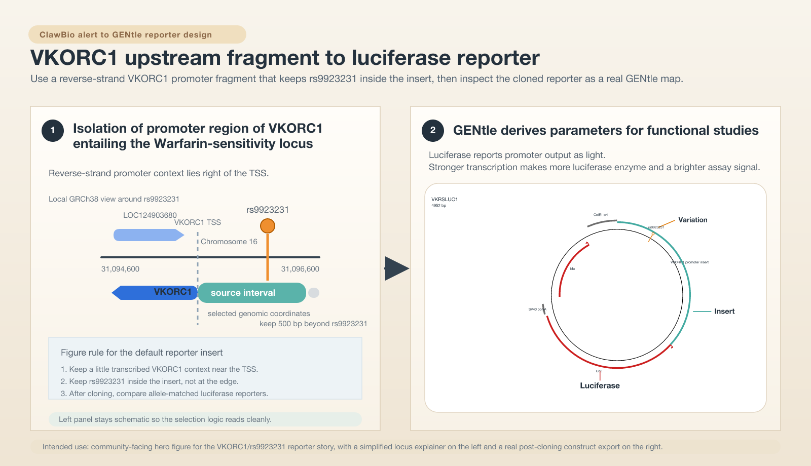
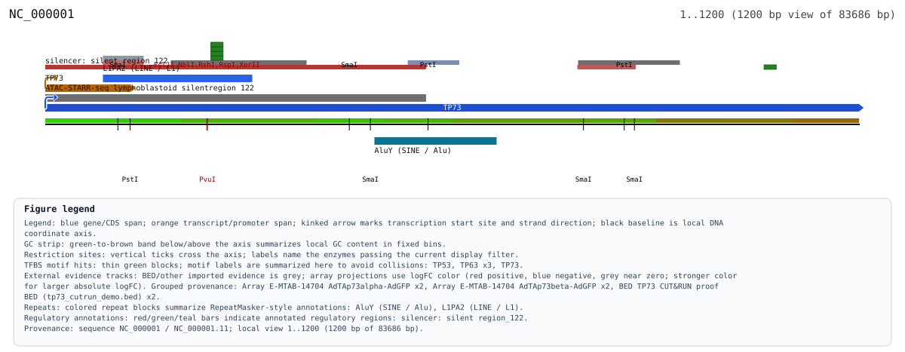
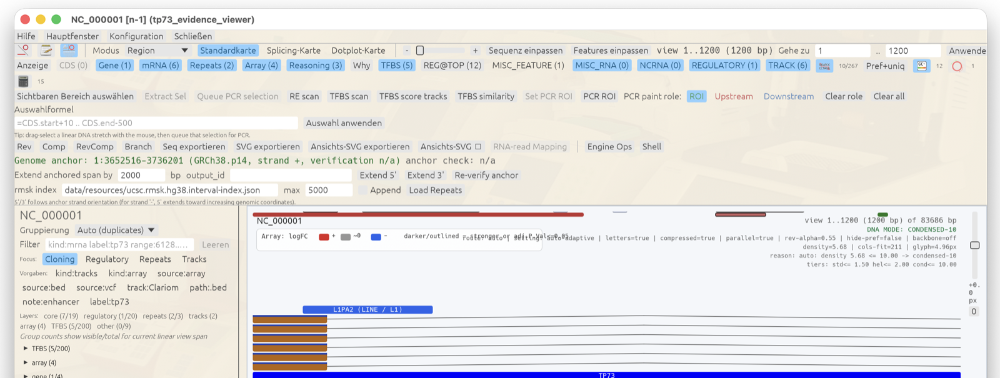

# GENtle

**A lab-oriented functional genomics platform.**

<p align="center">
  <a href="https://github.com/smoe/gentle_rs/actions/workflows/ci.yml"></a>
  
  
  <a href="copyright"></a>
</p>

<p align="center">
  <a href="INSTALL.md"><strong>Install</strong></a> &middot;
  <a href="docs/tutorial/generated/README.md"><strong>Tutorials</strong></a> &middot;
  <a href="docs/gui.md"><strong>GUI manual</strong></a> &middot;
  <a href="docs/cli.md"><strong>CLI manual</strong></a> &middot;
  <a href="docs/tutorial/01-01_agent_interfaces.md"><strong>Agent interfaces</strong></a> &middot;
  <a href="docs/showcase.md"><strong>Showcase</strong></a>
</p>

GENtle brings genomic and regulatory evidence into the same workspace as
sequences, assay designs and cloning plans. Annotations, experimental layouts,
results and their provenance remain linked as a project develops.

Its computational services range from **individual operations** to **biological
analyses** and **composed workflows**. One deterministic engine serves desktop
users, the integrated **inner agent**, and **outer agents** using CLI/MCP.
Agents discover supported capabilities, bind inputs and execute approved tasks;
researchers can inspect the inputs, decisions and results.

> **Internal preview:** interfaces and project files may evolve. The
> [maturity table](#what-to-trust-today) describes implementation, not biological
> validation. Review designs before bench use.

## Start Here

Follow [installation](INSTALL.md), then choose
`File -> Open Tutorial Project...` for a guided starting project.
From a source checkout:

```sh
cargo run --bin gentle_cli -- capabilities
cargo run --bin gentle
```

For automation, use the [agent tutorial](docs/tutorial/01-01_agent_interfaces.md)
or the [headless container](docs/container.md). To add a biological capability,
start with the [extension guide](docs/biological_extension_guide.md).

## What To Trust Today

Representative services at each level; links lead to commands or tutorials.

| Service level | Recommended starting paths | With caveats | Experimental / preview |
| --- | --- | --- | --- |
| **Individual operations**: one step | `Branch` / `ReverseComplement`: [02.01 sequence lineage](docs/tutorial/generated/chapters/02-01_load_branch_reverse_complement_pgex_fasta.md). | `primers design` with `--backend primer3`: [CLI](docs/cli.md#commands). | `sequence-design plan` / `sequence-design apply`: [06.07 synthetic redesign](docs/tutorial/06-07_synthetic_sequence_design.md). |
| **Reusable analyses**: one biological question | `dotplot compute` / `features tfbs-scan`: [CLI](docs/cli.md#commands). | `primers specificity-multi-handoff` / `primers specificity-multi-import`: [04.09 specificity and panel-matrix review](docs/tutorial/04-09_reference_bound_primer_specificity.md). | `regions homology-screen`: [CLI](docs/cli.md#commands), [08.12 companion-runner tutorial](docs/tutorial/generated/chapters/08-12_region_homology_promoter_modules_offline.md). |
| **Composed workflows**: an experimental task | [04.01 Simple PCR](docs/tutorial/04-01_simple_pcr_selection_gui.md) and [03.05 single-insert Gibson](docs/tutorial/03-05_gibson_specialist_testing_gui.md) (manual/hybrid). | `DesignTranscriptAssayPanel`: [04.08 isoform-marker study](docs/tutorial/04-08_gene_assay_study_gui.md) (manual/hybrid). | `planning protein-expression-handoff`: [09.03 provider-neutral draft](docs/tutorial/09-03_protein_expression_handoff_cli.md); `CreateGeneSetArrangement`: [03.10 storage projection](docs/tutorial/03-10_gene_set_storage_projection.md). Both manual/hybrid; runtime acceptance pending. |

Primer3 and BLAST paths require the corresponding local tools and references;
missing resources mean unavailable evidence, not a negative biological result.
Multi-reference specificity uses externally executed searches and retained
receipts. Scores, similarity and specificity do not establish assay validity or
order approval; synthetic redesign checks stated output constraints, not search
provenance. Expression drafts do not submit or order anything.

The [roadmap](docs/roadmap.md) tracks remaining work and release acceptance;
the [changelog](docs/CHANGELOG.md) records completed changes. A tutorial replay
does not replace native GUI or scientific acceptance.

## From Genomic Evidence To Experimental Design

<p align="center">
  <a href="docs/showcase.md#agent-and-clawbio-handoffs"></a>
</p>

An illustrative VKORC1 reporter question: left, a maintained promoter-selection
schematic; right, a GENtle map export of a synthetic construct record, not a
cloning-workflow result or validated assay. [Story and provenance](docs/showcase.md#agent-and-clawbio-handoffs).

## Selected Workflows

- **Cloning and physical layouts:** Gibson junctions, protocol cartoons, gels,
  arrangements, racks and OpenSCAD exports. [Visual examples](docs/showcase.md#cloning-and-verification).
- **Genome and regulatory context:** transcript structure, TFBS/CUT&RUN tracks,
  repeats and RNA evidence in anchored loci. [TP73/TERT examples](docs/showcase.md#genome-and-regulatory-context).
- **Primer pairs and isoform discrimination:** candidate design, product matrices
  and separate readiness gates. [04.02 pair-review tutorial](docs/tutorial/generated/chapters/04-02_pcr_selection_batch_primer_pairs_offline.md),
  [conceptual design diagram](docs/figures/isoform_primer_design_inputs.svg)
  ([interpretation notes](docs/figures/isoform_primer_design_inputs_notes.md)),
  [comparison with Primer-BLAST](docs/primer_blast_comparison.md).
- **Allele-aware RNA evidence:** `rna-reads allele-hash-screen` uses explicit read
  cohorts and transcript/variant inputs to summarize sequence representation,
  not causation. [CLI details](docs/cli.md#commands).

More figures, captions and regeneration instructions live in the
[showcase](docs/showcase.md) and [figure catalog](docs/figures/README.md).

## Interfaces

| Interface | Best suited to | Documentation |
| --- | --- | --- |
| **GUI** | Sequence inspection, specialists, project review | [GUI manual](docs/gui.md) |
| **CLI and shared shell** | Reproducible workflows and automation | [CLI manual](docs/cli.md) |
| **MCP** | Agent tools, capability discovery and structured results | [Agent interface](docs/agent_interface.md) |
| **Python** | Notebooks and CLI-backed automation | [Python integration](integrations/python/README.md) |
| **JavaScript and Lua** | Optional embedded scripting | [CLI manual](docs/cli.md) |
| **ClawBio/OpenClaw** | Curated scientific handoffs | [Integration guide](integrations/clawbio/README.md) |

Coverage varies by capability; the [parity matrix](docs/gui_cli_mcp_parity.md)
records remaining gaps. The expression preview's generic MCP executor test is
authored but unrun, while its MCP/JavaScript/Lua entries still record `gap`.

### One Project, Two Agent Positions

<table>
  <tr>
    <th width="50%">Outer agent: reproducible artifact</th>
    <th width="50%">Inner agent: live project context</th>
  </tr>
  <tr>
    <td><a href="docs/figures/tp73_outer_agent_evidence_viewer.svg"></a></td>
    <td><a href="docs/screenshots/tp73_inner_agent_evidence_viewer.png"></a></td>
  </tr>
</table>

Retained TP73 views of bases `1..1200` in one 83,686 bp project, not fresh
candidate acceptance. [Capture and generation provenance](docs/figures/README.md#tp73-inner-and-outer-agent-views).

## Project Status

- Development version: `0.1.0-internal.13`. The [published `.12` release](https://github.com/smoe/gentle_rs/releases/tag/v0.1.0-internal.12)
  provides Linux, macOS and Windows packages; its [evidence ledger](docs/release_notes/release_notes_v0.1.0-internal.12.md#publication-evidence)
  does not certify later source or scientific results.
- `.13` focuses on early containers/racks/3D review, provider-neutral expression
  drafts and explicit storage projection. Candidate acceptance remains pending;
  see the [release draft](docs/release_notes/release_notes_v0.1.0-internal.13.md).
- Desktop builds include GUI, CLI and MCP. JavaScript/Lua are optional features;
  Python uses a separate CLI-backed wrapper. [Builds and optional tools](INSTALL.md).

For implementation details: [system overview](docs/figures/gentle_system_overview.svg),
[architecture](docs/architecture.md), [protocol](docs/protocol.md),
[release process](docs/release.md) and [release-note index](docs/release_notes/).

## License And Contributing

GENtle is open source under **GPL-2.0-or-later**. See [copyright](copyright)
for third-party data terms, [contributing](CONTRIBUTING.md) to participate, and
[acknowledgements](ACKNOWLEDGEMENTS.md) for project history and credits.
