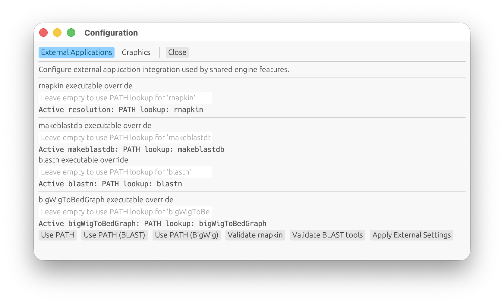
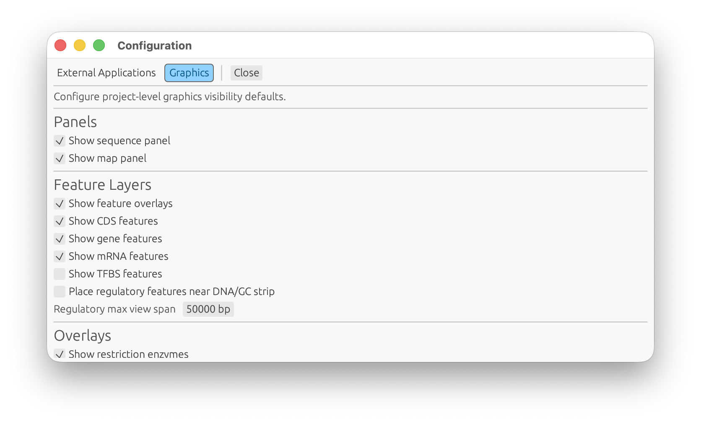

## Configuration Window

<!-- manual-counterparts:start -->
Related CLI reference: [Engine Settings](../cli/settings.md).
These topic links do not imply identical feature coverage across interfaces.
<!-- manual-counterparts:end -->

GENtle provides a project-level configuration window (not per-sequence).
It opens in an independent window/viewport, separate from the main project window.

Access:

- Main window menu: `File -> Configuration...` or `Settings -> Configuration...`
- macOS app menu: `GENtle -> GENtle Settings...`
- Shortcut: `Cmd+,`
- Sequence window top navigation: `Configuration` (opens Graphics tab)
- Re-selecting `Configuration...` while already open focuses the existing window
  (single-instance behavior).

Tabs:

- `External Applications`
  - Configure external executable overrides for:
    - `rnapkin` (`GENTLE_RNAPKIN_BIN`)
    - `makeblastdb` (`GENTLE_MAKEBLASTDB_BIN`)
    - `blastn` (`GENTLE_BLASTN_BIN`)
    - `bigWigToBedGraph` (`GENTLE_BIGWIG_TO_BEDGRAPH_BIN`)
  - Validate executable availability/version from within the UI.
  - `RNAfold` is resolved by the shared RNA-structure engine path through
    `GENTLE_RNAFOLD_BIN` or `PATH`.
  - Legacy SHA-1 download verification is resolved by the shared resource
    status path through `GENTLE_SHA1_TOOL` or `PATH`; set
    `GENTLE_DISABLE_LEGACY_SHA1=1` to skip it intentionally. GENtle reports
    availability in `resources status` and in relevant prepare warnings rather
    than showing a startup warning.
- `Microarrays`
  - Explains the three supported starting points without conflating them:
    prepared GENtle helper output, completed APT/R summary plus coordinate
    annotation tables, or raw CEL analysis through an explicit preflight.
  - Shows bounded, read-only status for the checkout-local Clariom D Human
    NetAffx staging directory, E-MTAB-14704 IDF/SDRF/CEL inputs, existing
    analyzed TP73 tables, and the committed synthetic TP73 demonstration
    output. GENtle compares only the build checkout and current working
    checkout, then uses whichever contains more of these documented resources.
  - Links to the public EMBL-EBI E-MTAB-14704 study and to the two documented
    Thermo Fisher support archives. The latter remain login-walled manual
    downloads; GENtle never downloads them silently.
  - This tab owns reusable resource guidance only. Import, output inspection,
    projection, and interpretation remain explicit actions for an active DNA
    sequence in `Array setup...`.
- `Graphics`
  - Configure project-level display visibility defaults (panels, feature layers, overlays).
  - Configure sequence text-panel max length (`Sequence panel max text length`, default `200000 bp`, `0=unlimited`).
    - If a sequence exceeds this limit, the text panel is suppressed and a hint is shown.
  - Configure feature-details font size (`Feature detail font size`, default `9 px`, live-applied).
  - Configure GC-content bin size (`GC bin size`, default `100 bp`) used by
    map overlays and SVG export.
  - Configure optional `Window Styling (experimental)`:
    - enable subtle themed backdrops
    - per-window tint color picker (`main`, `sequence`, `splicing`, `pool`, `configuration`, `help`, `agent assistant`)
    - optional per-window image watermark paths (`main`, `sequence`, `splicing`, `pool`, `configuration`, `help`, `agent assistant`)
    - styling editor is a table (`Window`, `Tint`, `Path`, `Actions`)
    - row actions include `Browse...`, `Clear`, and `Reset Color`
    - tint/image opacity controls
    - backdrop compositing keeps a warm/yellow visual tone by default even
      under newer `egui` color-management behavior
    - backdrop images are enabled for sequence/pool windows by default
    - content controls in dialog-style windows (main/help/configuration) render
      with a small inset margin (`8 px`) while the backdrop image still spans
      the full window/panel area
  - Applies to sequence windows through the shared engine display state.
  - Sequence-panel defaults are topology-aware:
    - circular sequence windows keep the text panel visible by default
    - linear sequence windows start with the text panel hidden by default
  - `Apply + Refresh Open Windows` forces immediate refresh of all currently open sequence windows.
  - The bottom `Cancel` and `Apply` actions are kept in a persistent footer and remain visible while scrolling.
- `Language`
  - Configure the runtime GUI interface language for visible window chrome,
    top-level menus, first translated configuration controls, and the
    Agent Assistant conversation and Agent Systems configuration surfaces.
  - The default is `System default (English)`, currently resolved to British
    English (`en-GB`) until platform locale detection is wired.
  - Available catalogs are British English (`en-GB`), US English (`en-US`),
    German (`de-DE`), French (`fr-FR`), Italian (`it-IT`), simplified Chinese
    (`zh-Hans`), Japanese (`ja-JP`), and Latin (`la`).
  - Chinese and Japanese are marked experimental until bundled/default font
    coverage is confirmed on supported platforms; Latin is a playful opt-in.
  - Changing language is staged like other configuration edits and takes effect
    after `Apply` without restarting.
  - Shared shell commands, saved project data, protocol fields, agent payloads,
    and scientific identifiers stay in deterministic English regardless of the
    GUI language.
  - Agent controls include tooltips, prompt-template names, bundled provider
    labels/descriptions, model discovery and setup guidance, screenshot review,
    response details, command results, and execution-state labels. Custom
    provider catalog prose, editable prompt/template bodies, provider replies,
    raw diagnostic records, and copied commands/JSON are not translated.
    Setup rows wrap to accommodate longer translated labels.

Persistence:

- Configuration is persisted in an app settings file at `~/.gentle_gui_settings.json`.
- Saved settings are restored on app startup.
- Window-styling color/image selections persist in the same settings file after
  `Apply Window Styling`.
- The selected GUI language persists in the same settings file after `Apply`.

Configuration screenshots:

 
*Figure: Configuration window, External Applications tab.*
 
*Figure: Configuration window, Graphics tab.*

<!-- manual-page-nav:start -->

---

[GUI Manual](../gui.md) | [Previous: External Services Window](external-services-window.md) | [Next: Workspace Latency Diagnostics](workspace-latency-diagnostics.md)
<!-- manual-page-nav:end -->
