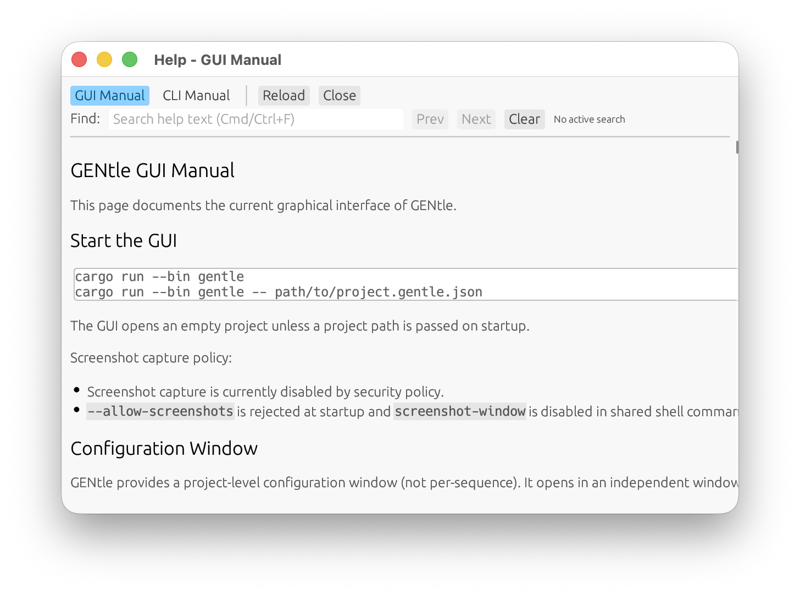

## microRNA Target Scan

<!-- manual-counterparts:start -->
Related CLI reference: [MicroRNA Target Scans](../cli/microrna.md).
These topic links do not imply identical feature coverage across interfaces.
<!-- manual-counterparts:end -->

- The shared Shell panel exposes `mirna explain-seed`, `mirna catalog-show`,
  and `mirna scan-target` for deterministic candidate seed-site inspection.
- `Patterns -> microRNA Target Scan...` opens a graphical specialist window
  over the same shared scan command. The panel provides query fields, region
  toggles, seed-class toggles, boundary flank length, ortholog/evidence notes,
  and optional pasted ortholog or candidate target snippets for side-by-side
  motif comparison.
- Selecting a candidate hit draws the mature microRNA seed, matched target
  motif, pairing lines, local coordinate context, region class, and matched
  sequence so CDS, intronic, UTR, and splice-boundary candidates can be
  inspected visually rather than as raw JSON.
- `mirna scan-target` returns `gentle.mirna_target_scan.v1` JSON grouped by
  region class, transcript id, and seed class. Results are sequence evidence:
  the report warns when a match is prediction-only and keeps orthologous context
  such as rat Tp73 PMID 37099528 separate from direct human validation.
- Every selected hit shows transcript-context interpretation, including
  possible alternative-splicing relevance for CDS, intronic, and splice-boundary
  matches, not only canonical 3-prime UTR repression.

Help content loading behavior:

- opening Help reuses already-loaded markdown/glossary payloads for faster
  window activation
- re-invoking the already selected Help tab while Help is open now performs a
  focus-only fast path (no markdown reload/search-refresh pass)
- opening Help can emit status-bar slow-path timing hints for:
  - help payload load
  - first-frame help render
  - total help-window open time
- if `docs/gui.md` / `docs/cli.md` / `docs/agent_interface.md` / `docs/reviewer_preview.md` exists at
  runtime, GUI loads those files
- otherwise GUI falls back to embedded copies compiled into the app binary
- shell-command help content is generated from the structured glossary source
  `docs/glossary.json`

Markdown image support:

- help content is rendered via CommonMark (headings/lists/tables/code blocks + images)
- use standard markdown image syntax (``)
- relative image paths in `docs/*.md` are resolved relative to the markdown file location
- relative local image paths are rewritten to `file://...` URIs for cross-platform loading
- images are dynamically constrained to 75% of help-pane width for readability
- screenshots in this manual include explicit caption lines (`*Figure: ...*`)
- `Reload` in the help window reloads markdown + images from disk
- `Copy Page` copies the current help/tutorial markdown source to the clipboard
- `View -> Selectable Text` switches the help body from rendered markdown to a
  selectable raw-markdown text view so inline values such as output IDs can be
  copied directly
- help viewer supports in-window text search (`Cmd/Ctrl+F` focuses search box)
- search UI includes match count and `Prev`/`Next` navigation
- help header controls and markdown body reflow when the help window is resized
  narrower; tutorial topic selection is width-clamped so long titles do not
  force the body into a stale wider layout

Help window screenshot:

 
*Figure: Help window with searchable in-app markdown manuals.*

<!-- manual-page-nav:start -->

---

[GUI Manual](../gui.md) | [Previous: RNA Structure (ssRNA)](rna-structure-ssrna.md) | [Next: Measured Gel Images (`.11` Development)](measured-gel-images-11-development.md)
<!-- manual-page-nav:end -->
