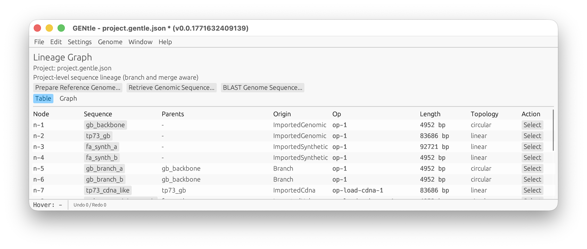

### Project And Sequence Window Examples

<!-- manual-counterparts:start -->
No direct CLI counterpart: This chapter describes desktop presentation or interaction; no dedicated command reference is paired with it.
<!-- manual-counterparts:end -->

Project overview screenshot:

 
*Figure: Project lineage workspace. On macOS this appears as a hosted internal
window inside the neutral root workspace.*

Sequence window screenshot:

 
*Figure: Current sequence window over local TP73 bases `1..1200`, with the
GRCh38.p14 anchor, evidence groups, controls, and map canvas. Transcript paths
continue to the viewport edge when their connected exon lies outside the
visible interval.*

<!-- manual-page-nav:start -->

---

[GUI Manual](../gui.md) | [Previous: Physical Arrangements And Project Layout](physical-arrangements-and-project-layout.md) | [Next: Status History And Background Jobs](status-history-and-background-jobs.md)
<!-- manual-page-nav:end -->
