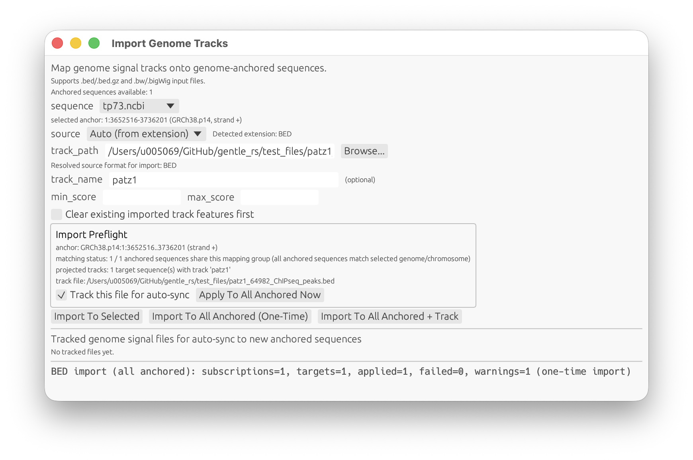

## Reference Genomes (Main Menu)

<!-- manual-counterparts:start -->
Related CLI reference: [Reference Genomes](../cli/genomes.md) | [Helper Sequences](../cli/helpers.md).
These topic links do not imply identical feature coverage across interfaces.
<!-- manual-counterparts:end -->

Reference-genome workflow is split into separate dialogs (masks) launched from
the main project window menu. `Prepare Reference Genome...` opens as its own
standalone window/viewport (not embedded in the project canvas):

- `Genome -> Prepare Reference Genome...`
- `Genome -> Prepared References...`
- `Genome -> Clear Caches...`
- `Genome -> Retrieve Genomic Sequence...`
- `Genome -> BLAST Genome Sequence...`
- `Genome -> Prepare Helper Genome...`
- `Genome -> Retrieve Helper Sequence...`
- `Genome -> BLAST Helper Sequence...`
- `Genome -> Import Genome Track...`
- `File -> Agent Assistant...`
- the same helper-genome and agent-assistant entries are also available from
  the command palette under the same titles.

Scope behavior:

- Reference and Helper dialogs now keep independent `catalog`/`cache_dir`
  setups.
- Standalone specialist windows use the shared top-row navigation
  (`Help`, `Main`, `Close`) so they can always open help, raise the main
  project window, or close directly from the first row.
- Switching between `Reference` and `Helper` menu entries restores that
  scope's last-used setup.
- BLAST runs against the indices in the active scope's `cache_dir`
  (reference and helper index trees stay separated unless you explicitly point
  both scopes to the same cache path).

### Prepare Reference Or Helper Genome

Choose the catalog, cache and genome in the prepare window. Review the source
summary before starting preparation or reindexing. Existing cached files are
kept unless you explicitly approve a re-download. Preparation runs in the
background; its progress remains bound to the original job settings.

### Retrieve Genomic Or Helper Sequence

Select a prepared genome, filter genes or enter a region, then review coordinates,
annotation-transfer settings and the output identifier before extraction. The
Reference and Helper scopes retain separate catalog/cache settings.

### BLAST Genome Or Helper Sequence

Select the query and prepared database, review invocation options, then run the
search. Inspect result details and provenance before importing hits as a track.

### Prepared References

Inspect install readiness, source summaries, size and contigs. Reindexing reuses
cached source files; removing an install and removing its catalog entry are
separate actions. Review confirmations before changing either.

### Import Genome Tracks

Import BED, BigWig or VCF overlays into an explicitly selected sequence. Review
the source file and coordinate mapping; an overlay is evidence, not an edit to
the underlying sequence.

### Clear Caches

Inspect the selected reference/helper cache roots and choose a cleanup mode.
Index-only cleanup and full install removal have different consequences; review
selected paths before confirming. Project files and build artifacts are outside
this dialog's cleanup scope.

### Detailed Workflow

Recommended flow:

1. Prepare/cache a genome once:
   - open `Prepare Reference Genome...`
   - set `catalog` + `cache_dir`
   - select `genome` from dropdown values loaded from catalog JSON
   - source summary line shows source types and, when available, nucleotide
     length and molecular mass metadata
   - the dropdown shows all catalog genomes; already prepared entries are tagged
     and selecting one switches the main action to `Reindex Selected...`
   - click `Prepare Genome` for new installs or `Reindex Selected...` for an
     already prepared genome; reindex keeps the cached local sequence and
     annotation files by default and rebuilds the indexes from them
   - `Update Ensembl Specs...` previews catalog-only refreshes for entries with
     bundled `ensembl_template` metadata:
     - fetches the current Ensembl/Ensembl Metazoa species listings
     - keeps older pinned release rows in the catalog
     - adds or refreshes the newest pinned release row without preparing or downloading genomes
     - if the active catalog file is not writable, the dialog requires saving an updated catalog copy instead of modifying the bundled catalog in place
   - `Browse Ensembl Candidates...` opens a read-only discovery browser:
     - inspects current Ensembl/Ensembl Metazoa FASTA + GTF species-directory listings
     - reports candidates where both listing types are present
     - shows collection, species directory, and the current listing URLs
     - vertebrate discovery uses Ensembl's `pub/current/fasta/` and
       `pub/current/gtf/` directories; installed URLs are pinned to the selected
       release's `fasta/` and `gtf/` directories, not a `vertebrates/` subdirectory
     - each candidate now offers `Quick Install...`, which opens a confirmation dialog showing the resolved release, file stem, concrete FASTA/GTF URLs, the target catalog write mode, and the chosen output catalog path before the normal prepare workflow starts
     - discovery itself still does not edit the catalog until `Install + Prepare` is confirmed
   - helper-scope dialogs (`Prepare Helper Genome...`, `Retrieve Helper Sequence...`,
     `BLAST Helper Sequence...`, and the prepared-reference inspector while
     helper scope is active) now also show a normalized helper-construct
     interpretation panel when the selected catalog entry carries structured
     helper semantics or procurement metadata
   - if the current catalog entry now points to different sources than the
     existing prepared manifest, `Reindex Selected...` still keeps the cached
     local files; only the explicit refresh action discards and re-downloads them
   - the confirmation dialog for prepared genomes offers two explicit actions:
     - `Reindex Using Cached Files`
     - `Remove Cached Files + Re-download`
   - after updating GENtle for NCBI GFF3 transcript-identity/parent-join fixes,
     use `Reindex Using Cached Files` for affected prepared references. An
     ordinary prepare can reuse the old transcript index; the application
     update does not silently rebuild it or rewrite retained scientific reports
   - when `Reindex Selected...` is launched from the floating prepare window,
     that confirmation prompt stays in the same window stack instead of opening
     behind the specialist window
   - this runs in background and now shows the full ordered prepare plan up front
   - changing the selected genome, catalog, cache or Reference/Helper scope does
     not retarget or cancel a running job. Detailed progress stays attached to
     the original job settings, including its completion or failure; a different
     selection shows the job's genome name and a `Show Background Jobs` button
     instead of displaying that job's checklist as if it belonged to the new
     selection. Follow or cancel the original job in `Background Jobs`, or select
     its settings again to see its progress here
   - the checklist now uses a single overall progress bar; the individual rows
     stay as status/check rows for sequence, annotation, FASTA index, gene
     index, and BLAST index
   - when the selected genome is already prepared, the idle checklist inspects
     the prepared install and marks the artifacts that already exist before you
     launch reindex/refresh
   - byte-based active steps now show `bytes: X / Y • ETA ...` once enough
     progress has been observed to make a stable estimate
   - FASTA and tabular gene/transcript indexing report progress and check
     cancellation at start, completion, and line boundaries after at least
     another 8 MiB of input. This avoids a progress update for every short line;
     it is a byte-based checkpoint, not a wall-clock cancellation guarantee
   - completed rows stay checked until you close the prepare window or start a
     new prepare/reindex/refresh run
   - after a successful prepare/reindex/refresh, the full checklist remains
     visible and is explicitly marked complete instead of collapsing back to a
     raw phase line
   - the specialist window itself now scrolls vertically, so long progress
     checklists and status text remain reachable on smaller viewports
   - long-running indeterminate work such as BLAST indexing stays visible as an
     active checklist row instead of looking idle
   - if reindex discovers that the cached prepared files are internally
     inconsistent, the dialog keeps the error details visible and offers
     `Reinstall From Sources...` as the recommended recovery action
   - the Background Jobs window keeps a compact prepare summary only:
     mode, current step, completed step count, one overall progress bar, and
     active-step ETA when the running step has determinate byte progress
   - the raw text status block remains below the checklist for full diagnostic detail
   - startup status now includes `makeblastdb` preflight diagnostics
     (found/missing/version/path) before heavy prepare work continues
   - a running prepare task can be cancelled via `Cancel Prepare`
   - optional `timeout_sec` can be set in GUI (or `--timeout-secs` in CLI/shell)
   - if a previous attempt already downloaded `sequence.fa` but annotation
     resolution fails (for example wrong GTF path), the next retry reuses the
     local FASTA instead of downloading it again
   - preparation now validates that gene-bearing contigs from the parsed
     annotation are actually present in the prepared FASTA index, so truncated
     or mismatched caches fail early during `Prepare Genome` instead of only
     surfacing later during extraction
2. Extract a region when needed:
   - open `Retrieve Genomic Sequence...`
   - select the same `genome` from dropdown
   - retrieval dropdown lists only genomes already prepared in the selected
     `catalog` + `cache_dir`
   - use `Gene filter` as case-insensitive regular expression
     (for example: `^TP53$`, `^HLA-.*`)
   - use `Biotype filter` checkboxes (auto-populated from parsed annotation data)
   - tune `Top matches` to cap candidate scanning on very large genomes
   - browse candidates page-by-page (`Prev`/`Next`) to avoid rendering huge lists
   - click a filtered gene to auto-fill `chr`, `start_1based`, `end_1based`
   - selecting a gene also auto-fills a deterministic default `output_id`
     (`<genome>_<gene>_<start>_<end>`); you can still override it manually
   - annotation transfer controls for genome extraction:
     - `include genomic annotation` (default on)
     - `annotation scope` (`none` / `core` / `full`)
     - optional `max annotation features` cap (empty = unlimited, `0` = explicit unlimited)
   - extraction status reports structured annotation projection outcome
     (`requested/effective scope`, attached/dropped feature counts,
     attached gene/transcript/exon/CDS counts, optional fallback reason)
   - click `Extract Selected Gene` (engine op `ExtractGenomeGene`) or
     `Extract Region` (explicit coordinate extraction)
   - `Extract Selected Gene` now follows the same annotation transfer controls
     as `Extract Region`:
     - default (`annotation scope=core`) attaches gene + transcript context
     - `annotation scope=full` additionally attaches exon + CDS subfeatures
     - `annotation scope=none` (or unchecked include flag) disables transfer
   - `Selected-gene interval` distinguishes two genomic extraction modes:
     - `Whole gene (no added flank)` is the default: the complete annotated
       gene span, including UTRs and introns, with no extra upstream DNA.
     - `CDS span + upstream flank` spans the first to last coding base across
       the gene's transcripts, retaining introns. `Upstream of CDS (bp)` adds
       a strand-aware 5' flank before the first coding base, **not before the
       transcription start site (TSS)**. `0` means the CDS span only. This is
       not whole-gene-plus-promoter extraction and may omit UTR sequence.
   - `Extract Region` ignores the selected-gene mode and flank value: it uses
     only `chr/start_1based/end_1based`. The shared output name may still contain
     `promoter`; that name is not proof of included upstream sequence. For a
     whole gene plus upstream DNA, select the gene, then decrease the explicit
     start on the plus strand or increase the end on the minus strand before
     using `Extract Region` (within the prepared chromosome bounds).
   - These distinctions are visible in the window, with wrapped explanations
     and translations in all eight catalogs. Extraction behavior and CLI/API
     options (`coding_with_promoter`, `promoter_upstream_bp`) are unchanged.
   - when transcript exon annotation is available, extraction also auto-creates
     an exon-concatenated synthetic companion sequence (`<seq_id>__exons`) with
     deterministic `N` spacers between merged exon blocks; this is useful as a
     lower-noise reference for cDNA dotplot workflows
   - chromosome coordinates here are 1-based and inclusive. The DNA viewer
     uses positions within the imported sequence; negative viewer positions
     cannot retrieve missing upstream DNA. Import that DNA first.
3. Run BLAST searches against prepared references:
   - open `BLAST Genome Sequence...`
   - dialog layout is organized into sections:
     - `1. Target`
     - `2. Input`
     - `3. Options`
     - `4. Execution`
     - `5. Results`
   - select a prepared `genome` from the selected `catalog` + `cache_dir`
   - choose query source:
     - `Manual sequence` (paste sequence text)
     - `Project sequence` (blast one loaded sequence by id)
     - `Project pool` (blast all members of a selected pool/container)
   - set quick options:
     - `max_hits`
     - `task` (`blastn-short` or `blastn`)
   - optional advanced options:
     - choose a `preset` (`None`, `Strict identity+coverage`, `Unique best hit`, `High stringency`)
     - optionally use structured threshold controls for:
       - `max_evalue`
       - `min_identity_percent`
       - `min_query_coverage_percent`
       - `min_alignment_length_bp`
       - `min_bit_score`
       - `unique_best_hit`
     - provide additional JSON object in `advanced options JSON` (or load via `Load JSON...`)
     - GUI shows `Effective options preview` after layering:
       - built-in defaults
       - optional defaults file / project override parameters
       - quick controls
       - preset + structured thresholds + advanced JSON override
   - click `Run BLAST`
   - startup status now includes `blastn` + `makeblastdb` preflight diagnostics
     (found/missing/version/path) before query execution progresses
   - while running, click `Cancel BLAST` in the dialog (or `Cancel` in `Window -> Show Background Jobs`).
   - BLAST runs in background and keeps the UI responsive; pool mode returns one result set per member
   - BLAST itself does not expose a native `% complete` CLI flag; GENtle therefore shows:
     - query-level progress (`done / total`)
     - live heartbeat status (`running`, elapsed seconds)
     - invocation template while running
     - resolved invocation line after each query completes
   - result details show executable, database prefix, full invocation, request override JSON, and resolved effective options.
   - when `Import Hits To Sequence` is used, GENtle stores BLAST invocation provenance
     in the corresponding `ImportBlastHitsTrack` operation (history/lineage context).
4. Inspect prepared installations when needed:
   - open `Prepared References...`
   - review per-genome install size, readiness flags, source types, and short
     SHA-1 fingerprints
   - each prepared row also shows a compact cached-sequence summary derived
     from the prepared FASTA index (`contig count | longest contig`), with hover
     details for total span and representative contig names
   - use `Reindex...` on a prepared row to rebuild indexes from cached local
     files; if you want to delete cached files and fetch fresh sources, choose
     the explicit `Remove Cached Files + Re-download` option in the confirmation dialog
   - use `Remove Prepared...` on a row to delete just that prepared install from
     the cache; the catalog entry remains available
   - use `Clear Caches...` from `Prepared References...` or `Genome -> Clear Caches...`
     when you want one bulk/partial cleanup view across the active reference
     cache, helper cache, or both
   - `Clear Caches...` inspects only the selected known cache roots
     (`cache_dir` settings for references/helpers) and does not scan the whole
     workspace
   - selective cleanup rows are keyed by install path, so duplicate prepared ids
     under different cache roots can be previewed and cleaned independently
   - cleanup modes are intentionally conservative:
     - `Remove BLAST databases only` removes only BLAST DB sidecars
     - `Remove rebuildable indexes` removes BLAST DB sidecars plus
       `sequence.fa.fai` and `genes.json`
     - `Remove selected prepared installs` removes only the checked prepared
       installs from the selected roots
     - `Remove all prepared installs in cache` clears all prepared installs
       under the selected roots
   - orphaned remnants are always shown in inspection results but can be
     removed only through the full-delete modes
   - after a partial cleanup (`BLAST databases only` or `rebuildable indexes`),
     the dialog can immediately offer `Rebuild from cached files` for the
     affected prepared installs so the indexes can be restored without
     re-downloading sources
   - cleanup leaves project state files, catalog JSON, MCP/runtime files,
     backdrop/runtime caches, and developer build artifacts (`target/`) alone
   - when the active catalog JSON is writable, rows also expose
     `Remove Catalog Entry...`; this edits only the catalog JSON and leaves any
     prepared cache untouched until `Remove Prepared...` is run explicitly
   - use built-in `Chromosome inspector` to list all contigs/chromosomes for a
     prepared genome as proportional line lengths
   - when extraction fails with chromosome/contig mismatch, status messages now
     include tried aliases, available-contig preview, and suggested matching
     contigs (for example accession-style names such as `NC_000017.11`)
   - those mismatch diagnostics also expose the prepared `sequence.fa` and
     `sequence.fa.fai` paths so cache contents can be inspected directly during
     debugging
   - when a credible suggestion exists, status output exposes a copyable
     `Suggested contig: '...'` line plus `Apply` / `Copy` actions for quick
     transfer into the `chr` field or clipboard
   - use `Retrieve` directly from an inspected row
5. Overlay signal tracks (BED, BigWig, or VCF) onto an extracted sequence:
   - open `Genome -> Import Genome Track...`
   - this opens in its own floating window
   - optionally select a genome-anchored sequence (for one-sequence import)
   - review the `Import Preflight` panel:
     - detected selected anchor and strand
     - anchor matching status across all anchored sequences
     - projected target count + track name
     - track-file existence check
   - choose a track file (`.bed`, `.bed.gz`, `.bw`, `.bigWig`, `.vcf`, or `.vcf.gz`)
   - gzip track inputs also accept concatenated gzip members
   - optionally set track name and score filters
   - optional preflight toggle:
     - `Track this file for auto-sync`
   - one-click preflight action:
     - `Apply To All Anchored Now`
  - selection-coupled import:
    - `Import To Selected` sits next to the `sequence` selector
    - keep the dialog open, switch `sequence`, and click `Import To Selected` again to reuse the same file/settings for another anchored sequence
  - batch import options:
    - `Import To All Anchored (One-Time)`: import onto all currently anchored sequences without saving a subscription
    - `Import To All Anchored + Track`: import onto all currently anchored sequences and save a tracked subscription for auto-sync to future anchored extracts
   - import runs in a background task with live progress and can be cancelled
     from the same dialog (`Cancel Import`).
   - tracked files are listed in the same window and can be managed:
     - `Apply now`: re-apply one tracked file to all currently anchored sequences
     - `Remove`: delete one tracked subscription (already imported features remain)
     - `Clear Tracked Files`: delete all tracked subscriptions (already imported features remain)

Track import screenshot:

<br>
*Figure: Import Genome Tracks dialog for BED/BigWig/VCF sources.*

How to enlarge the genomic span after extraction:

- Zoom/pan controls only change visual magnification of the current sequence map.
- To actually include additional genomic bases, run an anchor-extension command
  (creates a new sequence with a wider genomic interval).
- Primary GUI path for this operation:
  - open the extracted (anchored) sequence window
  - next to `Genome anchor: ...`, set extension length in bp
  - optionally set `output_id`
  - click `Extend 5'` or `Extend 3'`
  - if multiple compatible prepared assemblies are available, GENtle opens a
    chooser popup (`Select Prepared Genome`) and only proceeds after explicit selection
- Anchor verification in GUI:
  - each anchored sequence shows `anchor check: verified|unverified|n/a` next
    to the genome-anchor status line
  - `Re-verify anchor` re-runs verification against the currently resolved
    prepared genome and records a new provenance entry
- UCSC rmsk repeat loading in GUI:
  - anchored sequence windows expose an `rmsk index` path, `max` feature cap,
    `Append` toggle, and `Load Repeats` action next to the genome-anchor tools
  - `Load Repeats` applies the shared `MaterializeRepeatFeatures` operation and
    writes overlapping RepeatMasker rows as ordinary `repeat_region` features
    controlled by the existing Repeat layer toggle
  - selecting a materialized repeat shows a compact repeat-details block from
    its qualifiers: class/family/name, local and genomic strands, genomic
    interval, score/divergence, clipped status, and UCSC rmsk provenance; raw
    RepeatMasker `milliDiv` is shown with a derived divergence percentage when
    no explicit percent qualifier is present
  - imported repeat features that carry raw UCSC table-style qualifiers
    (`genoName` / `genoStart` / `genoEnd`, `repStart` / `repEnd` / `repLeft`,
    `id`) are summarized through the same selected-feature details path
  - the default index path is `data/resources/ucsc.rmsk.hg38.interval-index.json`;
    prepare it with `resources install-ucsc-rmsk --assembly hg38` or point the
    field at another prepared interval index
- Shell fallback path (same engine operation):
  - click `Shell` in the sequence toolbar
  - run one of these commands:
    - `genomes extend-anchor SEQ_ID 5p|3p LENGTH_BP [--output-id ID] [--catalog PATH] [--cache-dir PATH] [--prepared-genome GENOME_ID]`
    - `helpers extend-anchor SEQ_ID 5p|3p LENGTH_BP [--output-id ID] [--catalog PATH] [--cache-dir PATH] [--prepared-genome GENOME_ID]`
    - `genomes verify-anchor SEQ_ID [--catalog PATH] [--cache-dir PATH] [--prepared-genome GENOME_ID]`
    - `helpers verify-anchor SEQ_ID [--catalog PATH] [--cache-dir PATH] [--prepared-genome GENOME_ID]`
    - `features materialize-repeats SEQ_ID --index RMSK_INTERVAL_INDEX.json [--max-features N] [--append]`
- Example:
  - `genomes extend-anchor grch38_tp53 5p 2000 --output-id grch38_tp53_plus2kb_5p`
- Result behavior:
  - original sequence remains unchanged
  - a new derived sequence is created and opened
  - lineage/provenance records include the extended genomic interval
  - 5'/3' direction is contextual to anchor strand (`strand -` flips physical genomic direction)
  - core gene/transcript annotation is projected again from the prepared
    reference; parent-specific tracks/analyses are not copied. Keep annotation
    warnings and preview a fresh TSS inventory before approving new windows.

Equivalent workflow JSON (still supported via workflow runner):

```json
[
  {"PrepareGenome":{"genome_id":"Human GRCh38 Ensembl 116","catalog_path":"assets/genomes.json","cache_dir":"data/genomes"}},
  {"ExtractGenomeGene":{"genome_id":"Human GRCh38 Ensembl 116","gene_query":"TP53","occurrence":1,"output_id":"grch38_tp53","catalog_path":"assets/genomes.json","cache_dir":"data/genomes"}},
  {"ExtractGenomeRegion":{"genome_id":"Human GRCh38 Ensembl 116","chromosome":"1","start_1based":1000000,"end_1based":1001500,"output_id":"grch38_chr1_1000000_1001500","annotation_scope":"core","catalog_path":"assets/genomes.json","cache_dir":"data/genomes"}},
  {"ImportGenomeBedTrack":{"seq_id":"grch38_tp53","path":"data/chipseq/peaks.bed.gz","track_name":"H3K27ac","min_score":10.0,"max_score":null,"clear_existing":false}}
]
```

Notes:

- `Catalog...` opens a file picker for genome catalog JSON.
- `cache_dir` can be selected via folder picker; persistent project-local
  storage is recommended over `/tmp`.
- If `catalog` is empty, engine now uses the default discovery chain rather
  than one hard-coded file:
  - built-in `assets/genomes.json` plus optional `assets/genomes.d/`
  - system/user/project overlays under the same `gentle/catalogs/` policy used
    by CLI/shell routes
- Bundled `assets/genomes.json` currently includes Human GRCh38 (Ensembl 113 and 116),
  Mouse GRCm39 Ensembl 116, Rat GRCr8 Ensembl 115, Danio rerio GRCz11
  Ensembl 115, Pan troglodytes Pan_tro_3.0 Ensembl 115, Canis lupus familiaris
  ROS_Cfam_1.0 Ensembl 115, Drosophila melanogaster BDGP6.54 Ensembl Metazoa 62,
  Caenorhabditis elegans WBcel235 Ensembl 115, Saccharomyces cerevisiae S288c
  (Ensembl 113 and 115), and `LocalProject` (backed by
  `test_files/fixtures/genomes/AB011549.2.fa` +
  `test_files/fixtures/genomes/AB011549.2.gb`).
- A curated starter helper catalog is available at
  `assets/helper_genomes.json` (host references plus common online vector backbones).
  For lab-specific unpublished/local vectors, copy this file and add
  `sequence_local` / `annotations_local` entries for your installation.
- Catalog entries may specify `ncbi_assembly_accession` + `ncbi_assembly_name`
  instead of explicit remote URLs. In that case GENtle derives NCBI GenBank/RefSeq
  FTP URLs for sequence (`*_genomic.fna.gz`) and annotation (`*_genomic.gff.gz`)
  during `Prepare Genome`.
- Catalog entries may also specify `genbank_accession` (for helper vectors and
  non-assembly records). If explicit URLs are absent, GENtle derives NCBI EFetch
  sources for FASTA sequence plus GenBank annotation (`gbwithparts`) and then
  indexes extracted feature records for search/retrieval.
- For helper IDs containing `pUC18` or `pUC19`, extracted helper sequences get
  a deterministic fallback MCS (`misc_feature`) annotation when source
  annotation does not already include one and exactly one canonical MCS motif is
  detected (non-unique matches are warned and skipped).
- In the DNA sequence window, MCS annotations use a dedicated map color plus
  badge-backed labels in linear and circular maps; linear view keeps them
  visible even when generic `misc_feature` labels would normally stay
  collapsed, so the cloning window remains directly legible at overview zoom
  levels.
- MCS feature details expose `mcs_expected_sites` (REBASE-normalized enzyme
  names) so users can preferentially pick enzymes declared for that MCS.
- Malformed GTF/GFF lines are now reported as warnings with file/line context
  while valid gene records continue to be indexed.
- Genome track import accepts BED (`.bed` / `.bed.gz`) and BigWig (`.bw` / `.bigWig`) inputs.
- Genome track import also accepts VCF (`.vcf` / `.vcf.gz`) inputs.
- BigWig import uses `bigWigToBedGraph` and can be overridden via
  `GENTLE_BIGWIG_TO_BEDGRAPH_BIN`. GENtle checks the executable inside the
  background import job, so a slow or unavailable converter cannot block the
  GUI; an unavailable executable is reported as `BigWig import preflight
  failed` in the task status.
- VCF score filtering uses VCF `QUAL` for `min_score` / `max_score`.
- Genome track import requires a genome-anchored sequence (`ExtractGenomeRegion` or
  `ExtractGenomeGene`) to map genomic coordinates into local sequence coordinates.
- Imported GenBank files that include an NCBI `ACCESSION ... REGION: start..end`
  header are auto-anchored on load (for example `NC_000001 REGION: 3652516..3736201`),
  so BED tracks can be aligned immediately.
- `ACCESSION ... REGION: complement(start..end)` is interpreted as a reverse
  genomic anchor (`strand -`), and BED intervals are remapped into local
  sequence coordinates accordingly.
- `Import To All Anchored + Track` stores a tracked subscription in project
  metadata and auto-applies it to newly added anchored sequences.
- Imported BED/BigWig/VCF signals are materialized as generated `track` features.
  They render as dense signal tracks (lane-packed in linear view) and appear in
  the feature tree under a dedicated `Tracks` category, grouped by experiment
  (`gentle_track_name`).
- If the target sequence is already open, its sequence window refreshes
  automatically after import so the new track features are visible immediately.
- The tracked-subscription table in `Genome -> Import Genome Tracks...` includes
  a textual `Filter` box:
  - free text searches source/path/track name
  - scoped terms are supported (`source:`, `path:`/`file:`, `track:`)
  - one-click preset chips are available below the filter box
  - UI shows `Showing N of M tracked files` so it is clear when filters hide rows
- Prepare/Retrieve dialogs show resolved source types for the selected entry
  (`local`, `ncbi_assembly`, `genbank_accession`, `remote_http`).
- Retrieval fields are enabled only after the selected genome is prepared.
- During preparation, a persistent `genes.json` index is built in the genome
  cache to keep retrieval responsive.
- During preparation, GENtle also prepares a BLAST nucleotide index (if
  `makeblastdb` is available).
- `Genome -> Clear Caches...` can later remove those rebuildable derived
  artifacts without deleting the cached FASTA/annotation sources unless the
  user explicitly chooses a full prepared-install deletion mode.
- BLAST command-line searches use `blastn` and can be configured in
  `Configuration -> External Applications`.
- HTTP downloads support resume/retry behavior and continue from partial files
  when possible.
- Manifest legacy integrity fields (`sequence_sha1`, `annotation_sha1`) are
  captured after successful preparation and shown in `Prepared References...`
  only when a platform checksum tool is available.
- `start_1based` and `end_1based` fields are constrained to numeric input and
  up to 10 digits.
- Extracted regions are added to project state and opened in sequence windows.

Anchor-extension direction semantics (`5p` / `3p`):

- Direction is contextual to the anchored sequence strand, not purely to
  chromosome left/right.
- For anchor strand `+`:
  - `5p` extends toward smaller genomic coordinates (decreases start)
  - `3p` extends toward larger genomic coordinates (increases end)
- For anchor strand `-`:
  - `5p` extends toward larger genomic coordinates (increases end)
  - `3p` extends toward smaller genomic coordinates (decreases start)
- This means your observation is correct: on a negative-strand anchor, `5p`
  moves the physical base-pair position upward.
- If extension would cross chromosome start, GENtle clips at position `1` and
  reports a warning.

How to identify `SEQ_ID` and verify anchor context:

- `SEQ_ID` is the sequence ID shown in the sequence window title / lineage table.
- Genome-anchor status is shown in Engine Ops as:
  - `Genome anchor: <chromosome>:<start>..<end> (<genome_id>, strand +/-, verified|unverified|verification n/a)`
- You can also inspect anchors in `Genome -> Import Genome Tracks...` preflight
  (`selected anchor:` and `anchor: ... strand ...` lines).

<!-- manual-page-nav:start -->

---

[GUI Manual](../gui.md) | [Previous: Isoform Architecture Panels (Engine Ops)](isoform-architecture-panels-engine-ops.md) | [Next: Protein Expression Handoff](protein-expression-handoff.md)
<!-- manual-page-nav:end -->
