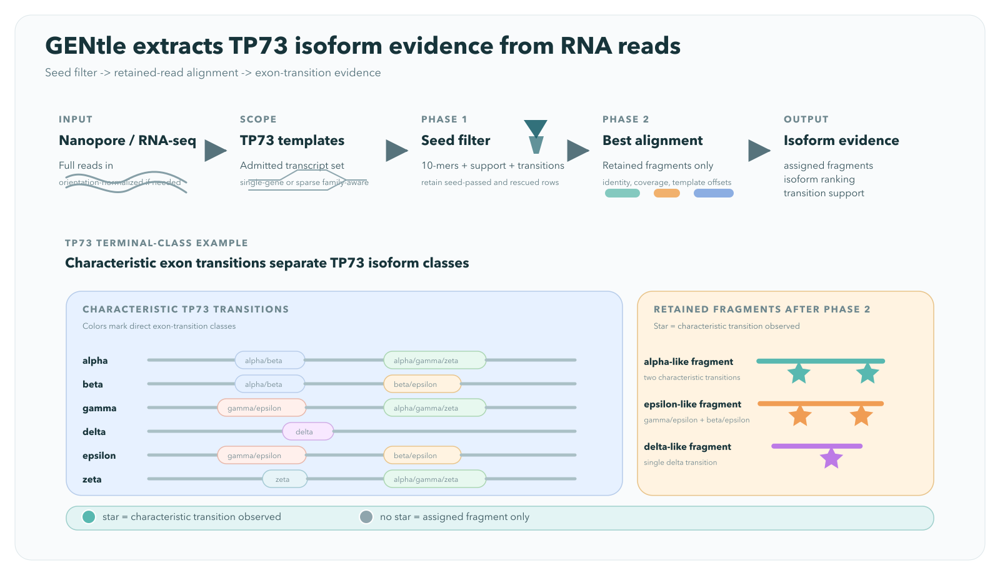

### RNA-Read Mapping Workspace

<!-- manual-counterparts:start -->
Related CLI reference: [RNA Read Interpretation](../cli/rna-reads.md).
These topic links do not imply identical feature coverage across interfaces.
<!-- manual-counterparts:end -->

- RNA-read run controls now live in a dedicated top-level `RNA-read Mapping`
  workspace:
  - direct launcher now also exists in the DNA sequence window toolbar as
    `RNA-read Mapping`
    - enabled when the current selected feature can seed a splicing view
      (`mRNA`, `ncRNA`, `misc_RNA`, `transcript`, `exon`, `gene`, `CDS`)
    - opens or focuses the same dedicated mapping workspace for that locus
  - seeded from the current splicing locus (`seq_id`, `seed_feature_id`, current
    scope/default report)
  - owns phase-1 FASTA input, report id, scope/origin controls, checkpoint/
    resume, phase-2 alignment controls, workflow staging, and report exports
  - the dedicated workspace now shows its main mapping parameters immediately;
    only optional tuning stays behind `Show advanced`
  - the compact conceptual diagram below summarizes the current mental model:
    reads first enter the phase-1 seed filter, only retained rows advance to
    phase-2 alignment, and only aligned fragments that actually cross one of
    the characteristic TP73 exon transitions add direct-transition support for
    an isoform class

 
*Figure: Compact RNA-read Mapping schematic. GENtle first filters raw reads to a retained report set, then aligns retained fragments and marks only those mapped fragments whose exon transitions support one characteristic TP73 terminal-class pattern.*

  - when a saved `Report ID` already exists, reopening the mapping workspace
    hydrates score density, support tables, and read inspection from that
    saved report even if no live task is running
  - the mapping controls now spell out the biological working set explicitly:
    - `Region / gene scope` now explicitly means:
      - `target gene/group` = transcript-like RNA features that resolve to the
        same gene/group label as the selected seed feature
      - `all overlapping` = transcript-like RNA features with any bp overlap
        against the selected ROI; full coverage is not required
      - `target-gene strand` = the selected target gene/group's annotated
        strand
      - `any strand` = the target-gene strand plus antisense/opposite-strand
        transcript templates; this is relative to the selected target gene, so
        a reverse-strand target gene has the forward strand as its opposite
        strand
    - a compact eligibility sketch now shows, for overlapping transcript-like
      RNA features, which combinations of target gene/group vs other overlap
      and target-gene strand vs antisense/opposite strand are indexed or
      excluded
    - `Gene expansion mode` is still one run, not multiple invocations:
      - `single_gene` = only the current target gene/group contributes
        transcript templates
      - `multi_gene_sparse` = the same run additionally includes transcript
        templates from the explicit sparse `Target genes` list
    - a read-only summary line below these controls states exactly which region
      and which gene set the current run configuration will use
  - `Show in Splicing Expert` returns to the viewer with the current mapping
    report selected
  - the workspace `Mapping guide [?]` exposes the detailed two-phase workflow:
    - phase 1 `InterpretRnaReads` streams FASTA input, optionally normalizes
      cDNA-like reads with a T-rich 5' head, and scores reads against locally
      admitted transcript/junction seed templates
    - retained top hits are stored under `Report ID`
    - phase 2 `AlignRnaReadReport` reopens that saved report, aligns retained
      rows, and refreshes mapping/junction/isoform summaries
    - the workflow remains ROI-first and local-model-first, not a whole-genome
      mapper
  - phase-1 FASTA input run panel for `InterpretRnaReads`
    (`.fa/.fasta`, optional gzip `.fa.gz/.fasta.gz`)
  - gzip FASTA input also accepts concatenated gzip members
  - progress updates are throttled to reduce UI overhead:
    - all build profiles: read-count updates every `10000` reads, plus the
      first three reads and the final result
    - time-based updates approximately every `2s` while processing continues
    - phase-2 retained-read alignment now reports progress every selected
      retained row (`update stride: 1`) so long alignment passes visibly move
  - live RNA-read progress stays in the dedicated `RNA-read Mapping` workspace;
    it no longer rewrites the DNA sequence window status line while the
    sequence window is only acting as the launcher/context holder
  - completed RNA-read report summaries and workspace-triggered mapping actions
    now also stay in the dedicated `RNA-read Mapping` workspace status area
    instead of leaking into the underlying DNA sequence viewer status line
  - persisted RNA-read reports now also appear in the project lineage
    graph/table as analysis artifacts linked from the source sequence
    - lineage actions reopen the `RNA-read Mapping` workspace directly on the
      selected saved report instead of only opening the source sequence
    - lineage details expose the stored interpretation profile,
      report-mode/origin-mode summary, total read count, seed-passed count,
      aligned-read count, and target-gene count
  - input FASTA path can be selected via file picker (`Browse...`) in addition
    to manual path entry
  - `Report ID` now defaults to a settings-aware stem derived from:
    - current splicing group / locus
    - input file name
    - active profile
    - active scope
    - active origin mode
    - explicit target genes when `multi_gene_sparse` is selected
  - `Report ID` now has:
    - `Auto` mode to keep that ID synchronized with the current settings
    - `Refresh ID` to regenerate the suggested value once without forcing
      future auto-sync
    - manual typing automatically switches the field into manual-override mode
    - saved IDs are validated against the open sequence and seed feature before
      they are used for progress, workflow staging, exports, or phase-2
      alignment; if an ID resolves to another locus, the workspace warns and
      requires a matching/refreshed ID instead of silently reusing it
  - field tooltips now explain how `Report ID`, `Scope`, `Origin mode`,
    `Report mode`, cDNA normalization, and alignment reuse affect retained
    reports and later inspection/export
  - `Input is cDNA (normalize T-rich 5' head)` checkbox controls read
    normalization mode:
    - enabled (default): reads with a T-rich 5' head are reverse-complemented
      before seed scoring (cDNA-oriented mode); minor interruptions in the
      head are tolerated
    - disabled: direct-RNA mode (reads are scored as provided)
  - seed-hash preview now includes a transcript-template audit section showing
    the exact transcript-oriented sequences used for hash generation:
    - minus-strand transcript templates are shown after exon concatenation and
      reverse-complement normalization from genomic orientation
    - hovering indexed seed dots reports the local hash window within that
      transcript-oriented template
  - advanced settings include `poly-T head min T-bp` (`poly_t_prefix_min_bp`):
    minimum T support required in the 5' detection window for the cDNA
    auto-flip gate
  - advanced runtime options include:
    - `Report mode` (`full` or `seed_passed_only`)
    - `Checkpoint path` (optional JSON checkpoint file)
    - `every reads` (`checkpoint_every_reads`, integer `> 0`)
    - `Resume` (`resume_from_checkpoint`; requires non-empty checkpoint path)
  - these runtime options are passed directly to the shared
    `InterpretRnaReads` engine operation (GUI/CLI/JS/Lua parity)
  - `Apply TP73 specificity preset` sets a stricter seed gate and scope
    (`target-group / target-gene-strand`) for focused pilot filtering runs
  - `report_mode=seed_passed_only` now keeps a smaller but still reviewable
    retained set:
    - composite seed-pass rows
    - retained rows at or above raw `min hit`
    - this keeps "reasonable seed" candidates available for later phase-2
      alignment and manual inspection even when they fail the stricter
      composite seed gate
  - default splicing scope is broad (`all overlapping / any strand`) with
    optional narrowing presets
  - advanced `Origin mode` controls are available:
    - `single_gene` (baseline; current execution path)
    - `multi_gene_sparse` (expands transcript templates with local-annotation
      matches from `Target genes` for the current run)
  - advanced `Target genes` field (comma/space/semicolon separated IDs) is
    used by `multi_gene_sparse` and persisted in report metadata
  - advanced `ROI seed capture` toggle is persisted in report metadata as a
    planned annotation-independent capture-layer request (warning emitted until
    this layer is implemented)
  - tutorial reference for TP53-basis multi-gene mapping:
    - `docs/tutorial/generated/chapters/07-02_tp53_multi_gene_sparse_mapping_online.md`
  - scope presets are explicit:
    - `all-overlap / any-strand`: all overlapping transcripts, including
      antisense/opposite-strand genes relative to the selected target gene/group
    - `target-group / any-strand`: target group only, any annotated strand allowed
    - `all-overlap / target-gene-strand`: all overlapping transcripts on the
      selected target gene/group's annotated strand
    - `target-group / target-gene-strand`: target group on the selected target
      gene/group's annotated strand only
  - strand-scoring semantics:
    - any-strand modes score against the union of admitted target-gene-strand
      and antisense/opposite-strand templates (shared k-mers can contribute in
      this combined mode)
    - target-gene-strand modes exclude antisense/opposite-strand templates from
      the score
  - seed-index semantics:
    - indexed seeds include annotated exon-body k-mers and exon-exon junction
      transition k-mers for admitted transcripts
  - phase-1 seed filtering hashes the full read span for every sequence
    - `hash stride` controls the seed-start density along each read
    - default seed-start density is one start per base (`seed_stride_bp=1`)
  - advanced seed constants expose a composite seed gate:
    - `k-mer length` (default `10`)
    - `hash stride` (default `1`; higher values make the initial hash screen
      sparser and faster)
    - `min hit` (raw hit fraction, default `0.30`)
    - `min weighted` (occurrence-weighted unique-k-mer fraction, default `0.05`)
    - `min unique` (minimum number of unique matched seed hashes, default `12`)
    - `min chain` (minimum coherent-chain support fraction for matched hashes,
      default `0.40`)
    - `max median gap` (maximum median distance between matched hash starts in
      the inferred transcript chain, default `4.0`)
    - `min transitions` (minimum confirmed exon-exon transitions in inferred
      isoform path, default `1`)
    - `min transition frac` (minimum confirmed/expected transition fraction in
      inferred isoform path, default `0.05`)
    - pass rule:
      `raw >= min hit AND weighted >= min weighted AND unique >= min(min unique, tested kmers) AND chain >= min chain AND median transcript gap <= max median gap AND confirmed transitions >= min transitions AND confirmed transition fraction >= min transition frac`
  - phase-1 hashing now exposes only the real density controls:
    `k-mer` and `hash stride`
  - in the score-density plot, the red vertical line marks raw `min hit` only;
    it is not the full composite seed-pass boundary
    - full-read hashing is always used in phase 1
    - removed legacy short/long sampled-window knobs are no longer shown
  - alignment fields are active for phase-2 retained-read mapping:
    - `align band`
    - `min identity`
    - `max secondary`
    - `align selection` (`seed_passed|all|aligned`)
    - `Prep concatemer review` sets a pragmatic audit preset:
      - `report_mode=full`
      - `align selection=all retained`
      - `max secondary=5`
    - the panel now also reminds you that the built-in `nanopore_cdna_v1`
      phase-1 run stores `max_secondary_mappings=0`, so concatemer review
      should rely on a phase-2 rerun with retained secondaries
    - the panel now explains the current phase-2 working set explicitly:
      `all` means all retained report rows, not only the rows above raw
      `min hit`; it also shows how many retained rows currently pass the
      composite seed gate
    - `seed_passed` is now the default round-2 setting; if it
      matches no retained rows, phase 2 falls back to retained rows at or above
      the raw `min hit` threshold so the run does not silently produce zero
      similarity scores
    - `all retained` remains available when you deliberately want the broader
      rescued-retained working set
    - `already_aligned` means rerun phase 2 only on rows that already received
      a stored mapping in an earlier pass
    - the panel now also shows an ETA during phase-2 retained-row processing
      and states the algorithm in plain language: banded semiglobal/local
      pairwise alignment against transcript templates with deterministic dense
      fallback if the banded pass yields no hit
  - saved-report evidence review now includes a `Concatemer review / partner
    census` panel:
    - runs the shared `InspectRnaReadConcatemers` engine path from the GUI
    - supports `selection`, `subset`, `limit`, adapter/barcode FASTA, one-path-
      per-line transcript FASTA catalogs, and prepared transcript indexes
    - shows recurring partner genes/transcripts plus ranked suspicious rows
    - can jump directly into `Mapped cDNA -> Read effects` for all suspicious
      rows or only the strongest rows
  - `Run RNA-read interpretation` executes phase-1 `InterpretRnaReads`
    with the currently visible mapping parameters
  - `Run alignment phase (retained report)` executes
    `AlignRnaReadReport` asynchronously for the current `Report ID`
    - tooltip explicitly notes that phase 2 reuses the saved report and does
      not reread the FASTA input unless phase 1 is run again
  - saved-report selectors now show a denser one-line summary per report:
    `report_id`, profile, origin mode, read/aligned counts, scope token, and
    target-gene count
  - phase-2 alignment updates persisted report counters and support tables:
    - `aligned`
    - `msa-eligible(retained)`
    - `Mapped` support tables for exon overlap, junction overlap, and mapped
      isoform ranking
    - seed/path diagnostics remain available separately under the `Seed` tab
    - exon/transition abundance exports derived from refreshed mapped support
      frequencies
  - phase-2 alignment strategy is reference-guided pairwise mapping
    (`semiglobal` preferred with deterministic `local` fallback), and the
    chosen mode is exported in read/report mapping summaries
    - backend uses `bio::alignment::pairwise::banded`; `align band` controls
      the band width around the seed backbone
    - selected retained rows are pairwise aligned even when their recomputed
      seed-pass flag remains `no`, so round 2 can still expose `Id%` / `Cov%`
      for strong outliers that the composite seed gate would otherwise hide
  - run executes asynchronously (non-blocking UI) with live read-progress
    indicators
  - workflow access routes for the same payload are available in the panel:
    - `Prepare Workflow Op` stages the generated `InterpretRnaReads` operation
      into `Engine Ops -> Workflow` (`run_id` + `ops` JSON)
    - `Copy Workflow JSON` copies a complete workflow object
      (`{"run_id":"...","ops":[...]}`) for `gentle_cli workflow ...` or shell
      reuse
  - live status now shows seed-pass as count and percentage of reads processed
  - streaming progress includes `ETA:` (uppercase) estimate derived from
    compressed/plain input bytes consumed vs elapsed runtime; ETA refresh is
    synchronized with read-count progress updates
  - running seed-confirmation histogram follows the shared read-count/time-based
    progress policy and is shown as genomic-position bars (`+` strand upward,
    `-` strand downward)
  - bar heights use a square-root scale so low-frequency bins remain visible
    while high-frequency bins are still comparable
  - red seed-anchor dots are overlaid on the histogram baseline (`+` above,
    `-` below) with hover details (hash bits, sequence, genomic position,
    transcript)
  - exon spans are overlaid in the same histogram (green top guide segments)
    for direct seed-location vs exon-context inspection
  - coordinate mode toggle supports genomic coordinates or exonic-only compact
    coordinates (merged exons adjacent without intronic gaps)
  - Seed-hit score-density chart includes:
    - a `Linear`/`Log` scale toggle (default `Log`); log mode uses
      `log(1+count)` so sparse high-score bins remain visible during strongly
      skewed runs
    - a population toggle:
      - `All scored`: every scored phase-1 read
      - `Composite gate`: only reads that passed the full composite seed gate
        under the recorded run thresholds
      - `Retained replay`: instant replay of the full composite gate over the
        retained saved-report rows using the current controls
    - the explanatory note changes with that population mode:
      - `All scored` keeps the raw `min_hit` red-line interpretation
      - `Composite gate` makes clear that the bars already respect the full
        gate, while the red line still marks the raw `min_hit` component
      - `Retained replay` makes clear that the replay is exact for retained
        rows only and does not revisit reads that were never retained by the
        original run
  - support statistics now live behind source tabs:
    - `Reported transcript`
    - `Thresholded cDNA`
    - `Mapped cDNA`
  - `Reported transcript` shows the annotation baseline for the current
    splicing scope: reported exon support, reported junction support, and the
    transcript catalogue
  - `Thresholded cDNA` shows phase-1 seed-passed evidence:
    - inferred exon support reconstructed from assigned transcript paths
    - confirmed junction support from seed-supported transitions
    - isoform ranking from thresholded cDNA assignments
    - exon/junction/isoform tables now reserve about 8 visible rows before
      scrolling so they stay usable during manual inspection
    - this is still phase-1 evidence, so it is best read as a thresholded
      transcript-assignment view rather than as the final mapped fragment
      support surface
  - the RNA-read mapping panel now shows the currently active RNA-read
    parameter summaries even before export, including explicit overlap/order
    density:
    - hashing summary (`k-mer`, `hash stride`)
    - RNA-read dotplot summary (`word`, `step`, `mismatches`, `tile`)
  - RNA-read tuning is available directly in the same panel:
    - `Dense 9-mer similarity preset` uses exact dense 9-mers for both the
      phase-1 hash screen and RNA-read dotplots
    - editable RNA-read dotplot knobs under advanced settings drive the exact
      settings used by `Export dotplot...` and `Export dotplots for selected
      reads...`
    - `Open Dotplot workspace` opens the full shared dotplot editor without
      leaving the splicing context
    - exported RNA-read sequence dotplots now carry `w/s/mm/tile` tags in the
      default filename, and the saved SVG header repeats the actual overlap and
      ordered-window density
  - `Mapped cDNA` is now split into two subviews:
    - `Read effects` (default)
      - read-first inspection surface driven from the saved report /
        `inspect-alignments` payload, not from the capped live preview
      - default table height now targets about 15 visible aligned rows before
        scrolling
      - aligned-read rows now show:
        - `Cov%` = how much of the read is aligned
        - `Tx%` = how much of the transcript template span is covered by that
          alignment
        - `FL` = full-length class (`exact`, `strict_end`, `near`, `partial`)
      - this is the view where the figure's starred fragments conceptually
        becomes concrete: aligned reads can be assigned to a TP73 template
        without yet contributing one of the characteristic direct-transition
        marks used in isoform-class support summaries
          derived from transcript-template coverage and current alignment
          threshold
      - short local fragment hits are now labeled more honestly in the detail
        pane: the selected read shows transcript-span coverage and warns when
        the alignment confirms only a small fragment of the transcript model
      - the score-density histogram above is now part of the inspection loop:
        clicking a bar highlights that bin and turns it into a formal
        `score_bin` subset for `Read effects`
        - the clicked bin also becomes the checkbox-selected saved-report
          subset, so the table, exports, and follow-up alignment actions all
          refer to the same explicit reads
        - the current subset line now states
          `filter=... | histogram=... | score_bin=... | sort=... | search=...`
        - in `Composite gate` mode, clicking a bar only selects retained
          saved-report rows in that bin that actually passed the full
          composite seed gate
        - in `Retained replay` mode, clicking a bar only selects retained
          saved-report rows in that bin that pass the current seed controls;
          this is intentionally a retained-only preview rather than a hidden
          rerun over all scored reads
      - filter controls let you focus on:
        - all aligned rows
        - `confirmed` rows only
        - `disagreement only` for non-confirmed rows (`reassigned` plus
          `aligned (no phase-1 tx)`)
        - `reassigned` rows only
        - rows aligned without a phase-1 transcript assignment
        - checkbox-selected rows only
      - sort controls support `rank`, `identity`, `coverage`, and `score`
      - search matches read ids, transcript ids/labels, effect labels, and
        `#record_index` labels
      - the displayed `Read effects` table now comes from the same engine-backed
        subset contract used by shared-shell `rna-reads inspect-alignments`, so
        GUI filter/sort/search/selected semantics stay aligned with agent-facing
        inspection JSON
      - shortcut buttons provide one-click subsets for:
        - `Disagreements`
        - `Max-score ties`
        - `Rightmost score bin`
        - `Reset view`
      - `Selection tools -> Select filtered rows` promotes the current
        filter/search/sort subset into the checkbox selection set for follow-up
        alignment, FASTA copy, materialization, or dotplot export
      - the panel states both:
        - the formal subset specification
        - score-bin provenance
          (`N saved-report reads in histogram mode X / bin Y, M aligned rows
          currently match`)
      - one row per aligned retained read with:
        - phase-1 transcript guess
        - phase-2 aligned transcript
        - deterministic effect label
          (`confirmed`, `reassigned`, `aligned (no phase-1 tx)`)
        - mapped exon/junction contribution counts
      - selecting a row opens a detail pane with:
        - phase-1 interpretation fields
        - phase-2 mapping metrics
        - explicit full-length status (`exact`, `near`, `strict_end`) and class
          label for the selected row
        - explicit phase-2 query orientation (`as stored` vs
          `reverse-complemented to fit the transcript template`)
        - exact `rust-bio` pairwise alignment strings for the selected
          read/transcript-template pair:
          - `|` = exact match
          - `.` = mismatch
          - blank column = insertion/deletion
        - mapped exon/junction contribution spans
        - on-demand pairwise alignment detail against the exact transcript
          template used by phase 2
          - shows backend (`banded` vs `dense_fallback`), mode, CIGAR,
            aligned spans, and the aligned query/relation/target text
          - makes partial local/semiglobal confirmations inspectable without
            forcing a new export
        - direct actions:
          - `Copy highlighted FASTA`
          - `Materialize highlighted`
          - `Show alignment`
          - `Open interactive dotplot`
          - `Export dotplot...`
          - headless parity now exists through:
            `rna-reads materialize-hits` for saved-read sequence creation and
            `rna-reads show-alignment` for the exact phase-2 pairwise detail
        - the inline dotplot preview was removed; use `Open interactive dotplot`
          for on-demand visual comparison in the full shared workspace
        - `Open interactive dotplot` opens the shared dotplot workspace on the
          selected read-vs-ROI comparison and keeps it live:
          - adjusting `word`, `step`, `mismatches`, or `tile` in the workspace
            recomputes the same selected-read comparison in place
          - the workspace header shows when the query axis is an RNA-read
            override rather than the active genomic sequence
          - crosshair-to-sequence selection sync is intentionally disabled for
            those RNA-read override views so the genomic selection is not
            misleadingly rewritten from read-local coordinates
      - selected-row actions now also include an `Export selected...` menu for
        exact saved-report subset export:
        - `FASTA...`
        - `Alignments TSV...`
        - `Exon paths TSV...`
        - `Exon abundance TSV...`
        - after using `Audit`, these exports write exactly the contributor
          reads behind the chosen mapped exon/junction/isoform row
      - an `Export filtered...` menu writes the exact current
        filter/search/sort subset, so quick views/searches can be exported
        reproducibly without first promoting them into the checkbox selection
        set
      - filtered exports now record that formal subset definition in their
        provenance as `subset_spec=filter=... | sort=... | search=...`
      - a `Read length distributions` panel now shows auto-binned plots for:
        - all encountered reads
        - seed-passed reads
        - aligned reads
        - full-length exact / near / strict subsets
        - target-positive share by total read length for the current
          splicing-group gene/report target
        - accepted target-positive read lengths
        - accepted target-fragment lengths
        - accepted target-fragment / total-read coverage fractions
        - the engine stores exact per-bp counts; GUI bins are presentation-only
          and deterministic from those exact counts
        - each read-length histogram now also shows a compact mean + five-number
          summary (`min / q25 / median / q75 / max`)
        - target-positive quality plots are derived from the shared
          `SummarizeRnaReadGeneSupport` engine payload, so the GUI is not using
          a second frontend-only definition of "TP73-positive"
        - `Export target quality...` now writes the current target-quality view
          through the shared engine export route:
          - saving as `.json` creates or extends a comparison bundle rather than
            silently overwriting one prior target/program/parameter run
          - saving as `.svg` writes a comparison figure plus a
            same-basename `.bundle.json` sidecar that accumulates comparable
            entries across genes, GENtle versions, and settings
          - if the requested SVG path already exists but is not paired with a
            reusable GENtle sidecar bundle, the engine preserves that file and
            writes a sibling `*_compare.svg` + sidecar instead
    - `Aggregate support`
      - `Mapped cDNA exon support`, `Mapped cDNA junction support`, and
        `Mapped cDNA isoform ranking` use phase-2 best mappings only and are
        the aggregate interpretation surface once retained-read alignment has
        been run
      - each mapped aggregate row now has:
        - `Audit (n)` to jump back to the exact aligned reads contributing to
          that statistic
        - `Export...` to write that same contributor subset directly as
          FASTA, alignment TSV, exon-path TSV, or exon-abundance TSV without
          leaving the aggregate table
      - mapped exon/junction support follows aligned transcript-template
        offsets, so alternative exons inside the genomic span are no longer
        counted unless the mapping actually traversed them
  - `Best-performing reads so far` is shown live during execution; selecting a
    row recomputes that read's seed hashes in-window and highlights supported
    positions in green with a displayed recompute time
  - the top-read area is explicitly a `Live preview`, not the whole retained
    report; it remains useful during runs, but post-run read inspection should
    use mapped `Read effects`
    - saved-report retention now guarantees:
      - the top 2000 rows by phase-1 score
      - any retained row in one of the highest 20 score-density bins at or
        above the current `min hit` threshold
      - this is meant to keep obvious high-score outliers available for later
        inspection and optional phase-2 alignment even when they would
        otherwise fall outside the broader retention-rank cap
    - after a run has finished, clicking a score-density bar can switch this
      preview from the capped live top-20 list to the exact saved-report rows
      belonging to that selected score bin
      - if a histogram bin has tested reads but no retained saved-report rows,
        the UI now says so explicitly instead of silently falling back to the
        unrelated live preview
      - histogram hover now distinguishes:
        - the current histogram population count (`All scored` or
          `Composite gate`)
        - retained saved-report rows in the bin
    - the preview table now reserves about 12 visible rows by default and can
      grow up to roughly 16 rows for shorter saved-report lists before opening
      an inner vertical scrollbar; this keeps compact score-bin previews from
      showing a second inactive-looking vertical scrollbar beside the workspace
      scrollbar
    - the table starts with `Ret.rank`, so orientation is easier to keep while
      triaging
    - the `align selection` summary now distinguishes the stricter saved-report
      composite seed-pass count from the raw red `min_hit` line in the
      histogram; for `seed_passed`, the working-set size comes from retained
      rows with `passed_seed_filter=yes`
    - preview rows are now sorted by phase-1 `Score`, while `Ret.rank`
      remains the saved-report/live retention-rank position
    - `Id%` and `Cov%` are shown as explicit columns:
      - `Id%` = phase-2 pairwise alignment identity
      - `Cov%` = phase-2 query coverage
  - saved-report selection helpers now let you:
    - select all reads tied at maximal seed score
    - select all reads in the rightmost non-empty score-density bin
    - keep those selections active even when some rows fall outside the
      top-preview cap
  - `Evaluate Top Hits (phase-2)` in the same panel runs
    `AlignRnaReadReport` immediately with the current `align selection`
    setting, so retained top rows gain mapping metrics without leaving the
    panel
  - `Evaluate Selected (phase-2)` aligns only checkbox-selected top rows
    (`record_index`-exact subset), useful for rapid manual triage before
    running a broader phase-2 pass
  - the top-hit preview now also supports one-click per-row `Run` for
    on-demand phase-2 alignment of a single read
  - the checkbox column header now toggles all currently listed rows in both
    the top-hit preview and mapped `Read effects` tables without clearing
    hidden selections outside the current filtered/listed subset
  - top-read rows include strand assignment diagnostics for the joint
    two-strand run (`strand`, `opp`, `ambig`)
  - top-read rows now also expose origin diagnostics from engine
    classification (`class`, `oconf`, `sconf`) and running class totals are
    shown while processing
  - once phase-2 alignment runs, top-read rows and FASTA headers also include
    compact mapping summaries (`align` mode, transcript, strand, target span,
    identity, query coverage, score, secondary count)
  - top-read rows support FASTA copy paths:
    - checkbox-select one/many rows, then `Copy selected FASTA`
    - `Copy highlighted FASTA` for the active highlighted row
    - `Ctrl/Cmd+C` copies selected rows (or highlighted row fallback)
    - row context menu (`right-click`) includes `Copy FASTA` actions
    - these copy paths now prefer the saved report when available, so selected
      rows beyond the top-preview cap are still included
  - `Dotplots` menu in the top-read preview:
    - `Export dotplot for highlighted read...`
    - `Export dotplots for selected reads...`
    - these create ordinary project read sequences through the engine and then
      reuse the standard pairwise dotplot export path against the current
      splicing ROI
  - export actions include:
    - `Export Retained Top Reads (FASTA)...`
    - `Export Exon Paths (TSV)...` (per-read path/mapping summary rows with
      the same `#` report/seed-screen provenance header block used by the
      alignment TSV export)
    - `Export Exon Abundance (TSV)...` (exon/transition abundance rows with
      the same `#` report/seed-screen provenance header block)
    - `Export Score Density (SVG)...` (uses current `Linear`/`Log` scale toggle
      and now keeps the compact per-bin count labels seen in the live plot,
      plus the active seed-screen provenance: profile, scope, origin mode,
      `k`, `hash stride`, and overlap/order density)
    - `Export RNA sample sheet ...` (multi-report cohort summary)
  - top-read ranking now includes weighted seed score (inverse seed-occurrence
    weighting) to reduce dominance from repetitive low-complexity seeds
  - throughput diagnostics are shown during run:
    reads/s, bp/s, cumulative bases processed, and mean/median/p95 read length
  - compute breakdown is shown during run
    (`seed`, `align`, `io`, `parse`, `norm`, `infer`, `emit`, `other`) for
    bottleneck inspection (`align` stays near zero in phase-1 seed-only mode)
  - alignment debug/status line is shown during and after runs:
    backend (`pairwise::banded` + dense fallback), mode priority
    (`semiglobal>local`), requested/effective `k`, and active/idle state
  - best-read rows now show full sequences in a horizontally scrollable pane
    (no forced line wrapping)
  - a `Seed hash preview` panel lists representative seed rows in-window and
    full detail remains exportable via `Export Seed Hash Catalog (TSV)...`
  - saved-report warnings and retained-preview details are collapsed by default
    under `Saved report details` to reduce idle clutter after large runs
  - `Export RNA sample sheet ...` writes a TSV summary for current-sequence
    reports, including cDNA/direct-RNA `input_orientation_mode` /
    `input_orientation_label` provenance and exon/junction support-frequency
    JSON columns
  - executes read-only interpretation/report generation (no direct feature
    mutation).

<!-- manual-page-nav:start -->

---

[GUI Manual](../gui.md) | [Previous: RNA-Binding Protein Evidence](rna-binding-protein-evidence.md) | [Next: RNA Structure (ssRNA)](rna-structure-ssrna.md)
<!-- manual-page-nav:end -->
