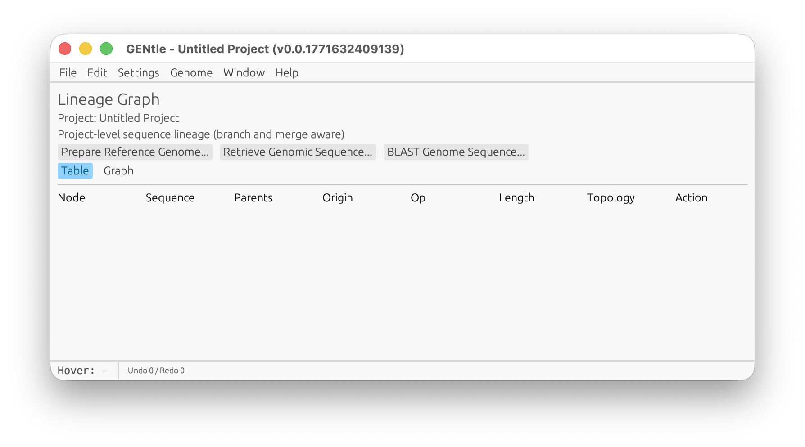

### TATA-Box Evidence In The DNA Viewer

<!-- manual-counterparts:start -->
Related CLI reference: [Accession-Pinned TSS Profiles](../cli/tss-profiles.md).
These topic links do not imply identical feature coverage across interfaces.
<!-- manual-counterparts:end -->

Open **TFBS scan > TATA-box evidence**, or the matching button in
**Sequence Tools**. This separate, resizable workspace leaves the DNA map
available. Use the whole sequence or the current selection, inspect, then click
a result's coordinates to locate it on the map. The table is virtualized and
scrollable. **Add selected to DNA map** is a separate, undoable mutation; a
changed sequence, annotation, matrix, or EPD file requires a fresh inspection.

Source annotations, EPD promoter classifications and TBP model predictions have
separate labels. EPD markers locate the TSS, not an invented exact TATA site.
Source feature qualifiers and TSS associations are available in row hover
details and the copied JSON. EPD source configuration is optional; a human
GRCh38 template is provided but is never used automatically for mouse data.
The default model is the exact JASPAR TBP `MA0108.3` PFM. By default only
transcript-oriented motif starts at -40..-15 bp from known TSS candidates are
scanned. **Scan without TSS restriction** explicitly scans both strands.
Transcript 5-prime annotation boundaries are candidate TSSs, not experimental
proof of initiation. See [the worked guide](../tata_box_evidence.md) for EPD setup,
threshold interpretation and reproducible shared commands.

```bash
cargo run --bin gentle
cargo run --bin gentle -- path/to/project.gentle.json
```

Runtime status diagnostics:

- On Unix, a running `gentle` process listens for SIGUSR1 and prints the
  process-local live activity stack to STDERR. Launch from a terminal if you
  want to see this diagnostic dump.
- The same in-memory snapshot is available through shared shell
  `introspect runtime`. It reports active scoped frames such as the current
  shell command, genome-preparation phase/progress, and GUI background jobs
  that are visible in the Background Jobs panel. The structured response also
  includes observed activity records from existing ledgers such as genome
  prepare markers, CUT&RUN shared-asset markers, and BLAST async jobs when
  those ledgers are discoverable. GENtle does not write a separate
  runtime-status file, and this is not a historical job log.
- When live runtime frames exist in the GUI process, the bottom status bar
  shows a compact `Runtime: N active` indicator with a hover summary.
- Opening a DNA sequence viewer contributes a `gui_action` frame while its
  viewport is queued, sequence payload is loading, and real content awaits its
  first paint. The frame is phase-only rather than displaying an invented
  percentage or ETA, and is removed when the content is ready, loading fails,
  or the window is closed.

The GUI opens an empty project unless a project path is passed on startup.

Example startup window:

<br>
*Figure: Main window after startup with an empty project.*

<!-- manual-page-nav:start -->

---

[GUI Manual](../gui.md) | [Previous: Accession-Pinned TSS Profiles](accession-pinned-tss-profiles.md) | [Next: Array Tracks In DNA Viewer](array-tracks-in-dna-viewer.md)
<!-- manual-page-nav:end -->
