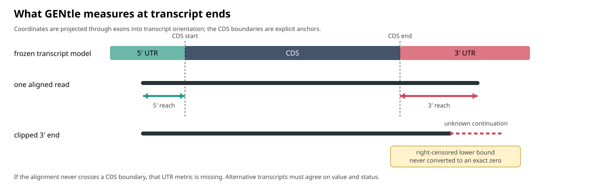
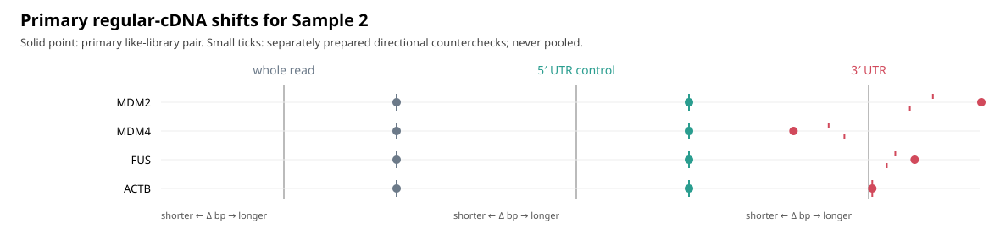

# Transcript-oriented RNA read-end metrics

GENtle's read-end utilities separate three questions that must not be collapsed:

1. **whole-read length** — a library and sequencing control;
2. **5′-UTR reach** — a useful truncation/control comparison; and
3. **3′-UTR reach** — the annotation-relative measurement of interest.

The utilities are deliberately downstream of the existing observed-SAM engine.
They do not align reads, choose a transcript silently, or infer a poly(A) site.

## Shared Rust Core: Step 1

### Integrated Saved-Service Contract

`rna-reads read-ends` / `RnaReadEnds` now share the typed commands in
`src/rna_read_ends.rs`. They are experimental and Rust/runtime-unverified locally.
The build schema is `gentle.rna_read_end_build.v1`; explicit source/gene/
transcript and ordered sample bindings are mandatory. One analysis per sample/
gene is admitted. Saved report status, result binding and artifact hashes are
verified before the pure core is called; the supplied normalized annotation is
authenticated against the original S2.3 annotation binding, then checked against
V2 model geometry. Do not substitute the GTF hash for the normalized file hash.

Output completion `gentle.rna_read_end_completion.v1` binds `pileup.json` and
`coverage.json`. Inspection takes the completion's **raw file hash and size**
as `report`, plus a `gentle.rna_read_end_pileup_view.v1` spec. Export uses the
same page and accepts explicit `json`, `tsv`, `svg`, `png`, `pdf` formats and
a fresh output directory. It writes artifacts with closed/synced handles and
publishes completion last through the existing owned S2.3 publication helper.
JSON/TSV/SVG are deterministic for identical saved input and view; PNG/PDF use
the same SVG with the established converters, not a cross-platform pixel promise.
Raster/vector conversion has an explicit 32-million-pixel page ceiling.

Coverage reports declared/assessed, gene-assigned and selected-transcript-compatible
counts, exclusions, exact-only quantiles and **both** censoring fractions.
Filters/page ranges do not recompute denominators. A/T remains unavailable
(`no_bound_basecalls`); composition parameters/provenance remain explicit.
Separate tail input binds an imported file and raw-signal manifest plus supported
caller/version/model/kit/basecaller/configuration. Unsupported/QC-failing rows
never acquire accepted values. These channels never change UTR censoring.

Indexed ingress binds configured executable/version, local alignment/index,
dictionary, interval and declared filters. Full alignment SHA verification is
optional and explicitly labelled; index pairing is a producer declaration plus
hash/size/mtime and tool-warning checks, not an exhaustive index proof. CRAM
requires a bound uncompressed FASTA and adjacent FAI, matching dictionary and
private REF_PATH/REF_CACHE. Alternate header UR locations are refused before
decode, conservatively including otherwise valid external-reference CRAMs.
See [samtools view](https://www.htslib.org/doc/samtools-view.html) and the
[HTSlib reference search order](https://www.htslib.org/doc/reference_seqs.html).
This is a trusted direct-child supervisor, not a process-tree security sandbox
or an operating-system guarantee against stalled filesystem calls.

`observed_transcript_structures::read_ends::project_read_ends` now provides the
same V2 UTR semantics as a pure Rust-level building block. It consumes a strict
V2 `ModelDocument`, existing typed `ObservedSamAnalysis` and the parsed normalized
annotation authenticated by the caller. It verifies reference/binding equality
and each used model's exact contig/strand/exons/gene agreement, then returns length and 5-prime/
3-prime reach. It reuses the shared genomic-to-query block transform for the
exon-to-transcript coordinates. It never reruns alignment or chooses a model.

`Metric::Observed` carries a value, `RightCensored` a lower bound and `Missing`
only a reason. Derived boundaries expose complete/included/separate/overlapping
or partial/unknown stop evidence without editing original CDS. Missing candidates
remain visible and withhold a complete gene assignment. Results do not promote
SAM query-unit identity into verified original reads or independent molecules.

Each optimal hypothesis retains its observation IDs and every compatible
candidate's saved relations, transcript intervals, metrics and additive clips.
The collapsed unit metrics derive from these records, not another calculation.
`annotation_gene_ids` retain saved match identities even without a CDS model;
`model_gene_ids` match Python's conservative complete-model assignment. Clip
lengths are unaligned query extents, with soft/hard/mixed/none/unknown kinds
from the terminal saved observation where determinable. They never change a
censored value into an observed end. A model/annotation mismatch refuses with
`rna_read_end_model_annotation_geometry`.

This is **not a new CLI/MCP command, file importer or frozen report schema**.
Callers must first authenticate saved artifacts; in-memory hash equality does
not verify actual files, reference bases or exhaustive search. Explicit model,
interval, observation, unit and work budgets fail without partial output.
Malformed identity/path/axis links refuse; incompatible geometry remains missing.
Existing standalone scripts/outputs are unchanged, including their conservative
legacy-v1 reader; this first Rust boundary accepts V2 only.

The [shared synthetic corpus](../test_files/rna_read_end_core/README.md) checks
31 literal cases in both implementations. Python's LF/CRLF corpus checks are
not Rust execution; see the [Glen checklist](glen_next_verification_handoff.md#shared-utr-core-step-1-2026-11-08)
for pending compilation/tests. Coverage, BAM/CRAM access, basecall terminal A/T,
raw-signal tail evidence, new exports and GUI remain later steps. No real-data
analysis, hard-wired gene/barcode selection or biological acceptance is added.

## 1. Freeze the transcript model

The integration's step 2 also defines pure coverage/evidence building blocks;
see [the plan and authorized defaults](rna_read_end_integration_plan.md).
Gene-assigned and transcript-compatible denominators are distinct. Coverage
is conditional on the selected model, with min/max bounds over hypotheses,
not an isoform allocation. Exact-only quantiles retain both censoring fractions
alongside missing reasons. These records have no file/service route yet.
Terminal composition is explicitly unavailable (`no_bound_basecalls`) until OD2;
configured tail-import rows preserve their own QC/provenance and cannot change
UTR metrics. No physical tail estimate is inferred from A/T or clips.

`scripts/project_rna_read_end_metrics.py` requires a CDS-aware model document
with schema `gentle.rna_read_end_transcript_models.v2`. Coordinates are genomic,
zero-based and half-open. Each transcript has stable transcript and gene IDs,
contig, strand, exons, original CDS and explicit stop-codon intervals. The document also binds the assembly,
reference FASTA SHA-256 and annotation SHA-256 already present in the completed
`gentle.observed_sam_structures_data.v1` artifact.

This extra binding is necessary because the observed-SAM report retains exon
comparisons but does not itself define CDS boundaries. A mismatched model is
refused.

The 3′-UTR begins **after the annotated stop codon**, not automatically after
the last raw GTF `CDS` interval. The preparer preserves `stop_codon` features,
including codons split across exons. Complete three-base stops that are separate
from, included in or partly overlap the CDS give the same derived boundary.
The raw CDS is never extended or rewritten. Missing/partial stop evidence leaves
3′ reach `missing`; there is no automatic `+3`. Legacy v1 models remain readable
but have unknown stop evidence and cannot supply a known 3′ boundary. The
[projection decision](decisions.md#standalone-transcript-read-end-projection)
records the source-format and compatibility limits. Reprepare a new model from
explicit evidence rather than relabelling an old v1 document as v2.

Prepare the model from an explicit GTF and the exact reference FASTA. Supply
the annotation digest recorded in the completed observed-SAM analysis; it is
kept separate from the raw GTF digest recorded as model provenance.

```sh
python3 scripts/prepare_rna_read_end_transcript_models.py \
  --gtf annotation.gtf.gz \
  --reference-fasta reference.fa \
  --assembly GRCh38 \
  --source-id ensembl-116 \
  --annotation-sha256 sha256:... \
  --output frozen-transcript-models.json
```

## 2. Project one sample



The solid read segment is projected through annotated exons. The 5′ and 3′
measurements begin at the corresponding CDS boundary. A clipped end is a lower
bound; it is not an observed short UTR.

```sh
python3 scripts/project_rna_read_end_metrics.py \
  --observed-sam-data barcode16.observed-sam.data.json \
  --transcript-models frozen-transcript-models.json \
  --sample-id barcode16 \
  --output-dir barcode16-read-end-metrics
```

The fresh output directory contains:

- `metrics.tsv`: the four-column input expected by
  `compare_rna_read_end_metrics.py`, with blank values for censored/missing rows;
- `projections.tsv`: per-read metrics plus transcript and gene identities,
  retaining numeric censored lower bounds separately from exact observations; and
- `report.json`: v2 projection policy, exact input hashes, model schema,
  stop-evidence counts and nonclaims.

Both gene-ranking utilities validate every detailed `projections.tsv` row
before counting it or excluding an unavailable/ambiguous gene assignment.
`observed` and `right_censored` require a nonnegative integer `value_bp`,
including valid zero; `missing` requires an exactly empty value. A missing
censored bound is invalid evidence, not an extra censored count. Refusals
occur before creating ranking outputs and do not rewrite inputs. This is the
**detailed-table** contract: the four-column comparator `metrics.tsv` still
requires blank censored values, with numeric lower bounds kept only in details.

Only saved optimal hypotheses and resolved `exact_full_chain`,
`exact_partial_chain` or `within_exon` transcript relations are eligible. A UTR
value is retained across transcript ambiguity only when all eligible paths and
models give the same value and status.
All compatible candidates are considered before model lookup. A remaining
candidate without a CDS model (for example, a noncoding alternative) keeps
both UTR metrics missing with `candidate_model_unavailable`; it does not
silently disappear. Candidate IDs remain visible; an incomplete model set
does not supply a supposedly complete gene assignment for ranking.

An aligned end that is clipped is **right-censored**: its value is a lower
bound, not an exact length. An alignment that does not cross the relevant CDS
boundary with coding-side support in the same connected projected interval is
**missing**, not zero. Merely touching the boundary from the UTR side is not
an anchor. Conversely, a coding-anchored read ending exactly at the boundary
may legitimately have observed reach zero. Unknown stop evidence affects only
the 3′ metric, not independently available 5′ or whole-read measurements.

## 3. Compare all six samples globally

Concatenate the six `metrics.tsv` files (retaining one header) and run:

```sh
python3 scripts/compare_rna_read_end_metrics.py \
  six-sample-metrics.tsv six-sample-qq
```

This produces the 15 sample-pair comparisons for each metric. Read the three
Q–Q matrices together: a 3′-UTR displacement is more interesting when the
whole-read and 5′-UTR controls do not show the same displacement.
Each sample/metric needs at least two exact observed values. An entirely
missing/censored metric cannot produce a Q–Q distribution; the comparator
refuses rather than inventing zero observations or relaxing its input contract.

## 4. Rank genes with explicit like-library contrasts

The biological samples are SK-MEL-28 (barcodes 13, 15 and 17) and WM793
(barcodes 14, 16 and 18), but the three barcodes per cell line are not
interchangeable replicates. Barcode 16 belongs to the regular-cDNA pair 15/16.
Pairs 13/14 and 17/18 used enrichment and therefore remain separate
directional counterchecks.

Create `contrasts.tsv`:

```text
contrast_id	focus_sample	comparison_sample	library_preparation	evidence_role
regular_cdna	barcode16	barcode15	regular_cdna	primary
enrichment_13_14	barcode14	barcode13	enrichment_13_14	directional_countercheck
enrichment_17_18	barcode18	barcode17	enrichment_17_18	directional_countercheck
```

Then use the detailed projection files:

```sh
python3 scripts/compare_rna_read_end_gene_contrasts.py \
  --projection barcode13-read-end-metrics/projections.tsv \
  --projection barcode14-read-end-metrics/projections.tsv \
  --projection barcode15-read-end-metrics/projections.tsv \
  --projection barcode16-read-end-metrics/projections.tsv \
  --projection barcode17-read-end-metrics/projections.tsv \
  --projection barcode18-read-end-metrics/projections.tsv \
  --contrast-sheet contrasts.tsv \
  --focus-label 'WM793 vs SK-MEL-28' \
  --minimum-observed 10 \
  --maximum-censored-fraction 0.25 \
  --output-dir wm793-gene-ranking
```

The ranking uses the regular-cDNA barcode16-minus-barcode15 median difference.
The enriched pairs contribute separate directional deltas and concordance
counts; they are never pooled into the primary score. Individual reads are not
treated as biological replicates. The report retains censored and missing
counts and excludes a pair when its evidence is too sparse or too censored.

For each gene and sample, the censoring fraction is
`right_censored / (observed + right_censored)`; missing rows are reported
separately and are not in that denominator. The minimum-observed and maximum-
censoring requirements must pass in both samples of a contrast. A percentage
of censored rows among **all** rows is a different summary, not this gate.
Aggregate barcode percentages cannot substitute for per-gene eligibility.
If no gene passes the prespecified thresholds, report that outcome rather
than loosening the gate to force a ranking.

The resulting candidates can motivate follow-up around the TP73–MDM2/MDM4
hypothesis. They do not demonstrate that TP73, MDM2 or MDM4 caused a change.
Library preparation, read truncation, mapping, transcript selection and the
frozen annotation remain alternative explanations.

## Interpretation picture



The committed figure is synthetic. Regenerate its six-sample fixture and SVG:

```sh
python3 scripts/build_rna_read_end_tutorial.py
```

The solid points are the regular-cDNA pair; small ticks are enriched-library
counterchecks. The three panels deliberately use separate scales. Compare direction and
candidate ordering, not the apparent horizontal distance between panels.
