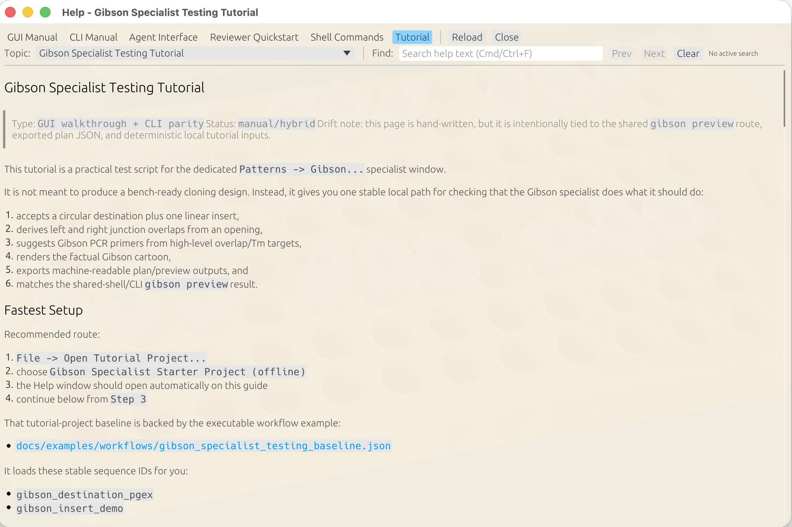
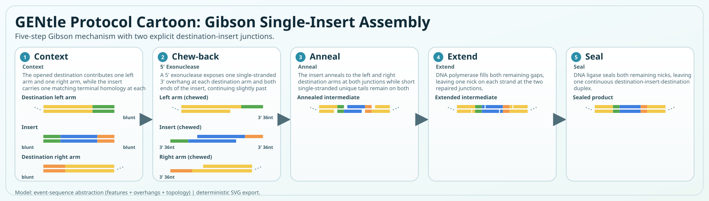
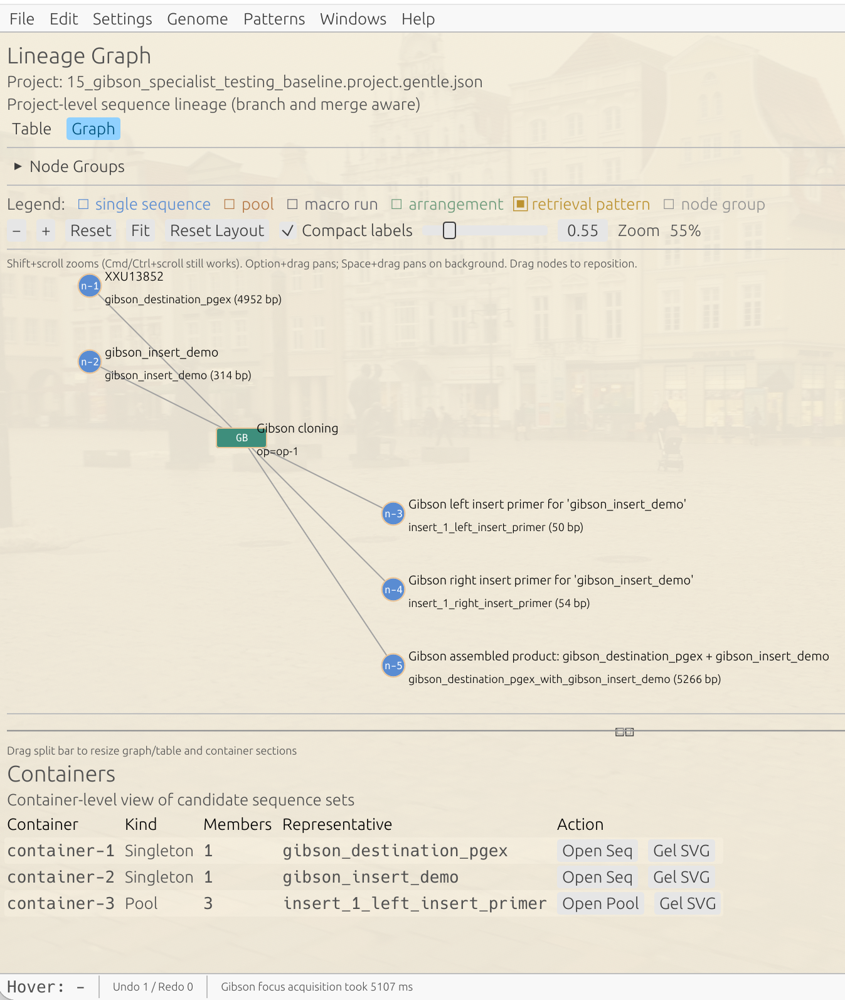
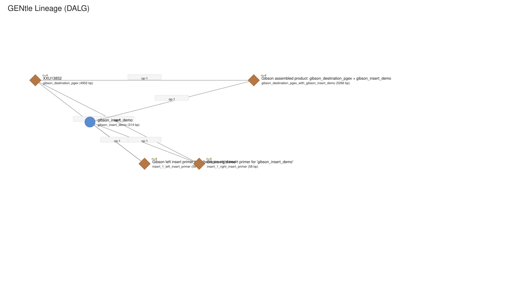

# Synthetic Biology in GENtle: Design, Build, Track and Verify

This tutorial is a route through existing GENtle operations rather than one
large wizard. It is intended for a first synthetic-biology exercise in which a
designed coding insert is assembled into a vector and then followed through
physical planning and sequence confirmation.

The examples linked below use small synthetic or public teaching inputs. They
do **not** describe one continuous experimental construct: the sequence-design
fixture and the Gibson fixture are deliberately separate. Treat each stage as
a stable unit operation and carry a real construct between stages only after
checking its identifiers, topology and sequence.

## What GENtle can establish

| Stage | GENtle can record or check | It does not establish |
| --- | --- | --- |
| Design | motif, CDS-wide GC and window-GC constraints in the saved result | expression, folding, fitness or a globally optimal sequence |
| Build | overlap geometry, assembly order and the predicted product | successful cloning or a physically present molecule |
| Track | lineage, arrangements, rack positions and export provenance | tube identity without human labelling and handling |
| Verify | trace/reference alignment, intended differences and uncertainty | biological function or independent experimental replication |

## 1. State the design intent

Write down the product you want, the sequence constraints that are mandatory,
and which observations will count as verification. Keep these three concepts
separate. A forbidden motif is a design constraint; an intact reading frame is
an output check; protein expression is a later biological observation.

For a small, executable design example, follow
[06.07 Redesign a synthetic coding insert](./06-07_synthetic_sequence_design.md).
Its 12-bp coding fixture demonstrates joint motif and GC constraints, explicit
approval of the exact proposed sequence, and same-session undo/redo. It is not
a natural-gene recoding benchmark.

## 2. Preview an assembly before applying it

Use the [Gibson specialist tutorial](./03-05_gibson_specialist_testing_gui.md)
with its synthetic destination and insert. Review destination topology,
fragment orientation, both junctions, overlap sequences and predicted product
before selecting **Apply**. The shared CLI preview is useful as an independent
representation of the same plan; it is not evidence that the wet-lab assembly
succeeded.

This older native screenshot shows where the Gibson tutorial was presented in
Help. It is orientation, not evidence that a current binary loaded the starter
project or completed the workflow.

The picture is generated from a protocol template. Its example overlap lengths
are illustrative; read the current plan for the actual overlaps.

## 3. Inspect lineage and organize the physical plan

After applying the reviewed plan, inspect the lineage graph. Inputs should feed
one operation and the predicted products should have distinct identifiers.

This 2026-03-23 screenshot is retained for orientation and predates the current
hash-bound GUI-acceptance format. Use the current project rather than the image
when judging a candidate build.

Continue with [03.07 Gibson Arrangements](./03-07_gibson_arrangements_gui.md)
and [03.08 Gibson Physical Rack](./03-08_gibson_physical_rack_gui.md). An
arrangement is an ordered plan; a rack position is a physical bookkeeping
claim. Confirm labels at the bench rather than inferring that a planned tube
exists.

## 4. Verify the result against sequence evidence

Use [10.02 Sequencing Confirmation](./10-02_sequencing_confirmation_gui.md) to
compare an imported Sanger trace with the baseline and intended construct.
Inspect the raw trace, low-confidence calls, uncovered regions and each intended
difference. A matching local base does not turn insufficient evidence into a
confirmed construct, and a confirmed sequence does not prove biological
function.

Save and reopen the project before handoff. Verify that the sequence,
annotations, trace evidence and lineage are still present after reopening.

## 5. Choose the next handoff

- For an external synthesis package, continue with
  [09.02 GeneArt handoff](./09-02_geneart_external_service_handoff_gui_cli.md). The export is a
  reviewed handoff, not an order.
- For protein-expression planning, continue with
  [09.03 Protein-expression handoff](./09-03_protein_expression_handoff_cli.md).
  Suitability remains a planning judgment.
- For a reporter construct, use
  [08.05 Reporter Construct Handoff](./08-05_reporter_construct_handoff_cli.md).
  Candidate readiness and experimental approval remain separate.

## Review checklist

- [ ] The exact designed sequence, constraints and receipt are retained.
- [ ] Assembly orientation, overlaps, topology and predicted product were
      reviewed before apply.
- [ ] Lineage identifiers and any arrangement/rack labels are unambiguous.
- [ ] Sequence-confirmation uncertainty and uncovered regions remain visible.
- [ ] Save/reopen preserves the intended project state.
- [ ] Planning, physical execution and biological function are not conflated.

## Screenshot status

This route deliberately reuses two provenance-labelled native Gibson screenshots
and deterministic SVG exports. Current native captures are still desirable for
the sequence-design preview/result, Gibson review-before-apply and sequencing
save/reopen checkpoints. Capture them only with synthetic/public inputs and
retain the raw image, source revision, binary hash, project hash and semantic
checkpoint alongside any teaching crop.
