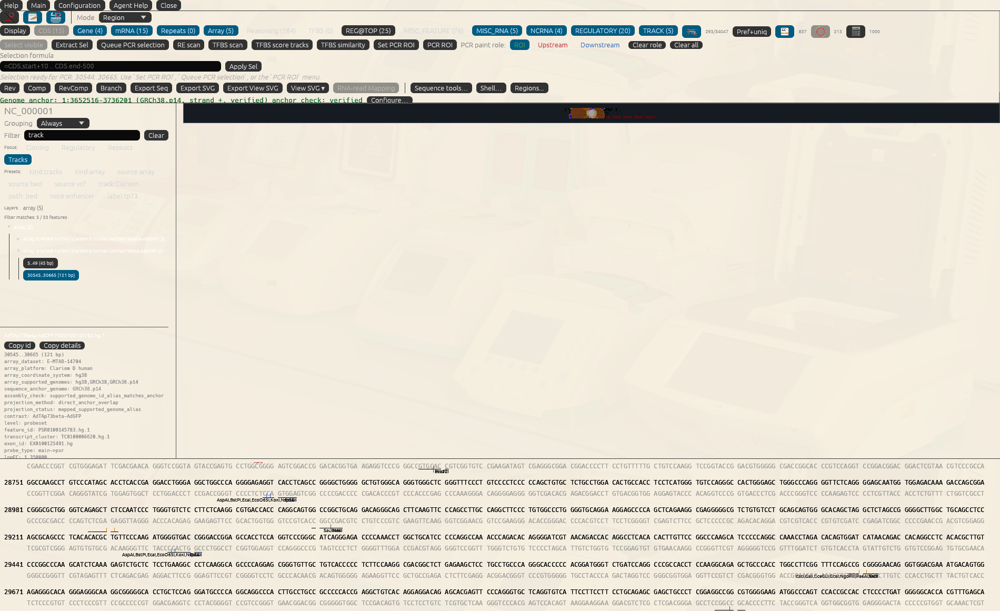
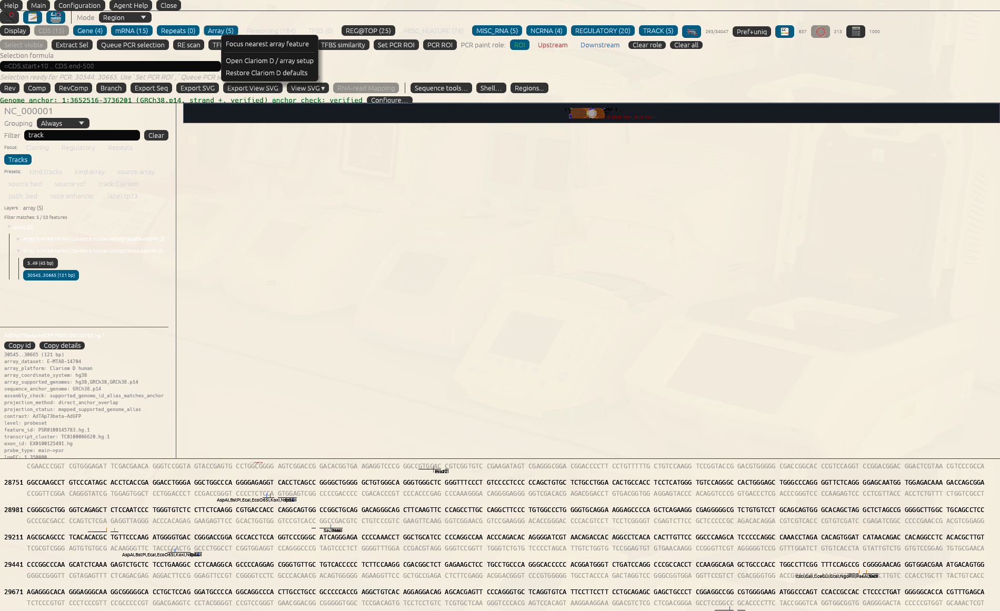

# Find Clariom D Evidence Along the TP73 Locus

> Which array probes cover the region I am inspecting, which contrast do their
> values describe, and what can an uncovered region tell me?

This 20-minute lesson starts with committed inputs, without CEL processing or
downloads. Probeset IDs and hg38 coordinates are derived from vendor annotation;
**all contrast statistics in this exercise are synthetic**. They are not
expression measurements from E-MTAB-14704 and must not support a disease claim.

**The short route:** inspect the manifest, project its five teaching rows, then
focus one Array feature and read its coordinates and contrast. Stop there on
the first pass. The public CEL workflow at the end is a different exercise.

## Before You Start

Run from the checkout root and use a disposable project. Keep the same state
path for every terminal command, for example `/tmp/clariom-lesson/state.json`
(create its parent directory first). CLI and unsaved GUI projects are separate.

Reuse the [TP73 GenBank record](../../test_files/tp73.ncbi.gb), RefSeq
NC_000001.11 REGION 3652516..3736201, and the
[vendor-subset manifest](../../test_files/fixtures/microarray_tracks/clariomd.tp73_vendor_subset.manifest.json).
Read [their provenance](../../test_files/fixtures/microarray_tracks/README.md).
Keep both contrast TSV files beside the manifest; their relative paths matter.

## 1. Choose the Correct File Route

**GUI:** open **Configuration -> Microarrays**. The shared GUI-hosted command
is `ui open configuration microarrays`. Review **Expected sources and file
roles** and **Detected in this checkout**. Suggestions are bounded local checks,
not permission to replace a path you selected or download missing files.

| File role | What it contributes | What it does not provide |
| --- | --- | --- |
| Vendor probeset/transcript annotation | IDs, coordinates and platform mapping | measured expression |
| CEL files | raw array experiment input | normalized contrasts or automatic assembly conversion |
| Sample metadata, IDF/SDRF | sample, condition and replicate identities | an expression effect by itself |
| Completed APT/R summary | normalized measured feature matrix | genomic coordinates without annotation |
| Analyzed contrast table | effect/statistics for a named comparison | proof of causation or isoform specificity |
| GENtle track manifest | coordinate system, contrast order and table paths | permission to silently run external analysis |

For the first lesson use prepared coordinate-bearing tables. Raw CEL processing
is a separate reviewed R/APT workflow, not a prerequisite for seeing an Array
track. A full-platform table with coordinate-less rows is not interchangeable
with the small projection-ready fixture.

## 2. Inspect the Manifest Before Projecting

```sh
gentle_cli --state /tmp/clariom-lesson/state.json arrays inspect-microarray-track test_files/fixtures/microarray_tracks/clariomd.tp73_vendor_subset.manifest.json
```

Look for hg38, the documented supported genome identities, and the two ordered
contrasts `AdTAp73alpha-AdGFP` then `AdTAp73beta-AdGFP`. The first TSV has three
rows and the second two. Keep the fixture's synthetic-statistics warning visible,
even though its dataset/platform names describe the vendor-derived context.

**Ask the inner agent:** "Inspect the committed Clariom D TP73 vendor-subset
manifest. Explain which fields are authentic coordinates and which statistics
are synthetic. Show the commands; do not fetch CEL files or run R/APT."

Inspection alone does not add sequence features. A missing table, incompatible
build or unrecognized coordinate source must be reported, not converted to zero.

## 3. Project onto the Anchored TP73 Sequence

**GUI:** choose **File -> Open Sequence...**, open `test_files/tp73.ncbi.gb` and
inspect its genome anchor. In that DNA window choose **Array setup...**. Inspect
its file-role help. This panel handles completed **probe-region helper output**;
it is not a direct manifest-import form. For this manifest exercise use the
`arrays inspect-microarray-track` / `project-microarray-track` commands in the
GUI-hosted **Agent Assistant**, using the actual open sequence ID. The general
Microarrays tab configures reusable resources; projection is sequence-specific.

**CLI / shared Shell:**

```sh
gentle_cli --state /tmp/clariom-lesson/state.json shell '/open file test_files/tp73.ncbi.gb --id tp73_array_lesson'
gentle_cli --state /tmp/clariom-lesson/state.json arrays project-microarray-track tp73_array_lesson test_files/fixtures/microarray_tracks/clariomd.tp73_vendor_subset.manifest.json --contrasts AdTAp73alpha-AdGFP,AdTAp73beta-AdGFP --level probeset --min-abs-logfc 0 --max-adj-p 1 --max-features 20 --clear-existing
```

For the live GUI project, omit `gentle_cli --state ...` and run the shared
command text through Agent Assistant after approval. A separate CLI projection
does not update an unsaved GUI project. Likewise, use `/open file ... --id ...`
in that host if you want to assign the example's exact sequence ID there.

`--clear-existing` is deliberate for this disposable exercise, not advice for a
valuable project: it replaces existing array features. Require normal project
mutation approval and save your original first. The zero effect cutoff and
p-value limit 1 retain the teaching rows; they are not significance thresholds.

The existing regression expects five parsed/imported rows, no wrong-chromosome
or nonoverlap rows, and anchor genome GRCh38.p14. Five features do **not** mean
five independent probesets: contrasts reuse probe coordinates. For alpha's
`PSR0100145779.hg.1`, genomic 3652520..3652564 inclusive corresponds to local
zero-based `[4,49)`, 45 bp. Check both coordinate conventions in its detail.

**GUI-hosted handoff:** `ui open sequence-window tp73_array_lesson` opens the
sequence when applied by Agent Assistant on the live project. A headless CLI
returns an unapplied UI receipt; it has not displayed your result.

## 4. Read the Array Track and Navigate

If the saved project reopens in **Cloning** focus, switch the left-hand focus to
**Tracks** first. A retained feature filter can otherwise hide correctly saved
Array features. Enable **Array (5)** and use **Fit Features** to bring the
projected intervals into view. The two contrast groups should contain three and
two rows respectively; expand a group and select an interval to inspect its
detail.



The retained Linux capture comes from the saved five-feature project. Its
selected detail shows the E-MTAB-14704 fixture context, Clariom D platform,
assembly check, projection status, named contrast, vendor probeset/transcript
cluster IDs and local interval. Those fields establish traceability, not a real
expression result.

These are raw evidence images, not the final high-contrast teaching views.
Open them at full size to inspect small labels; do not infer a missing feature
from the compressed map overview. The selected beta row is
`PSR0100145783.hg.1`, displayed at local bases 30545..30665 inclusive (121 bp).
It is a different row from the 45-bp `PSR0100145779.hg.1` coordinate example
above. Neither selection is a measured expression result.

The [capture record](../screenshots/microarray_evidence_gui_cli/native_20261104/evidence.json)
binds the PNGs and four committed input files. It records GUI producer
`503cb391` separately from CLI report producer `3839426f`; it is not evidence
that a newer binary has been natively accepted.
Captured by Glen (`smoe-bot`), retained in
[`37bc0cea`](https://github.com/smoe-bot/gentle_rs/commit/37bc0ceab467b09050fe4e998477af8c460b9347).

Inspect a projected feature's hover/detail:
probeset, transcript cluster, exon identifier, contrast, logFC and provenance.
Right-click Array and choose **Focus nearest array feature**. The viewer uses
the current selection midpoint, or visible-range midpoint without a selection.
It finds the nearest projected interval, not the nearest unimported vendor probe
anywhere in the genome.



Compare the same probeset across alpha/beta before comparing different regions.
Color summarizes a named effect, not signal detection, RNA-seq abundance or
evidence that a specific promoter is active. A broad or shared probe interval
does not establish unique transcript coverage. Fold change, adjusted p-value
and absolute expression are different quantities; none alone proves regulation.

### Read One Feature Before Comparing Colors

Use this evidence card beside the live hover/detail, rather than trying to read
small labels in a screenshot:

| Field | Check In This Exercise | Do Not Conclude |
| --- | --- | --- |
| Probeset and contrast | `PSR0100145779.hg.1`, alpha or beta contrast named explicitly | Two contrasts are two independent probes. |
| Coordinates | Genomic 3652520..3652564 inclusive; local `[4,49)` | A local offset is a second genomic coordinate. |
| Effect/statistics | Synthetic values from the named TSV | These are measured TP73 expression or CEL-analysis results. |
| Coverage | Only the projected intervals are represented | An uncovered interval has zero expression. |

Zoom or focus the live feature until its labels are readable. For your own
notes retain the feature ID, contrast, assembly and exact coordinate convention;
color alone loses those distinctions. Save the disposable project, close and
reopen it, then inspect the same row. An exported figure is not a saved project.

## 5. Recover When Nothing Is Visible

Distinguish **not configured**, **not projected**, **outside the viewport**,
**filtered out** and **incompatible coordinates**. Inspect the manifest and
projection counts first, enable the Array layer, clear unintended display
filters, then use nearest-feature focus or zoom out. A successful zero-overlap
projection is not an expression value of zero.

For a deliberately unsuitable input, inspect
`test_files/fixtures/microarray_tracks/clariomd.synthetic.hg19_projected.manifest.json`.
It declares hg19/GRCh37 source coordinates and an explicit map to hg38
chr1:2001..2100. That destination does not overlap this TP73 excerpt. Do not
relabel hg19 as hg38 or claim a liftover because the names look similar. In a
separate disposable copy, a supported map with no overlap should add no feature;
an incompatible/missing mapping is a distinct error. Neither means TP73 lacks
expression. The fixture README describes the exact map and its synthetic origin.

## Continue with Genuine Data

The Microarrays tab links the public
[E-MTAB-14704 landing page](https://www.ebi.ac.uk/biostudies/arrayexpress/studies/E-MTAB-14704)
and the manual Thermo Fisher/NetAffx Clariom D Human na36 hg38 annotation sources.
Follow the [checkout-local staging instructions](../../data/resources/affymetrix/clariom_d_human_na36_hg38/README.md).
Vendor downloads may require login and GENtle never obtains them silently.

Retrieve the correct CEL files and sample metadata, confirm platform and build,
then create/review an `arrays probe-regions` preflight before explicitly allowing
external execution. Do not describe this fixture as a replay of those CEL data.
Save/reopen your projected project and retain the actual input/contrast hashes
before joining evidence to [gene-informed assays](04-08_gene_assay_study_gui.md).

## Interpretation Exercise and Verification

Ask: why are five projected rows not five independent probesets? Why does an
empty intron viewport not establish zero expression? Why must hg19 and hg38
not be exchanged without a verified coordinate map?

Command/source/coordinate checks live in `scripts.test_tutorial_gap_lessons`.
The existing Rust regression
`project_microarray_track_uses_vendor_subset_on_tp73_genbank_anchor` covers the
five-row projection and exact `[4,49)` interval; reverse-anchor and explicit-map
regressions are separate. Glen/CI must rerun them on the selected SHA. The two
native screenshots are revision/checksum-bound Linux/Xvfb observations of the
saved synthetic-statistics fixture, not automated cross-platform GUI
acceptance. Genuine CEL replay and human interpretation remain pending. This
manual guide does not claim a real expression result.
