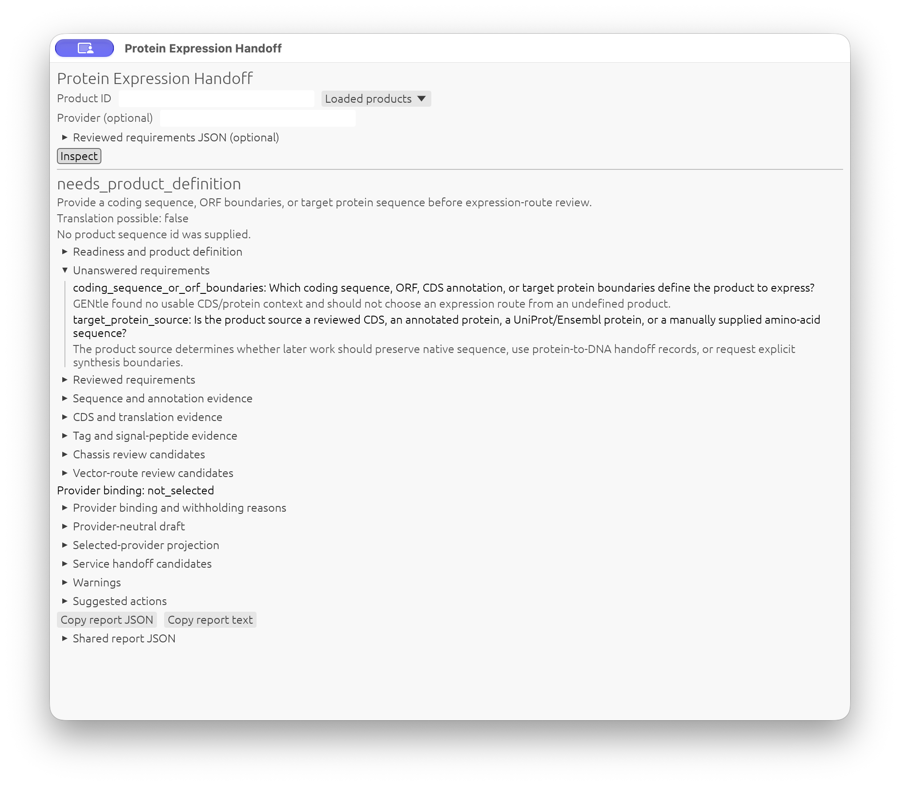
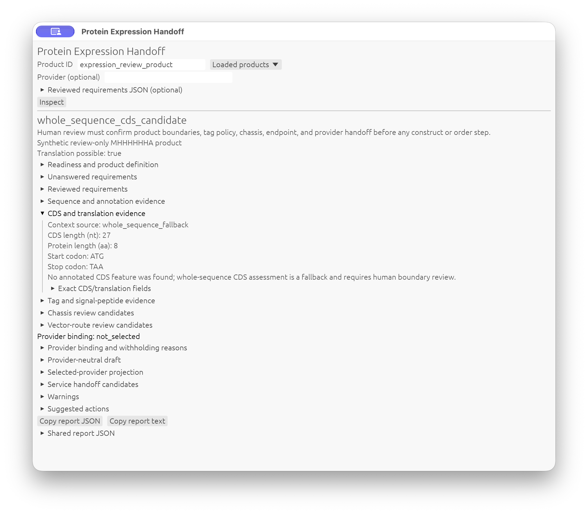
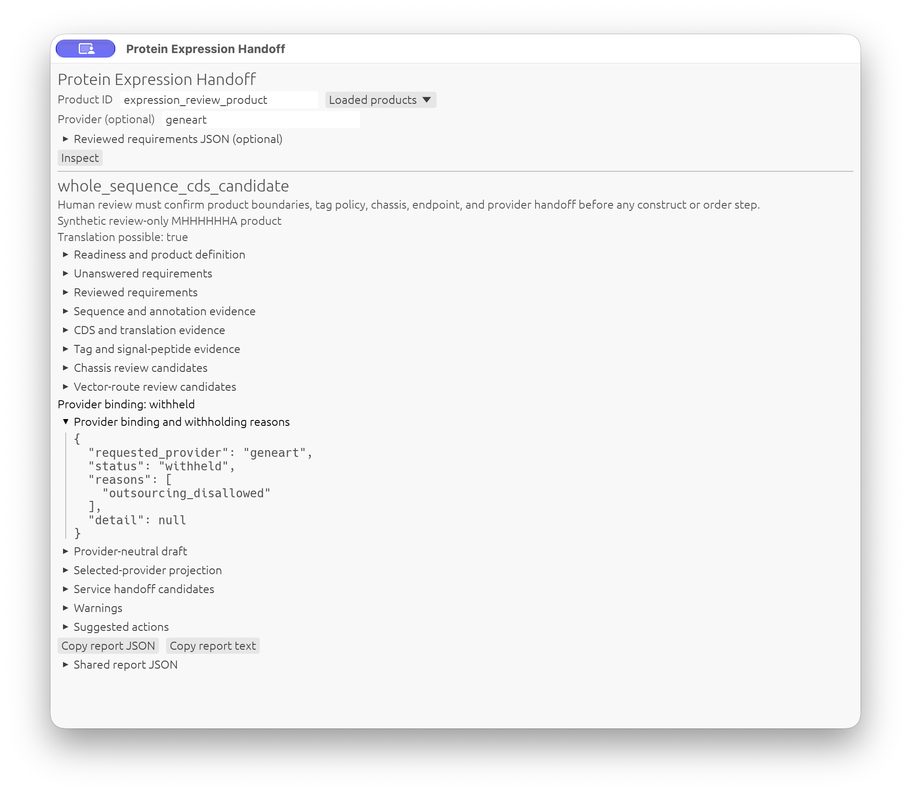
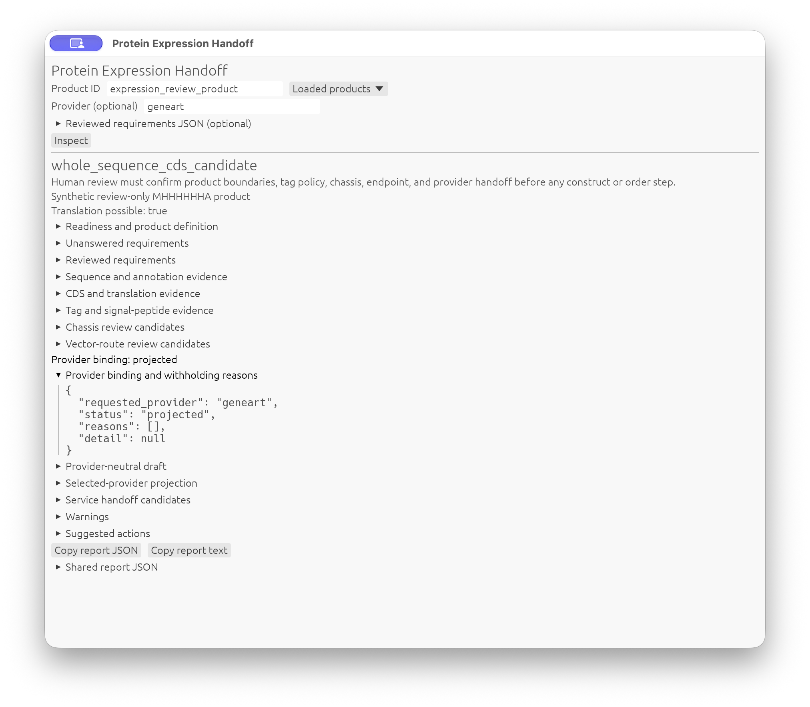

# Plan a High-Yield Protein-Expression Handoff

> Type: `GUI / CLI / agent walkthrough`
> Status: `manual/hybrid`
> Images: four real macOS inspector captures at `9f01098b`; integrated acceptance remains pending.
> Drift note: this page is hand-written, but every operational step routes
> through the shared `planning ...` and `services ...` shell/CLI contracts.

This tutorial shows how to turn the deliberately vague request "give me the
maximal amount of protein" into a reviewable GENtle planning report.

The key lesson is that "maximal protein" is not one biological objective.
Maximum total expression, soluble expression, active protein, purified protein,
secreted protein, and membrane-localized protein can point to different hosts,
vectors, tags, induction policies, purification endpoints, and providers.

GENtle therefore does not answer the request by choosing the strongest promoter
or one default expression host. It emits a read-only handoff report that makes
the missing decisions explicit.

## Safety Boundary

The `planning protein-expression-handoff` route does not:

- create constructs,
- optimize codons,
- select a final vector,
- submit a provider request,
- upload data to GeneArt or any other vendor,
- claim that a sequence is expression-ready.

It is a planning bridge for a human or agent who needs to decide what should
happen next.

## Step 1: Run The Minimal Handoff

From the repository root:

```bash
cargo run --quiet --bin gentle_cli -- planning protein-expression-handoff \
  --objective '{"schema":"gentle.planning_objective.v1","biological_intent":"protein_expression_max_yield"}' \
  --format json
```

Expected outcome:

- `schema` is `gentle.protein_expression_handoff.v2`
- `biological_intent` is `protein_expression_max_yield`
- `status` is `needs_product_definition`
- `product_definition.sequence_present` is `false`
- `product_readiness.status` is `needs_product_definition`
- the report contains `host_chassis_candidates[]`,
  `vector_route_candidates[]`, `missing_questions[]`,
  `neutral_service_draft`, `provider_binding`, `warnings[]`,
  `suggested_next_actions[]`, and sequence-readiness records

This is the safest first response when no product sequence has been loaded.
GENtle can still explain the choices, but it refuses to pretend that the
product is already defined. `neutral_service_draft` is null until a usable,
unambiguous product is present;
`provider_binding.status` is `not_selected`, `provider_projection` is null and
`service_handoff_candidates[]` is empty. Neither text nor structured actions
offer provider preflight or quote work. Legacy v1 JSON remains readable, but
new reports use v2 so the changed provider-selection behavior is explicit.

## Step 2: Read The Missing Questions First

Start with `missing_questions[]`. With no usable product context, the first
questions should ask which coding sequence, ORF, CDS annotation, or target
protein boundaries define the product.

Once a CDS or protein context is inferable, a high-yield protein plan should
answer:

- which yield metric matters: total, soluble, active, purified, secreted, or
  membrane-localized protein
- which purification endpoint matters: crude lysate, affinity capture, polished
  purity, activity assay, buffer, or delivery format
- which tag strategy is preferred, including N- vs C-terminal position,
  cleavage, retention/removal, and whether annotated tags or signal peptides
  should be preserved
- which chassis is acceptable: bacterial, yeast, insect, mammalian, cell-free,
  or provider-managed expression
- whether the protein needs disulfides, glycosylation, cofactors, secretion,
  membrane insertion, low-temperature expression, chaperones, or solubility
  tags
- whether toxicity is expected and what induction/repression policy is needed
- what scale, tag, purity, buffer, and delivery endpoint define success

Do not proceed to cloning or vendor handoff until those answers are explicit
enough for the biology.

## Step 3: Record Reviewed Requirements

For a complete offline rehearsal, first create a fresh disposable project from
this hand-crafted 27-bp synthetic product (M + six His + Ala + stop). Run from
the repository root; use a new state filename, not a private project. This
setup explicitly creates a sequence; the subsequent handoff is read-only.

```bash
cargo run --quiet --bin gentle_cli -- --state expression-review.gentle.json \
  workflow @docs/examples/workflows/protein_expression_review_starter.json
```

The product ID is `expression_review_product`. It is not a natural gene,
demonstrated expression construct or experimentally validated protein.

Use `gentle.protein_expression_requirements.v1` to make reviewed answers
portable instead of leaving them only in notes or chat. A complete synthetic
in-house example is provided at
`docs/examples/plans/protein_expression_requirements_in_house.json`.

```bash
cargo run --quiet --bin gentle_cli -- --state expression-review.gentle.json \
  planning protein-expression-handoff \
  --seq-id expression_review_product \
  --requirements @docs/examples/plans/protein_expression_requirements_in_house.json \
  --format text
```

Each optional topic record means that topic was reviewed. This distinction is
important for fields such as folding: `"folding": {}` means that the reviewer
knows of no special PTM, cofactor, chaperone, or disulfide requirement, while
an absent `folding` field remains unanswered.

GENtle validates essential fields and removes only the questions answered by
the supplied topics. A partial record is valid and deliberately leaves the
other questions visible. The example sets `outsourcing.allowed` to `false`, so
provider preflight and quote actions are withheld while in-house cloning
consultation remains available. Without a provider flag there is no provider
row at all; an explicit selection with this in-house record is `withheld` with
reason `outsourcing_disallowed`, not an executable provider request.

Replace the synthetic answers and reviewer label with project-specific,
human-reviewed requirements. These answers now populate
`neutral_service_draft`, using the existing
`gentle.external_service_delivery_route_request.v1` contract. Missing fields
remain absent; supplied `false` values and reviewed empty lists are retained.
The record does not yet rerank chassis/vector candidates.

Read the draft as a request, not an expression prediction:

- `source_target` identifies the exact DNA `seq_id` or protein `protein_seq_id`,
  its name, molecule type, bp/aa length, current readiness and observed
  `cds_assessment`. These are project references, not inline sequence letters.
  Protein-only targets explicitly mark coding DNA as `unresolved` and reverse
  translation as `not_performed`; selecting a provider does not manufacture DNA.
- `optimization_target` holds the reviewed yield goal, chassis, localization,
  folding/PTM/cofactor/chaperone and toxicity/induction requirements.
- `vector_spec` holds reviewed tag policy and any annotation-only tag evidence;
  it does not invent a vector or decide that an annotated tag must be retained.
- `delivery_options` holds yield goal and supplied scale, purification, purity,
  endotoxin, buffer, QC and delivery-format requirements.
- `request_metadata` carries the human-review boundary, supplied requirements
  ID/reviewer/date, service intent, unresolved question IDs, product readiness
  and nonclaims. A requested yield is not a prediction of expression, folding
  or synthesis success.

## Step 4: Interpret Chassis And Route Candidates

The report retains the following conservative chassis candidates:

- `e_coli`
- `yeast`
- `hek293`
- `insect_baculovirus`
- `cell_free`

These are review candidates, not final recommendations. `E. coli` appears
first because it is often the fastest and cheapest high-biomass screening
route, but the warning row should be read just as seriously: eukaryotic
processing, solubility, toxicity, secretion, membrane insertion, and activity
requirements can make a slower route more biologically correct.

The route candidates follow the same idea. They name plausible expression
routes and their missing inputs, while leaving the execution decision to the
reviewer.

## Step 5: Add A Product Sequence When One Exists

If the protein-coding product is already present in the GENtle project state,
pass its sequence id:

```bash
cargo run --quiet --bin gentle_cli -- --state expression-review.gentle.json \
  planning protein-expression-handoff \
  --seq-id expression_review_product \
  --objective '{"schema":"gentle.planning_objective.v1","biological_intent":"protein_expression_max_yield"}' \
  --format text
```

Expected difference:

- `product_definition.seq_id` records the supplied id
- `product_definition.sequence_present` tells whether the id is loaded
- if loaded, `sequence_context` records sequence name/type, nucleotide or
  protein length, feature count, GC percent/range, ambiguous bases, and
  relevant CDS/protein/tag annotations
- `cds_assessment` reports whether annotated CDS context or whole-sequence
  fallback context was used, plus nucleotide length, inferred protein length,
  start/stop sanity, internal stops, ambiguous codons, translation table, and
  warnings
- `tag_assessment` summarizes annotated affinity, solubility, epitope, or
  signal-tag context while keeping tag policy explicit
- if no usable CDS/protein context is found, the report asks for product
  boundaries instead of selecting an expression route
- if a CDS/protein context is inferable, the report shifts toward the
  expression-specific review questions
- `product_definition.readiness.status` determines in-house next actions:
  CDS candidates can point to cloning consultation, protein-only targets to
  reverse-translation review, and unresolved sequences to boundary inspection.
  Provider actions require the separate explicit selection described next.

This analysis is read-only. GENtle does not infer that the product is
expression-ready, codon-optimize it, mutate the sequence, create a construct,
choose a final host/vector/tag, or submit anything to a provider.

## Step 6: Choose A Provider Explicitly, If Outsourcing Is Allowed

When the product is usable and outsourcing is permitted but no provider is
selected, `select_protein_expression_provider` suggests `services providers list`.
Review that catalog, then choose `--provider PROVIDER_ID` explicitly. This is
discovery, not approval of every provider or a request to run a quote.

To rehearse the positive path without real-product permission, use **only** the
synthetic state from Step 3 and the separately labelled local-review fixture:

```bash
cargo run --quiet --bin gentle_cli -- --state expression-review.gentle.json \
  planning protein-expression-handoff --seq-id expression_review_product \
  --requirements @docs/examples/plans/protein_expression_requirements_review_only.json \
  --provider geneart --format json
```

Compare with the in-house record: this report can contain a provider projection
and local preflight action; neither command contacts GeneArt. Do not execute a
quote/artifact action merely because it is suggested, and never apply these
synthetic permissions to a real product.

First prepare your own reviewed `reviewed-expression.json`; this is a learner
input, not a bundled file. Only if outsourcing is actually approved, set
`outsourcing.allowed` to `true` and record approved provider IDs (for example
`["geneart"]`). Do not change the supplied in-house example or infer permission
from a chat message. Run:

```bash
cargo run --quiet --bin gentle_cli -- --state path/to/project.gentle.json \
  planning protein-expression-handoff \
  --seq-id target_cds_or_protein_product \
  --requirements @reviewed-expression.json \
  --provider geneart --format json
```

With a usable, unambiguous product and catalog capability:

- `provider_binding.status` is `projected`, not submitted or biologically ready.
- `provider_projection` is `gentle.external_service_request.v1`, with
  `provider = geneart`, `service_kind = protein_expression` and the unchanged
  neutral draft fields. No vendor template supplies missing answers.
- `service_handoff_candidates[0]` has `product_draft_review_required`, an empty
  legacy `example_request_path`, that same projection as `draft_request_preview`,
  and a product-specific local preflight `shell_line`.
- The same preflight appears in `suggested_next_actions[]`. It does not submit
  anything; GeneArt's bundled local preflight keeps
  `direct_submission_available = false`.

Read `provider_binding.reasons` if selection is withheld: missing outsourcing
permission, disallowed outsourcing, an excluding non-empty allowlist, missing
or multiple-CDS product identity, unusable product readiness, or an unsupported
provider/capability all suppress provider rows and commands. Partial biological
requirements may still permit a **draft** projection and local preflight, but
their question IDs remain visible. They suppress quote suggestions.
An empty `approved_providers` list chooses nobody and grants no blanket external
consent: outsourcing must still be allowed and a supported provider explicitly
selected for local review. It is never submission or purchase permission.

After checking the exact product and resolving all questions, a CDS handoff can
offer `prepare_provider_protein_expression_quote_after_review`, but only if
the canonical local preflight also reports `eligible = true` and
`quote_handoff_available = true`. A provider catalog may support expression
without offering this quote route, or may require source facts not yet supplied;
complete biological answers do not override either restriction. Protein-only
targets retain reverse-translation/provider-target review rather than a quote
shortcut. Nothing runs just because an action is listed. The draft route never
writes files, changes project state, contacts a provider or submits an order.
Provider commands reference project IDs, not embedded sequence letters.

The bundled GeneArt request remains a separate **synthetic rehearsal**, never
the source of the selected product's draft:

```bash
cargo run --quiet --bin gentle_cli -- services project-preflight \
  @docs/examples/external_services/geneart_protein_expression_request.json
```

Expected outcome:

- schema is `gentle.external_service_preflight.v1`
- provider is `geneart`
- service kind is `protein_expression`
- direct submission remains unavailable
- warnings keep the human-review boundary visible

The bundled quote example below is likewise only a rehearsal:

```bash
cargo run --quiet --bin gentle_cli -- services project-quote \
  @docs/examples/external_services/geneart_protein_expression_request.json
```

This remains a local handoff artifact. It does not upload data, request pricing
from a provider API, or submit an order.

Never substitute the bundled tutorial protein for the selected project
product. If no product-specific action is present, return to the missing
questions instead of preparing a quote packet.

## GUI Inspection Of The Same Handoff

The inspector makes the same decisions inspectable without reading a terminal
report. It does **not** introduce another expression algorithm. Start with the
fresh synthetic project from Step 3, then open that saved state in GENtle. Do
not start from a private product or reuse the fixture's permissions for one.

Open **Services > Protein Expression Handoff...**, or use the command palette's
**Protein Expression Handoff** entry. The GUI Shell and external agents can use:

```text
ui open protein-expression-handoff
ui focus protein-expression-handoff
ui close protein-expression-handoff
```

These intents take no product/provider arguments; they address one window.
A headless host only records the intent. The `planning` command is still the
route to obtain a report without a GUI.

1. Leave **Product ID**, **Provider (optional)** and requirements empty, then
   press **Inspect**. Expect `needs_product_definition`, the coding-boundary
   questions, no neutral draft and no provider projection. Even though a
   product is loaded, the window does not silently choose it. Product identity
   matters: high-yield advice about the wrong CDS is not useful advice.
2. Select `expression_review_product` from **Loaded products** (or enter that
   exact ID), keeping provider and requirements blank, and inspect again.
   Review **Readiness and product definition**, **Sequence and annotation
   evidence**, **CDS and translation evidence**, and **Tag and signal-peptide
   evidence**. Compare their fields with Step 5's shared-shell output, using
   `--format text` when comparing the whole JSON including `text_report`.
   Timestamps differ between inspections. Sequence/CDS candidates are not an
   expression-success prediction, and synthetic histidines do not substitute
   for an explicit tag-retention decision.
3. Paste the complete contents of
   [`protein_expression_requirements_in_house.json`](../examples/plans/protein_expression_requirements_in_house.json)
   into **Reviewed requirements JSON (optional)**; the GUI field accepts
   inline JSON, not an `@FILE` reference. With provider blank, expect
   `provider_binding.status = not_selected`, a neutral draft, no provider
   projection and no service handoff candidates. Inspect the unchanged chassis
   and vector-route review candidates; their order is not a product-specific
   ranking. A lower number does not prove a better host or more soluble protein.
4. Enter `geneart` explicitly in **Provider (optional)**, keeping those in-house
   requirements, and inspect. Expect `withheld` and `outsourcing_disallowed`
   under **Provider binding and withholding reasons**, with provider projection
   null and no provider actions. Naming a provider is not outsourcing permission.
5. For this synthetic rehearsal **only**, replace the pasted requirements with
   [`protein_expression_requirements_review_only.json`](../examples/plans/protein_expression_requirements_review_only.json).
   Keep `geneart` selected and inspect. Expect `projected` with the same neutral
   source/optimization/vector/delivery fields retained in the selected-provider
   projection. Check the shared `suggested_next_actions[]`, warnings and review
   gate. Projection is a local request value, never provider acceptance.
6. Use **Copy report JSON** and **Copy report text** to compare with Step 6's
   shared command (with `--format text` for the text-bearing JSON). Expand
   **Suggested actions** and copy one command if useful, but do not execute a
   quote/export command for this rehearsal. Copying an action merely places
   the shared `shell_line` on the clipboard; the inspector has no Run, Submit
   or Order action and does not contact a provider.
7. Change or clear the product ID: the old report must disappear until another
   inspection. An actual project edit or reopening/replacing the project must
   also discard late results and require inspection again. Close during a
   pending inspection, then reopen/focus: inputs remain local, no report from
   the abandoned receiver is adopted, and the product/provider are not reset
   to defaults. Stale evidence must not describe a newly selected product.

For an acceptance run, retain the copied report and the exact source revision,
compare scientific fields with the equivalent shared command, and verify that
inspection/copy/open/focus/close leave project bytes and undo/redo counts
unchanged. Separate deliberate project edits in checkpoint 7 from those
read-only checks. Test a small window as well: inputs wrap and the report scrolls
vertically so requirements and actions remain reachable. No screenshot capture
or native acceptance is implied by this walkthrough. Rust/runtime/native checks
remain for Glen/CI; this chapter stays `manual/hybrid`, not an automated GUI pass.

## Interface Parity

The four entry points inspect the same report, not four expression-design
implementations:

| Interface | Entry point | State boundary |
| --- | --- | --- |
| CLI / GUI Shell | `planning protein-expression-handoff` with the reviewed operands above | CLI saved state, or current GUI state in the GUI Shell |
| GUI | `Services > Protein Expression Handoff...`, then **Inspect** | Current project snapshot; inputs remain local to the inspector |
| MCP / outer agent | Named `protein_expression_handoff` tool | Saved `state_path`; unsaved GUI edits are not visible |
| Inner agent | A reviewed suggestion of the same `planning` command, or `ui open protein-expression-handoff` | The GUI's shared command executor, without another biology layer |

For example, an external MCP caller can send this `tools/call` parameter object
after Step 3 has saved the synthetic starter:

```json
{
  "name": "protein_expression_handoff",
  "arguments": {
    "state_path": "expression-review.gentle.json",
    "seq_id": "expression_review_product",
    "format": "text"
  }
}
```

The report appears in `structuredContent`. No provider or reviewed requirements
were supplied, so neither may be inferred. MCP `requirements` and `objective`
accept inline JSON **objects**, not paths or `@FILE` strings. For instance,
adding the following fields rehearses an explicit in-house refusal while
keeping every other biological question unanswered:

```json
{
  "provider": "geneart",
  "requirements": {
    "schema": "gentle.protein_expression_requirements.v1",
    "outsourcing": {"allowed": false, "approved_providers": []}
  }
}
```

This must yield `withheld` / `outsourcing_disallowed`, not a fallback provider.
Do not add `confirm`: this tool is read-only, accepts no mutation approval and
never executes its suggested actions. Omit `format` for JSON without the text
presentation; choose `text` to compare the inspector's text-bearing report.
Use identical saved product, objective/profile, requirements, provider and
format when comparing all fields, excluding only `generated_at_unix_ms`.
Fresh source tests are not a substitute for executing those adapters.

An inner-agent practice prompt is:

```text
Review protein expression for the loaded synthetic expression_review_product.
Propose the read-only planning protein-expression-handoff command for review.
Keep unknown requirements unanswered and choose no provider. Show the shared
Protein Expression Handoff inspector as an alternative. Do not execute any
suggested preflight, quote, synthesis or ordering action.
```

The deterministic acceptance boundary is `AgentResponse` -> shared parser ->
shared report and the GUI result viewer. Model prose quality and biological
recommendation quality are separate; no live model test is claimed here.
After running a suggestion, the model has an execution receipt, not the report
rows. Review the JSON in the Agent Assistant's result panel and choose
**Use reviewed result in next prompt**, then review/send that draft explicitly
if you want the model to discuss the actual evidence. This shares data, not
permission to run a provider action. The inspector's copy buttons do not send
anything to an agent.

## Required Tutorial Screenshots

Four real inspector screenshots were captured on macOS from the owner-rebuilt
binary reporting `9f01098b749c79fb5c9eccfcfb184bb085c63357` on 2026-10-18.
These are manual teaching captures, not automated GUI acceptance or proof that
the newer MCP/inner-agent changes run correctly. The
[capture receipt and limits](../screenshots/tutorial_gui_acceptance/protein_expression_handoff_cli/README.md)
bind the binary, starter/project hashes, requests and raw PNG hashes. No
model/provider was contacted; no suggested service command was executed.

Use the Step 3 synthetic project in a fresh profile and a verified GUI binary
containing this inspector. The owner's tutorial-image request authorizes these
four window-bound synthetic captures only, not background/desktop capture,
private projects, provider contact or model calls. Capture the actual inspector
window after **Inspect** finishes, not the project overview or a still-running
spinner. Close unrelated windows and exclude account names/private paths.

| Retained checkpoint / filename | Visible content |
| --- | --- |
| `missing_product.raw.png` | GUI step 1: blank product/provider, `needs_product_definition` and unanswered product-boundary questions. Caption: "A loaded project does not silently choose the product to express." |
| `neutral_product.raw.png` | GUI steps 2-3: explicit synthetic product, expanded CDS fallback evidence, human-review gate and `not_selected` binding. |
| `provider_withheld.raw.png` | GUI step 4: explicit `geneart`, in-house requirements, `withheld` and expanded `outsourcing_disallowed`. Caption: "Naming a provider cannot override the reviewed in-house restriction." |
| `provider_projected.raw.png` | GUI step 5: synthetic review-only requirements, `projected` with expanded binding details, and report-copy controls. The full projection and suggested commands are collapsed in this image. |

### Missing Product



The loaded project contains a product, but the blank selector leaves its
boundaries unanswered. Opening the inspector is not product selection.

### Neutral Product Review



The 27-nt whole-sequence CDS is explicitly a fallback, not an annotation.
`Translation possible: true` does not remove the human boundary-review gate.

### Withheld Provider



The exact `outsourcing_disallowed` reason explains why selecting GeneArt does
not authorize a provider draft under these in-house requirements.

### Local Provider Projection



The separate review-only fixture allows this local projection. `projected` is
not a quote, submission, order approval or promise of expression. Copying a
report is separate from executing any proposed next step.

With `gui-test-support`, the window is
`window.protein_expression_handoff`; controls are
`protein_expression.product`, `.provider`, `.requirements`, `.inspect`,
`.copy_json` and `.copy_text`. The `.status` and `.provider_binding` items retain
the actual report status in `outcome_role`. These are post-layout locators and
observations only, not an input-injection API and not a scientific oracle. Expand
the named sections and scroll until the relevant content is actually visible
before capturing; a rectangle existing in a snapshot is not screenshot proof.

For a full acceptance replay, retain each raw PNG, source revision and binary SHA-256,
starter/project hashes, matching shared JSON report, semantic snapshot,
window/geometry/scale, capture tool and time, and hashes/transforms of any
crop/annotation. Keep raw captures as the visual evidence. Stage the four
selected images and provenance under
`docs/screenshots/tutorial_gui_acceptance/protein_expression_handoff_cli/`,
review readability, and update real image references and source `graphics`
metadata with actual capture dates. This manual archive has no retained
semantic snapshot or typed GUI report JSON; those remain acceptance work,
not fabricated green receipts. The visual checkout checker validates the
manual image bindings. The X11 screenshot publisher requires its own complete
runner evidence; 09.03 remains manual/hybrid and has no full generic-runner
GUI acceptance contract yet. A screenshot is not a scientific oracle.

## Step 7: Ask For Cloning Strategy Only After Expression Constraints

Once the product metric, host, folding/PTM needs, toxicity policy, and endpoint
are known, ask the cloning consultation to rank routine families:

```bash
cargo run --quiet --bin gentle_cli -- planning consult cloning \
  --objective '{"schema":"gentle.planning_objective.v1","biological_intent":"protein_expression_max_yield"}' \
  --format json
```

That report answers a different question: which cloning routine and helper
vector path should be considered. It should not replace the protein-expression
handoff; it should follow it.

## ClawBio Use

MCP clients should use the named `protein_expression_handoff` tool described
above. The existing `agent_execute_plan` tool remains an alternative when an
outer orchestrator already has a reviewed `kind: shell` candidate containing
the same command; neither path calls a model to compute this report. Direct
CLI, shared shell, GUI inspector, MCP and inner-agent command-path regressions
must run in Glen/CI before runtime acceptance.

This chapter stays manual/hybrid: the generated project-chapter runner executes
engine operations, while the planning handoff is a shared-shell report, not a
workflow operation. The starter is an executable offline workflow; the full
review tutorial is not falsely labelled a generated/checked chapter. Ranking,
native inspector acceptance and wet-lab usefulness remain separate from this
source/command contract.

For ClawBio or another agent, the safe instruction is:

- call `planning protein-expression-handoff`
- quote `biological_intent`, `product_definition`,
  `product_readiness`, `requirements`, `sequence_context`, `cds_assessment`,
  `tag_assessment`,
  `host_chassis_candidates`, `vector_route_candidates`, `missing_questions`,
  `neutral_service_draft`, `provider_binding`, `provider_projection`,
  `service_handoff_candidates`, and `suggested_next_actions`
- omit `--provider` until the user actually selects an allowed provider; explain
  withheld reasons instead of substituting GeneArt or its example protein
- do not invent a final expression host, promoter, vector, tag, or vendor
  submission from chat context alone

GUI note: the read-only inspector is available through the Services menu and
shared UI intent in this chapter. It renders the same v2 report; provider
selection is explicit and suggestions are copy-only. The four macOS captures
above illustrate the inspector; integrated runtime/native acceptance remains
pending, including execution of the new MCP/inner-agent parity checks.

For an offline replay with an already-built candidate CLI, run:

```bash
GENTLE_TUTORIAL_BIN_DIR=/absolute/path/to/candidate/bin \
  python3 -m unittest scripts.test_release_workflow_tutorials -v
```

This creates the synthetic starter in a temporary project, checks neutral,
in-house/withheld and explicitly selected provider reports, and asserts that
review does not rewrite the saved project or create artifacts. It does not
execute suggested preflight/quote actions or contact a provider. With no binary
directory supplied, the runtime tests explicitly skip. Native GUI and human
scientific acceptance are separate.

## Expected Outcome

At the end of this tutorial you should have:

- a `gentle.protein_expression_handoff.v2` report (legacy v1 remains readable)
- a clear distinction between product definition and expression route choice
- a versioned record of reviewed protein-expression requirements
- read-only sequence/readiness/CDS/tag context when a sequence id is supplied
- ranked but review-required chassis and route candidates
- explicit missing biological questions for either product boundaries or
  expression-route review
- a neutral draft, plus local provider preflight/quote suggestions only after
  explicit permitted provider binding and the applicable review gates
- no created construct and no vendor-side action

## Feedback

If this tutorial is confusing, execution-stale, biologically suspect, or
missing a useful figure, please open the matching tutorial issue template and
include the context copied from GENtle Help -> Tutorial -> Copy Feedback
Context.

- Tutorial title:
- Tutorial/chapter id:
- Step reached:
- Expected vs. actual:
- Interface used: GUI / CLI / Agent Assistant / ClawBio

Paste the Tutorial feedback context here:

```text

```
