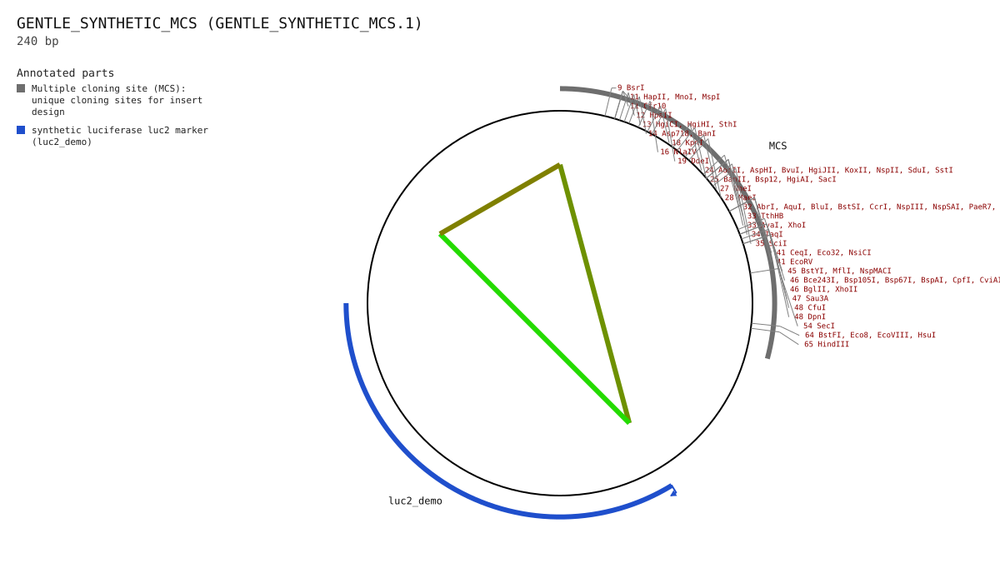
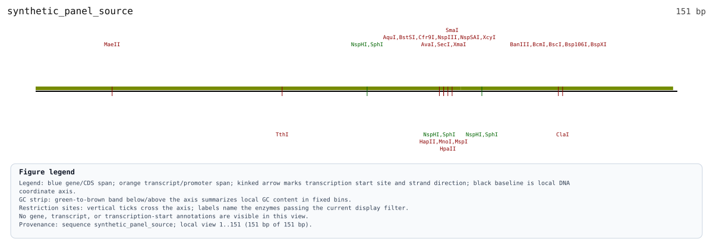

# 09.04 - Plan Cloning Work, Waiting And Cost With Protocol-Publishing Suppliers

This offline walkthrough is for a wet-lab biologist deciding how much bench
attention, waiting and purchasing a cloning idea might require. Promega's
pGL4.10[luc2] is the worked product example because the owner prefers it, not
because GENtle has ranked it above other suppliers.

**Question:** "I have a candidate regulatory insert. Which vector and protocol
can I justify reviewing, and what resources would the cloning work require?"

**Outcome:** validate an explicitly synthetic vector with the existing 08.09
workflow, inspect its proposed insert/products, compare advisory time/cost,
find protocol-publishing suppliers and retain a decision sheet. No proposed
construct is materialized, supplier contacted, sequence downloaded or order
prepared. Loading the two teaching inputs is an explicit project mutation.

**Route:** vector identity -> sequence/MCS review -> protocol applicability ->
resource estimate -> supplier evidence -> human decision. Catalog administration
is an optional [advanced exercise](../examples/planning/supplier_catalog_update_exercise.md),
not a prerequisite for choosing a vector.

## 1. Keep Four Kinds Of Evidence Apart

| Question | Evidence to inspect | What it does not establish |
| --- | --- | --- |
| Which product? | Promega pGL4.10[luc2], E6651; official product page and TM259 manual | That another pGL4 vector is interchangeable |
| Which actual DNA? | For Promega: AY738222.1, 4,242 bp, circular, still requiring acquired-sequence validation. In this offline exercise: the separately identified 240 bp synthetic vector | That the synthetic fixture is pGL4.10 or a product name proves DNA identity |
| Which laboratory procedure? | Current supplier protocol, exact enzymes/insert/vector, and local review | That a readable PDF is an executable GENtle workflow |
| How much effort and cost? | Shared planning estimate and the declared local profile below | That synthetic defaults are measured Promega protocol durations or a quotation |

pGL4.10[luc2] is a promoterless luciferase reporter vector: an inserted region
can be investigated in a reporter experiment. A vector listing or planning
score does not predict luciferase activity, autonomous promoter function or
successful cloning. This is not a generic high-yield protein-expression vector;
use [09.03](./09-03_protein_expression_handoff_cli.md) for that separate question.

Official references: [Promega product E6651](https://www.promega.com/products/luciferase-assays/genetic-reporter-vectors-and-cell-lines/promoterless-firefly-luciferase-basic-vectors/?catNum=E6651),
[pGL4 technical manual TM259](https://worldwide.promega.com/-/media/files/resources/protocols/technical-manuals/0/pgl4-luciferase-reporter-vectors-protocol.pdf?rev=395cb76a0eed4807ae0bbd6f67b7bb77&sc_lang=en).
Opening these is an optional explicit network action; the exercise does not
retrieve them. The commercial vector sequence is not bundled.

## 2. Start With A Disposable Offline Project

From the repository root, use an already-built `gentle_cli` on your PATH:

```bash
ROOT="$PWD"
GENTLE_CLI="$(command -v gentle_cli)"
test -n "$GENTLE_CLI"
RUN="$(mktemp -d "${TMPDIR:-/tmp}/gentle-planning-09-04.XXXXXX")"
RUN="$(cd "$RUN" && pwd -P)"
STATE="$RUN/tutorial.gentle.json"
export GENTLE_ASSET_ROOT="$ROOT"
export GENTLE_SYSTEM_CONFIG_ROOT="$RUN/system"
export XDG_CONFIG_HOME="$RUN/user"
export GENTLE_PROJECT_ROOT="$RUN/project"
g() { "$GENTLE_CLI" --state "$STATE" --full-report "$@"; }
g planning profile show --scope effective
g planning profile set @docs/examples/planning/cloning_in_stock.json --scope project_override
```

The profile-setting step is an explicit project mutation. Use this disposable
state, not your study. Read the [synthetic input provenance](../examples/planning/README.md).
Its EUR amounts and availability are teaching values, not Promega prices,
physical stock checks or an assertion about what your laboratory owns.

### 2.1 Validate A Vector Before Borrowing Its Name

Reuse [08.09's existing vector-validation workflow](generated/chapters/08-09_promoter_reporter_panel_planning_offline.md).
Its 240 bp circular vector has a synthetic MCS at `1..70` and an artificial
`luc2_demo` marker at `100..180` (1-based inclusive); the insert is 151 bp.
It contains neither a functional luciferase reporter nor a demonstrated origin
or selection system. Do not invent an antibiotic marker or bacterial host.
Promega's manual is **not applicable to this fixture**.

This Python block only copies the canonical workflow and binds its existing
input/output paths. It does not implement vector validation or select enzymes.
Run from the same repository root; use a fresh `$RUN` for a repeat exercise.

```bash
python3 - "$ROOT" "$RUN" <<'PY'
import copy, json, pathlib, sys
root, run = (pathlib.Path(p).resolve() for p in sys.argv[1:])
source = root / "docs/examples/workflows/promoter_reporter_panel_planning_offline.json"
example = json.loads(source.read_bytes())
for index, operation in enumerate(example["workflow"]["ops"]):
    if "LoadFile" in operation:
        operation["LoadFile"]["path"] = str(root / operation["LoadFile"]["path"])
    elif "RenderSequenceSvg" in operation:
        operation["RenderSequenceSvg"]["path"] = str(run / pathlib.Path(operation["RenderSequenceSvg"]["path"]).name)
    elif "PlanPromoterReporterPanel" in operation:
        request = operation["PlanPromoterReporterPanel"]["request"]
        request["helper_catalog_path"] = str(root / request["helper_catalog_path"])
        for member in request["members"]:
            member["candidate_set_path"] = str(root / member["candidate_set_path"])
        request["output_dir"] = str(run / "planned-products")
    else:
        raise SystemExit(f"Review changed canonical workflow operation {index}")
example["required_files"] = [str(root / p) for p in example["required_files"]]
request = copy.deepcopy(next(op["PlanPromoterReporterPanel"]["request"]
                            for op in example["workflow"]["ops"] if "PlanPromoterReporterPanel" in op))
for name, value in (("vector-workflow.json", example), ("vector-request.json", request)):
    with (run / name).open("x", encoding="utf-8", newline="\n") as handle:
        json.dump(value, handle, indent=2)
        handle.write("\n")
PY
g workflow @"$RUN/vector-workflow.json" > "$RUN/vector-workflow-report.json"
g promoters panel-plan @"$RUN/vector-request.json" --path "$RUN/vector-proposal.json" > "$RUN/vector-plan-report.json"
```

The workflow loads only `synthetic_panel_vector` and `synthetic_panel_source`,
exports their maps and plans the panel. The second command retains a proposal
file for inspection; it does not materialize products. Review:

| In `vector-proposal.json` | What to inspect |
| --- | --- |
| `vector_validation` | `verified` **against Synthetic panel vector only**; expected/observed accession, 240 bp, circular topology and each required-feature check |
| `vector_sequence_sha256`, `helper_catalog` | Exact sequence and catalog bindings; not a signature or proof of physical tube contents |
| `mcs_start_0based`, `mcs_end_0based_exclusive` | `0..70`, the same interval as the map's `1..70` |
| `cloning_strategy` | Selected directional sites or explicit fallback, per-insert site audits, blockers and warnings; never select an enzyme merely because the MCS lists it |
| `products`, `workflow` | Predicted circular wild-type/motif-mutant products, insert orientation and retained marker; not products present in project state |
| `approval_required`, `nonclaims` | Approval is still required. A motif change is not proof of weaker luciferase activity |

These existing 08.09 figures show the **teaching inputs**, not a pGL4.10 map or
native GUI screenshots. The two newly exported maps in `$RUN` should describe
the same input geometry; source/profile differences can change presentation.





**Molecular reading:** the insert is proposed at the validated MCS while the
marker remains in the backbone. Inspect the proposal's actual workflow/product
fields for enzyme choice and orientation; the pictures alone do not establish
those facts. Keep this separate from section 3's dependency-only bench graph.
Stop before 08.09's materialization step. No `panel-materialize` command is
required here, and changing the catalog label to Promega must not validate the
synthetic DNA as pGL4.10.

### 2.2 Decide Whether A Protocol Actually Applies

For a real vector, review the acquired sequence and the **exact** product manual
before choosing a cloning method. For Promega, TM259 covers multiple pGL4
vectors; its title alone cannot establish applicability to E6651.

| Review question | Evidence to retain / stop condition |
| --- | --- |
| Is this the exact vector? | Product/catalog ID, accession/version, sequence hash, topology, annotated MCS, reporter orientation, host and selection system; stop at a mismatch or an unknown essential property |
| Which instructions apply? | Document URL/local origin, title, revision/date, retained raw-file SHA-256 and relevant page/section; a catalog's `checked_on` is not a document hash |
| Are the inputs compatible? | Vector and insert geometry, enzyme/site audits or overlap design, required materials/equipment and the protocol's stated input constraints; a supplier match is not an applicability verdict |
| What does successful review require? | Appropriate empty-vector/positive controls, sequence/junction confirmation and the intended assay readout; controls and acceptance remain human-reviewed |
| What is still unknown? | Missing document bytes, unreviewed instructions, quantities, costs, stock or timing; do not replace them with synthetic estimates |

Offline answer for this chapter: **real Promega sequence/protocol applicability
is not evaluated**. Keep the checklist open in the decision sheet. GENtle has
not retained or normalized TM259, and no vendor procedure has been approved.

## 3. Separate Bench Attention From Waiting

```bash
g routines explain restriction.digest_ligate_extract_sticky > "$RUN/in-stock.json"
g planning consult cloning --format text
g planning consult cloning --objective '{"schema":"gentle.planning_objective.v1","helper_profile_id":"Reporter Promega Luciferase AY738222 (online)"}' --format json > "$RUN/promega-context.json"
g routines compare restriction.digest_ligate_extract_sticky gibson.two_fragment_overlap_preview
```

In `in-stock.json`, find `planning.estimate`, schema
`gentle.planning_estimate.v2`. The same estimate is used by consultation,
routine listing, explanation, comparison and Routine Assistant.
The second consultation names the existing Promega helper explicitly; inspect
`objective_summary.objective.helper_profile_id` and `vector_candidates` to see
that choice. It changes planning context, not supplier selection or sequence
validation. It does not prepare/download the helper or prove enzyme/insert
compatibility. The unbound consultation is retained for comparison.

| Typical scenario, no delays | Expected value | Why you care |
| --- | --- | --- |
| `hands_on_hours.typical` | 0.8 h | Bench attention is not the whole time until the next decision |
| `unattended_hours.typical` | 2.6 h | Incubation still occupies elapsed time without continuous human work |
| `elapsed_hours.typical` | 3.2 h | Dependency-compatible preparation overlaps; do not add every step serially |
| `step_model` / `estimated_time_hours_basis` | `present` / `step_model_critical_path` | These identify the origin of the displayed scalar |
| `explanation.time_policy.hours` | 6 h | Preserved legacy proxy for ranking and the time guardrail; not measured bench time |

Inspect `schedule[]`: step IDs, dependencies, earliest start/finish ranges and
source notes explain the calculation. `explanation.critical_paths` records a
separate path for minimum, typical and maximum scenarios. These are scenarios,
not probabilities or confidence intervals. Human work plus unattended work is
3.4 h, but the dependency critical path is 3.2 h.

The branch preparing later ligation materials can overlap the digest branch.
This is idealized dependency-only overlap, **not** a staff, equipment-capacity,
calendar or collision-free booking schedule. Transformation, colony screening,
sequencing and experimental success are not silently included. The figures are
hand-authored synthetic allowances, not a Promega protocol or timings measured
in a laboratory. The in-silico digest/ligation/extraction macro is a different
thing and is not executed by `routines explain`.

In the Gibson comparison, the three breakdown ranges are `null`/`unknown`,
`step_model=absent`, and the scalar has basis `legacy_family_scalar`.
Only the restriction/ligation routine currently has a step model. A missing
breakdown does not mean zero effort, nor does comparing differently based
scalars prove which method is faster in your laboratory.

Giving one procedure a richer description must not, by itself, make it win a
comparison. `composite_meta_score` and the `max_time_hours` guardrail therefore
retain the **old family/base scalar plus delays** for every routine, separately
recorded in `explanation.time_policy`. Here that proxy is 6 h, even though the
displayed synthetic critical path is 3.2 h. Changing the bench model cannot
change ordering or a guardrail verdict. A guardrail pass is not a promise that
the experiment, or even the displayed maximum scenario, fits within that time.
Historical reports missing the policy record display its basis as unknown;
do not guess it from their elapsed value. A calibrated timing comparison would
need a separately reviewed policy and suitable evidence for every method.

Try the policy limit explicitly while the in-stock profile is still active:

```bash
g planning consult cloning --objective '{"schema":"gentle.planning_objective.v1","max_time_hours":5}' --format json > "$RUN/time-guardrail.json"
```

Find the `restriction` row in `strategy_candidates`. Its estimate has
`passes_guardrails=false` and a `max_time_hours_exceeded (6.0 > 5.0)` failure,
despite displaying 3.2 h. The two numbers answer different questions. This
advisory rejection neither changes the protocol nor executes another method.

### 3.1 Read The Protocol Overview Without Running A Routine

In **Patterns -> Routine Assistant**, find and select
`restriction.digest_ligate_extract_sticky`. In the comparison stage, switch
from **Explanation** to **Protocol Overview**. This is a dependency diagram,
not an execution record or a validated Promega protocol.

- Locate the two independent roots: digest-material preparation and preparation
  of later ligation supplies. Follow both arrows into the ligation setup path.
  This explains why preparation need not be added serially to the critical
  path; it does not promise that one operator or shared equipment can do both.
- Select or hover a step to inspect its source, prerequisites and
  minimum/typical/maximum ranges. Magenta marks the **recorded typical** critical
  path, not the minimum/maximum scenario or a completed laboratory action.
- Zoom, fit or scroll the overview. Horizontal spacing is dependency depth,
  **not an elapsed-time axis**. The 6-hour policy proxy remains separate from
  the displayed 3.2-hour scenario; neither is changed by opening this tab.
- Use **Copy SVG** for the portable figure with hover details. **Copy JSON**
  retains the full explanation and the estimate needed to check its binding.
- Select the Gibson alternative: its bench-step overview must say unavailable,
  not display invented steps or an empty successful procedure. Legacy reports
  without the new record also cannot establish a verified diagram.

The graph currently has **seven synthetic bench steps**, not molecular inputs
or outputs. It deliberately does not draw your vector, insert or assembled
product: those identities and transfers are not bound by this model. GENtle's
existing molecular `protocol-cartoon` illustrations remain separate, as does
the lineage graph of actual project operations. Do not run a routine merely
to obtain a diagram.

### 3.2 Retain The Same Figure From Shared JSON

The CLI, GUI and agent-facing shared shell return the same
`planning.protocol_overview`, schema `gentle.planning_protocol_overview.v1`.
MCP/script callers use the existing agent-plan executor with a read-only shell
candidate `routines explain restriction.digest_ligate_extract_sticky`; MCP's
tool is `agent_execute_plan`, not a new protocol-specific tool. This exercises
the deterministic command path and requires no inner model or supplier call.
Using the `in-stock.json` retained above:

```bash
python3 - "$RUN/in-stock.json" "$RUN/protocol-overview.svg" <<'PY'
import json
import sys
with open(sys.argv[1], encoding="utf-8") as handle:
    explanation = json.load(handle)
overview = explanation["planning"]["protocol_overview"]
if overview["status"] != "available":
    raise SystemExit(overview["reason"])
with open(sys.argv[2], "w", encoding="utf-8", newline="\n") as handle:
    handle.write(overview["svg"])
print(overview["source_estimate_sha256"], overview["content_sha256"])
PY
```

Keep the full JSON alongside its SVG. The content bindings identify this
routine/estimate/projection; they are not authenticated search, supplier or
laboratory evidence. The GUI verifies the diagram against the actual estimate,
including changed payload bytes, rather than trusting a claimed digest alone.
Opening the view and copying these records do not change project state,
ranking, guardrails, stock, lineage or execution approvals.

**Native acceptance remains pending.** From a matching verified GUI build,
retain real screenshots of: the complete seven-step overview with its timing
proxy; a selected step's source/ranges; and the Gibson unavailable state.
Record the exact revision, explanation/content hashes and active routine.
Compare copied SVG node/edge IDs and hover details with JSON, and verify that
viewing/copying leaves the project unchanged. No screenshots are fabricated;
these checkpoints are not established by the authored headless tests.

## 4. Explain Cost Before Comparing It

The synthetic in-stock estimate has a **known subtotal** of 39 EUR:

| Field | In stock | Meaning |
| --- | --- | --- |
| `routine_base_cost` | 0 | Existing routine base; not proof of no overhead |
| `stock_drawn_material_cost` | 9 | Per-class allowances 2 + 7; not quantity-aware consumption |
| `missing_material_purchase_proxy_cost` | 0 | No required profiled material is marked unavailable |
| `machine_run_cost` | 30 | Synthetic rate 5 x legacy 6 h occupancy basis |
| `estimated_cost` | 39 | Sum of the four components, not an orderable price |

The machine approximation deliberately still uses the legacy base duration,
not the new 3.2 h critical path or 0.8 h hands-on time. Inspect
`explanation.machine_run_cost_basis_hours`, `material_cost_rows`,
`machine_cost_rows`, `unknown_material_classes`, `unpriced_material_classes`,
`unpriced_machine_classes` and `cost_assumptions` before treating a subtotal
as useful. Unpriced/unknown is not free. Package size, tax, shipping, minimum
orders, expiry, remaining aliquots and repeat allowances are not modelled.

## 5. Introduce Procurement And An Equipment Queue

```bash
g planning profile set @docs/examples/planning/cloning_waiting.json --scope project_override
g routines explain restriction.digest_ligate_extract_sticky > "$RUN/waiting.json"
```

Only two facts change: ligase is unavailable with a two-business-day delay,
and the thermocycler queue is half a business day. Hands-on and unattended
ranges stay unchanged. The disclosed delay prefix adds
`2.5 x 24 x 7/5 = 84 h`, making typical elapsed time 87.2 h.
This is the existing business-day approximation, not a promised completion
date: no start date, holidays, weekend calendar or vendor delivery is known.
The ranking/time-guardrail proxy separately becomes `6 + 84 = 90 h`, not
87.2 h. Machine charges still use the original 6 h occupancy approximation,
not either delay-inclusive figure. This keeps the three purposes inspectable.

The known subtotal stays 39 EUR, but stock-draw value becomes 2 and the
missing-material purchasing proxy becomes 7. The distinction helps explain
why a method can consume stock yet require no new purchase, or wait for a
purchase without adding human bench work. It does not trigger procurement.

## 6. Find Suppliers By Protocol And Country, Not Brand Guessing

```bash
g services providers doctor
g services providers list > "$RUN/suppliers.json"
python3 - "$RUN/suppliers.json" "$RUN/supplier-comparison.tsv" <<'PY'
import csv, json, sys
catalog = json.load(open(sys.argv[1], encoding="utf-8"))
with open(sys.argv[2], "x", encoding="utf-8", newline="") as handle:
    writer = csv.writer(handle, delimiter="\t", lineterminator="\n")
    writer.writerow(["provider", "country", "support", "formats", "protocols"])
    for row in sorted(catalog["providers"], key=lambda p: p["provider"]):
        protocols = row.get("protocols") or []
        writer.writerow([row["provider"], row.get("country_code") or "unknown",
                         row["support_status"], ",".join(sorted({p["format"] for p in protocols})) or "unassessed",
                         "; ".join(p["title"] for p in protocols) or "unassessed"])
print(open(sys.argv[2], encoding="utf-8").read(), end="")
PY
python3 -c 'import json,sys; c=json.load(open(sys.argv[1])); print(json.dumps([p for p in c["providers"] if p.get("country_code")=="DE" and p.get("protocols")],indent=2))' "$RUN/suppliers.json"
g catalog doctor > "$RUN/catalog-health.json"
g catalog search --entity product --query luciferas > "$RUN/product-identities.json"
g catalog search --entity provider --query promega > "$RUN/promega-record.json"
g catalog search --entity protocol --query luciferase --limit 20 > "$RUN/protocol-references.json"
```

Replace `DE` with another ISO alpha-2 country code. The new directory is global,
not Europe-only; it is source-backed but **non-exhaustive**. An unknown country
or absent protocol list is unassessed for this filter, not evidence that a
supplier lacks protocols. `country_code` identifies the named company/operation,
not shipping coverage, ownership or manufacturing. Promega's named company is
`US`, even though it has European offices.

Each `protocols[]` item has `title`, `url`, `format`, `checked_on` and scope
notes. Both `html` and `text_pdf` are readable documents, not structured JSON/XML
instructions or an executable GENtle workflow. Filter a provider's protocols
by `format` if needed. A product page or order form alone is not a protocol.
The [directory and official sources](../../assets/external_service_providers.d/README.md)
explain inclusion, country sources, older manuals and how to add further
qualifying suppliers. Reviewing current license, product and protocol revision
remains a human responsibility; no live stock or commercial status is queried.

Try the deliberate no-adapter boundary:

```bash
g services project-preflight '{"schema":"gentle.external_service_request.v1","provider":"promega","service_kind":"vector_supply","source_target":{"kind":"catalog_vector","catalog_number":"E6651"}}' > "$RUN/promega-preflight.json"
```

Expected: `capability_status=catalog_only`, `eligible=false`, both availability
flags false, and turnaround/cost hint `null`. A published protocol does not
create a GENtle adapter. The catalog number also supplies no actual DNA, so
source validation can report a missing sequence as well; do not invent vector
DNA to clear that message. Listing Promega must not inherit a GeneArt turnaround
claim. GeneArt and metabion keep their separate, existing local handoff
contracts; none of these commands submits an order or contacts a provider.

### 6.1 Review A Disposable Supplier Update Without Changing Vendor Facts

Product rows are existing helper/vector/reference identities, not automatically
orderable products. Provider rows include full config and `record_sha256`,
distinct from the raw `source_sha256`. Protocol rows have a linked document,
`document_sha256=null` and `procedure_review=not_evaluated`. Commercial offers
and reviewed vendor procedures are unavailable; private profiles are not
inspected. None of this changes the earlier time, cost, scores or guardrails.

The optional [advanced supplier-catalog exercise](../examples/planning/supplier_catalog_update_exercise.md)
uses the same disposable roots to preview/apply one synthetic supplier, verify
retained history, reject stale approval and explicitly withdraw it. It is
configuration maintenance, not vector selection. Complete the decision sheet
first; this exercise is not needed for the scientific review.

### 6.2 Retain A Human-Review Decision Sheet

This writes a **tutorial worksheet**, not a new engine report, supplier join,
approval or procurement record. Values are copied from the retained reports;
unknown protocol/stock facts remain questions for the human. Raw report hashes
let a colleague identify the exact inputs without certifying their contents.

```bash
python3 - "$RUN" <<'PY'
import hashlib, json, pathlib, sys
run = pathlib.Path(sys.argv[1])
names = ("vector-proposal.json", "in-stock.json", "waiting.json",
         "promega-context.json", "promega-preflight.json", "suppliers.json")
raw = {name: (run / name).read_bytes() for name in names}
reports = {name: json.loads(data) for name, data in raw.items()}
proposal = reports["vector-proposal.json"]
validation = proposal["vector_validation"]
preflight = reports["promega-preflight.json"]
strategy = proposal["cloning_strategy"]
molecular = {"strategy": strategy["strategy"], "selected_pair": strategy.get("selected_pair"),
             "fallback_reason": strategy.get("fallback_reason"),
             "products": [{key: product[key] for key in ("product_seq_id", "allele", "length_bp",
                          "circular", "assembly_model", "sequence_sha256")} for product in proposal["products"]]}
lines = ["# Cloning review: teaching data only", "", "Status: HUMAN REVIEW REQUIRED; no approval or order.",
         "", "## Keep the two identities separate",
         "Commercial context: " + reports["promega-context.json"]["objective_summary"]["objective"]["helper_profile_id"],
         "Offline vector: " + validation["helper_catalog_id"],
         "Exact-vector status (synthetic identity only): " + validation["status"],
         "Sequence binding: " + proposal["vector_sequence_sha256"],
         "Proposal binding: " + proposal["proposal_digest"],
         "", "## Proposed molecular work (not materialized)", "```json",
         json.dumps(molecular, indent=2), "```",
         "Read vector-proposal.json for all site audits, workflow/orientation details, warnings and nonclaims.",
         "", "## Advisory resource estimates"]
for name in ("in-stock.json", "waiting.json"):
    estimate = reports[name]["planning"]["estimate"]
    fields = {key: estimate[key] for key in ("hands_on_hours", "unattended_hours", "elapsed_hours",
              "estimated_cost", "routine_base_cost", "stock_drawn_material_cost",
              "missing_material_purchase_proxy_cost", "machine_run_cost")}
    explanation = estimate.get("explanation") or {}
    fields["evidence_limits"] = {key: explanation.get(key) for key in ("time_policy",
        "machine_run_cost_basis_hours", "unknown_material_classes", "unpriced_material_classes",
        "unpriced_machine_classes", "cost_coverage", "currency")}
    fields["cost_assumptions"] = estimate.get("cost_assumptions")
    lines.extend([name + " (synthetic allowances, not a quote)", "```json", json.dumps(fields, indent=2), "```"])
lines.extend(["", "## Supplier boundary", "```json", json.dumps({key: preflight[key] for key in
              ("capability_status", "eligible", "quote_handoff_available", "direct_submission_available")}, indent=2), "```",
              "See supplier-comparison.tsv and the full suppliers.json; no preferred seller is inferred.",
              "", "## Open human-review checklist",
              "- [ ] Real vector sequence/topology/MCS, host and selection verified; fixture is NOT pGL4.10.",
              "- [ ] Exact protocol revision, retained document SHA-256 and applicable pages reviewed (currently not_evaluated).",
              "- [ ] Insert compatibility, controls and sequence/junction confirmation defined.",
              "- [ ] Actual stock, quantities, equipment access, prices and unpriced/unknown classes reviewed.",
              "- [ ] Decide: stop / obtain evidence / review a fresh exact proposal. This sheet grants no approval.",
              "", "## Retained input bytes"])
lines.extend(f"- {name}: sha256:{hashlib.sha256(raw[name]).hexdigest()}" for name in names)
with (run / "cloning-decision.md").open("x", encoding="utf-8", newline="\n") as handle:
    handle.write("\n".join(lines) + "\n")
PY
```

Keep `cloning-decision.md`, the full JSON inputs, `supplier-comparison.tsv` and
both sequence maps together. Read the full estimates' unknown/unpriced classes
and source assumptions, not just the subtotals. Do not infer a ranked supplier,
real delivery date or laboratory success from the worksheet. Revising an input
means retaining a new review rather than silently reusing the old sheet.

## 7. Inspect The Same Facts In The GUI Or Through An Agent

1. Open a disposable project, then `Patterns -> Routine Assistant...`.
2. Select the restriction/ligation routine and inspect its shared planning
   estimate, labels and comparison with the unmodelled Gibson alternative.
3. In the GUI Shell, inspect/set the synthetic project profile only after
   explicit approval; do not assume the GUI and a separate CLI process share
   unsaved state. Use the in-stock profile for the 3.2-hour overview checkpoint;
   compare the same effective profile before comparing numbers. Substitute
   actual absolute paths: the GUI Shell does not expand `$RUN` or shell functions.
4. Open `Services -> External Services...`, refresh the catalog and inspect
   Promega's discovery-only status and raw shared catalog metadata. The
   country/format filtering above operates on JSON; this chapter does not
   claim a new graphical country-filter control.
5. Use local preflight to see the blocked discovery-only result. Do not use
   submission, external browsing or account credentials for this exercise.
6. For the vector review, run the saved `vector-workflow.json` through the GUI
   Shell's `workflow @ABSOLUTE_PATH` route, quoting the `@...json` argument if
   it contains spaces. This supplies the exact two expected sequence IDs.
   Use 08.09's **Promoter design -> Promoter-reporter panel -> Plan panel**
   route, pasting the contents of `vector-request.json`. Inspect the validation and proposed products,
   but do not materialize them. There is no new supplier/material-flow GUI.

The inner agent and an outer CLI/MCP agent should request these shared shell
commands and explain the returned fields, not invent another estimate or
promote a supplier listing to validated ordering. Profile edits retain mutation
approval. These are existing shared-shell routes; the chapter does not claim
a new named MCP tool or a live inner-model/native-GUI acceptance run.

### Native Screenshot Checkpoints For Glen

| Checkpoint | Visible evidence to retain | Shared evidence to compare |
| --- | --- | --- |
| V1: synthetic vector | Circular MCS/marker map, loaded sequence ID and synthetic label | Vector fixture and `vector-proposal.json`; no pGL4.10 identity claim |
| V2: proposed panel | Exact-vector validation, selected cloning strategy and unmaterialized products | Proposal digest, workflow and product fields; inputs only in project |
| P1: dependency overview | All seven steps, critical-path legend and separate timing proxy | `in-stock.json` and copied SVG/JSON |
| P2: unavailable model | Gibson overview explicitly unavailable | Shared explanation with absent bench model |
| S1: supplier review | Promega selected, catalog-only/blocked preflight | `suppliers.json` and local preflight, no account or network action |

These are pending capture instructions, **not screenshot placeholders or proof**.
Use a matching verified build and disposable project, retain the full source
SHA/binary hash, selected IDs, raw PNGs and report hashes, and record before/after
state. Where a control is not semantically addressable, report a harness gap
rather than guessing. Static teaching SVGs above do not close native acceptance.

## Acceptance And Limits

- The optional real-CLI companion in `scripts/test_specialist_tutorials.py`
  exercises both synthetic profiles, cost reconciliation, unknown legacy
  breakdowns, filterable supplier metadata and blocked Promega preflight. Its
  additional literal-chapter replay covers the reused 08.09 workflow, maps,
  proposal/worksheet and advanced add/preview/apply/stale/withdraw exercise.
  These runtime checks are authored for Glen/CI, not executed here.
- Source checks cover catalog registration, local links and fixture intent;
  the existing LF/CRLF tutorial-checkout gate covers the generated catalog.
- No screenshots are fabricated. Native GUI review/capture and human
  scientific/procurement acceptance remain pending; this chapter is a
  `manual/hybrid` guide, not another completed executable workflow replay.
- No preferred supplier, fastest method, real completion date, quote,
  experimental success or reporter-function claim follows from this exercise.

Glen/CI, using an already built source-matched CLI (no build in this command):

```sh
GENTLE_TUTORIAL_BIN_DIR=/absolute/bin/dir python3 -m unittest scripts.test_specialist_tutorials.SpecialistBinaryTests.test_09_04_literal_walkthrough_and_catalog_update -v
```
