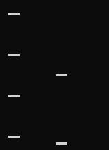

# Estimate a PCR Band's Size from a Gel Image

> Which size is consistent with this band's migration between two confirmed
> ladder bands, and where must I refuse an estimate?

This 15-minute exercise uses a drawn image, not an experiment. It teaches the
manual calibration path shared by the GUI, CLI and agents. Automatic band
detection, identity, concentration and experimental validation are not included.
The optional [real TapeStation companion](#real-tapestation-companion) below
adds a reproducible two-report comparison and explains which enrichment
questions still need numerical electropherograms.

## Before You Start

Run from the repository root. Keep a fresh writable output directory and one
disposable project, for example `/tmp/gentle-gel-lesson/state.json` (create the
parent directory first). Use the same `--state` on every terminal invocation.
A separate CLI does not inherit the GUI's unsaved project.

Inputs and recreation are documented in the
[fixture README](inputs/gel_sizing/README.md). No download or external image
library is needed:

- [Drawn image](inputs/gel_sizing/gel_sizing_synthetic.png).
- [DNA assignments](inputs/gel_sizing/dna-analysis.json).
- [Exact checksums](inputs/gel_sizing/SHA256SUMS).



The picture is deliberately small. Zoom for marking; zoom must not change its
original zero-based pixel coordinates. The left lane is the ladder and the
right lane contains a bracketed band and an unbracketed band.

## 1. Import the Original Image

**GUI:** choose **Patterns -> Gel Image Analysis...**, then **Import image...**.
Open the PNG above. DNA selection is not required. Do not check TIFF page 0 for
a PNG. The shared `ui open gel-image-editor` opens the same independent editor
when applied by the GUI host; a headless receipt is not an opened window.

**CLI / shared engine:**

```sh
gentle_cli --state /tmp/gentle-gel-lesson/state.json gel-image import '{"image_id":"gel_teaching","path":"docs/tutorial/inputs/gel_sizing/gel_sizing_synthetic.png"}'
```

Inspect `result.gel_image.sha256` and compare it with the image digest in
`dna-analysis.json` and `SHA256SUMS`. An image mismatch means stop, not edit the
expected digest. The project retains original bytes; a thumbnail is display only.

**Ask the inner agent:** "Open the measured-gel editor. Import the retained
synthetic PNG only after showing the exact command. Keep its original pixel
coordinates and verify its digest; do not infer bands or send the image away."

## 2. Confirm Lanes and Ladder Assignments

**GUI:** draw the ladder rectangle first, then the sample rectangle. Select bp
and downward migration. Use numeric correction in **Assignments** to match:

| Item | Original pixels | Assignment |
| --- | --- | --- |
| Ladder lane | x=0..40, y=0..219 | synthetic marker |
| Sample lane | x=60..130, y=0..219 | synthetic sample |
| Ladder centers | (20,20), (20,80), (20,140), (20,200) | 2000, 1000, 500, 250 bp |
| First sample | (90,110) | unknown; localization half-width 2 px |
| Second sample | (90,210) | unknown; outside reference range |

Enter the invented ladder's source explicitly. In a real gel, use the supplier,
lot and confirmed visible reference bands; do not shift missing bands down a
predefined list. Marks are user assignments, not automatically detected peaks.

**CLI:** the committed request supplies exactly these assignments:

```sh
gentle_cli --state /tmp/gentle-gel-lesson/state.json gel-image analyze @docs/tutorial/inputs/gel_sizing/dna-analysis.json
gentle_cli --state /tmp/gentle-gel-lesson/state.json gel-image inspect synthetic_dna_1
```

**GUI:** choose **Analyze and save report** after confirming all assignments.
The GUI may assign its own image/report IDs; do not paste the fixture's IDs over
an unrelated imported image. Ask an agent to draft the request using the actual
imported ID/digest and confirmed marks, then explicitly approve the analysis.

## 3. Explain the Answer

The first band is halfway in migration between 1000 and 500 bp:

```text
log10(size) = (log10(1000) + log10(500)) / 2
size = sqrt(1000 * 500) = 707.106781... bp
```

It is **not 750 bp**. GENtle interpolates log size between adjacent references,
not arithmetic size and not a universal global gel curve. The second band lies
beyond y=200: expect `outside_calibrated_range` and a null estimate. Do not
extrapolate or treat null as zero bp.

The optional +/-2 px bounds reflect mark localization only. They exclude ladder
uncertainty, gel smiling, sample-dependent migration and photography distortion;
they are not a statistical confidence interval. Straight comparable lanes and
correct calibration remain operator responsibilities.

## 4. Export and Reopen Without Replacing Evidence

```sh
gentle_cli --state /tmp/gentle-gel-lesson/state.json gel-image export '{"report_id":"synthetic_dna_1","path":"/tmp/gentle-gel-lesson/sizing.tsv","format":"tsv"}'
gentle_cli --state /tmp/gentle-gel-lesson/state.json gel-image export '{"report_id":"synthetic_dna_1","path":"/tmp/gentle-gel-lesson/sizing.svg","format":"svg"}'
```

**GUI:** select SVG/TSV/JSON and **Export...**, then **File -> Save Project**.
Reopen the project and the editor: original image and assignments should remain
available even if the external source is moved. Editing a mark makes the old
report outdated; analyze under a new report ID. Existing exports are refused,
not overwritten. Use fresh output names for the second run.

Ask an agent to inspect/export the saved report, not to claim a screenshot or
an experimental result from a successful headless command. A defensible summary
is "approximately 707 bp under these confirmed synthetic ladder assignments;
the lower band is outside calibration", not "the PCR product is identified".

## Appendix: Apparent SDS Protein Mass

Use the separate [protein request](inputs/gel_sizing/protein-analysis.json) on
the same imported `gel_teaching` image, or confirm its assignments in the GUI.
It sets `sds_protein_kda`, synthetic 100/50/25/12.5 kDa markers and an explicitly
synthetic prestained gel-system label. The midpoint is sqrt(50*25), about
35.355339 **apparent kDa**. The outside band is still unestimated.

```sh
gentle_cli --state /tmp/gentle-gel-lesson/state.json gel-image analyze @docs/tutorial/inputs/gel_sizing/protein-analysis.json
gentle_cli --state /tmp/gentle-gel-lesson/state.json gel-image inspect synthetic_sds_1
```

Do not use these invented masses for a real Western blot. Prestained marker
calibrations depend on gel/buffer system; record the applicable vendor values.
Switching units does not convert existing ladder assignments. Apparent mass is
not protein identity or quantity, and separate marker exposures are not silently
registered. See the [full method and limitations](../gel_image_analysis.md).

## Real TapeStation Companion

Allow another 20 minutes. This part uses real owner-approved public data, **not**
the synthetic image or its invented ladder assignments. It asks two separate
questions: can GENtle reproduce reported peak sizes, and what can these reports
actually tell us about physical length enrichment and combined priming?

The [fixture and provenance](../../test_files/fixtures/gel_images/tapestation_26r266/README.md)
retain both original PDFs, unscaled extracted images, confirmed coordinate
assignments and vendor tables. The first report is **before additional cleanup**;
it is not an experiment without custom primers. Targeted priming and physical
length enrichment are different experimental dimensions.

### 1. Keep Samples And Ladders Separate

| Preparation | Cell 1, before | Cell 2, before | Cell 1, after | Cell 2, after |
| --- | --- | --- | --- | --- |
| Custom primers | B1 | C1 | C1 | D1 |
| Manufacturer primers, labelled CRTA in the after report | D1 | E1 | E1 | F1 |
| Both primer types | not supplied | not supplied | G1 | H1 |

Before A1 is a ladder. After L1 and L2 are ladders; **E1/F1 is a cell-line pair
split by L2**, not a reason to pair E1 with its adjacent sample. A lane identity
always includes its source report. Do not mix the two cell lines, and do not
infer which gene produced a band from its size.

### 2. Run The Same Measured-Image Engine

From the repository root, supply an existing CLI and a new output directory:

```sh
python3 scripts/gel_tapestation_acceptance.py \
  --gentle-cli /absolute/path/to/gentle_cli \
  --output-dir /tmp/gentle-tapestation-lesson
```

Use a suitable writable path on your platform; the output directory must not
already exist. The replay invokes the existing GENtle import/analyze/inspect/
export operations, never another sizing algorithm. It retains the actual binary
and source identity, input hashes and exact engine requests. No Cargo build,
network access, automatic peak detection or intensity measurement is performed.

Inspect `comparison.json` and `receipt.json`. Expect 13 vendor sample-peak
comparisons, 14 cross-ladder controls, 15 estimates without a vendor peak-table
value and three out-of-calibration controls. `agreement_pass: null` is not a
passed comparison. The after-report has no sample Peak Tables; a region mean
is not a substitute. The 15/10000 bp markers are not sample fragments and do
not extend the nine-band 100-5000 bp calibration.

**GUI:** open the resulting `project.gentle.json` through **File -> Open Project**,
then **Patterns -> Gel Image Analysis...**. Use **Reopen a saved report** to
inspect `before_A1`, `after_L1` and `after_L2`. Review marks, calibration and
warnings, then inspect their SVG/TSV exports. The two after analyses deliberately
use separate ladder assignments; this grouping is not a recovered TapeStation
internal calibration setting. Editing a mark requires a new analysis, not a
silent replacement of the saved evidence.

**Ask the inner agent:** "Show the retained before/after gel reports and their
source hashes. Keep cell lines, ladder controls and absent comparison values
separate. Explain the saved sizes without inventing a curve or claiming an
enriched gene. Draft any import/analysis command for my approval."

### 3. Compare What The PDFs Really Report

The following are **vendor Region Table summaries, not GENtle distributions**.
Their separately recorded source values and page references are in
[`region_summaries.json`](../../test_files/fixtures/gel_images/tapestation_26r266/region_summaries.json).

| Cell | Priming | Before average bp | Before % of total | After average bp | After % of total |
| --- | --- | --- | --- | --- | --- |
| 1 | Custom | 1790 | 41.83 | 2528 | 67.69 |
| 2 | Custom | 1923 | 58.99 | 2404 | 80.55 |
| 1 | Manufacturer | 2221 | 86.28 | 2333 | 89.79 |
| 2 | Manufacturer | 1832 | 81.21 | 1897 | 85.36 |
| 1 | Combined | not supplied | not supplied | 2230 | 85.06 |
| 2 | Combined | not supplied | not supplied | 2142 | 82.92 |

**These are not matched-window effect estimates.** Before uses 400-5000 bp;
after uses 500-7000 bp, whose upper limit exceeds the nominal D5000 sizing
range. Changing the region alone changes its mean and included percentage.
The reported custom means are higher afterwards, but this table cannot isolate
cleanup's effect or calculate short-fragment removal, recovery or fold enrichment.
Keep region and sample/peak-table concentration fields distinct as well.
ScreenTape expiry warnings and differing image contrast also remain part of the
evidence; absence of a warning is not proof of accurate quantification.

### 4. Ask Whether The Mix Contains Custom-Like Structure

Compare after G1 with **both C1 and E1** for cell 1, and after H1 with **both D1
and F1** for cell 2. Similar sizes can suggest candidate structure to inspect,
but do not identify its source or quantify enrichment. In the first retained
GENtle replay, selected short custom-only marks are near 697/700 bp, whereas
combined marks are near 644/635 bp. Do not automatically label those as the same
band. These are selected annotation-assisted marks, not all peaks in a smear.

This size-only exercise does **not** compare full measured lane distributions or
subtract lane intensities. The separate [development workbench](../gel_workbench.md)
now provides explicit stored profiles, weighted QQ/shape comparisons and signed
linear combinations, with new-source/native acceptance still pending. Image
display profiles are not calibrated detector traces. Do not interpret subtraction
of PDF brightness as biological enrichment or construct a smear by adding
peak-table heights. For a quantitative comparison request numerical
electropherograms with axis/signal units, calibration, marker handling,
normalization and dilution/loading information for both runs. The supplied
before-cleanup `.D5000` archive has encrypted measurement/model members whose
numerical data are not currently importable; its opt-in thumbnail is not raw detector data. A tabular
export must contain curve samples, not merely another summary table.

The [profile-comparison plan](../gel_lane_profile_comparison_plan.md)
starts with source-bound overlays, then common-support distributions, then
explicit signed lane algebra. An exploratory expression such as combined minus
scaled manufacturer could reveal a residual compatible with custom structure;
it would not establish an additive reaction model or gene-specific enrichment.
Use the workbench only with explicitly reviewed compatible profile inputs and
coefficients; this lesson's region summaries do not supply those inputs. Preserve negative residuals,
unknown scale factors and unavailable values rather than forcing a positive
"custom contribution".

## Optional Synthetic Signed Algebra

This separate exercise teaches arithmetic and report inspection, not enrichment
of the public cell-line libraries. Create `/tmp/gentle-algebra-lesson` and use a
fresh `state.json`; keep this project separate from the real companion. No image
or external numerical export is needed. These are **invented integrated bins**,
with `synthetic` evidence, not TapeStation fluorescence or molecule counts.

| Size interval (bp) | Synthetic A | Synthetic B | A - B | Signed density per bp |
| --- | --- | --- | --- | --- |
| 100-150 | 2 | 3 | -1 | -0.02 |
| 150-200 | unavailable | 1 | unavailable | unavailable |
| 200-300 | 6 | 3 | 3 | 0.03 |

The source digest below is SHA-256 of the literal UTF-8 recipe label
`GENtle synthetic gel algebra v1` **without a trailing newline**, not a hash of
experimental data. Recreate it with `printf %s 'GENtle synthetic gel algebra v1' | shasum -a 256`.
Both inputs retain that declared teaching provenance. The illustrative `1/-1`
coefficients are not an approved normalization policy for C1/E1/G1 or D1/F1/H1.

<!-- gel-algebra-lesson:start -->
```sh
gentle_cli --state /tmp/gentle-algebra-lesson/state.json gel-image workbench '{"action":"import_profile","profile":{"id":"teaching_a","label":"Synthetic A","run_id":"synthetic_recipe","lane_id":"A","source_sha256":"788f3f75709fe4b0f3d32c39c39146dc3bb475824a7bf37d4feeb3032d7c5ff9","evidence_kind":"synthetic","size_kind":"linear_dna_bp","signal_units":"synthetic_area","edges":[100,150,200,300],"weights":[2,null,6],"measure":"synthetic_bin_integral","processing":["Invented teaching recipe; not a vendor measurement"]}}'
gentle_cli --state /tmp/gentle-algebra-lesson/state.json gel-image workbench '{"action":"import_profile","profile":{"id":"teaching_b","label":"Synthetic B","run_id":"synthetic_recipe","lane_id":"B","source_sha256":"788f3f75709fe4b0f3d32c39c39146dc3bb475824a7bf37d4feeb3032d7c5ff9","evidence_kind":"synthetic","size_kind":"linear_dna_bp","signal_units":"synthetic_area","edges":[100,150,200,300],"weights":[3,1,3],"measure":"synthetic_bin_integral","processing":["Invented teaching recipe; not a vendor measurement"]}}'
gentle_cli --state /tmp/gentle-algebra-lesson/state.json gel-image workbench '{"action":"algebra","output_id":"teaching_residual","range":[100,300],"terms":[{"profile_id":"teaching_a","coefficient":1},{"profile_id":"teaching_b","coefficient":-1}]}'
gentle_cli --state /tmp/gentle-algebra-lesson/state.json gel-image workbench '{"action":"inspect_algebra","profile_id":"teaching_residual"}'
gentle_cli --state /tmp/gentle-algebra-lesson/state.json gel-image workbench '{"action":"export","path":"/tmp/gentle-algebra-lesson/residual.json","title":"Synthetic signed algebra; no enrichment claim","analysis_ids":[],"algebra_ids":["teaching_residual"]}'
gentle_cli --state /tmp/gentle-algebra-lesson/state.json gel-image workbench '{"action":"export","path":"/tmp/gentle-algebra-lesson/residual.pdf","title":"Synthetic signed algebra; no enrichment claim","analysis_ids":[],"algebra_ids":["teaching_residual"]}'
```
<!-- gel-algebra-lesson:end -->

Expect `result.gel_workbench.algebra.verification == "verified"`, saved weights
`[-1, null, 3]` and display densities `[-0.02, null, 0.03]`. The final bin is
twice as wide as the first; plotting totals as heights would hide that difference.
The black line is zero; the hatched interval is missing, not zero. There is no
residual CDF, QQ, KS test or p-value. A coherent replay does not validate biology.

### Read The Weighted Operand Overlays

The thick teal curve is the residual. The thinner coloured/styled curves are
the **contributions actually added to it**, not independently normalized input
profiles. Read each numbered legend entry as coefficient times that operand's
rebinned integral divided by the common bin width. All curves share one Y axis;
there is no fitted scale or hidden loading correction. Colours and line styles
follow request order, not a guessed biological grouping.

| Interval (bp) | Term 1: +1 x A per bp | Term 2: -1 x B per bp | Residual per bp |
| --- | --- | --- | --- |
| 100-150 | 0.04 | -0.06 | -0.02 |
| 150-200 | unavailable | -0.02 | unavailable |
| 200-300 | 0.06 | -0.03 | 0.03 |

The negative B curve is intentional: subtraction contributes negative signal.
At 150-200 bp, B is still visible but A and the residual are unavailable. A line
inside a hatched interval does **not** recover the missing residual. Each curve
breaks at its own gaps. A zero coefficient is labelled provenance/grid-only and
has no operand curve; two terms naming the same profile remain separate terms.

As a non-unit control, create a **new** result with half of B subtracted. This
changes the recorded algebra, not just a display setting, and leaves the first
result untouched. The coefficient is a teaching choice, not an experimentally
justified loading factor:

<!-- gel-algebra-weighted-lesson:start -->
```sh
gentle_cli --state /tmp/gentle-algebra-lesson/state.json gel-image workbench '{"action":"algebra","output_id":"teaching_half_b","range":[100,300],"terms":[{"profile_id":"teaching_a","coefficient":1},{"profile_id":"teaching_b","coefficient":-0.5}]}'
gentle_cli --state /tmp/gentle-algebra-lesson/state.json gel-image workbench '{"action":"inspect_algebra","profile_id":"teaching_half_b"}'
```
<!-- gel-algebra-weighted-lesson:end -->

Expect weights `[0.5, null, 4.5]`, residual densities `[0.01, null, 0.045]`,
and B's contribution `[-0.03, -0.01, -0.015]`. A's contribution stays
`[0.04, null, 0.06]`. In the inspection JSON, `contributions` retains each
nonzero term's zero-based `term_index`, `profile_id`, coefficient, weighted
integrals and density on `series.edges`. The printed legend numbers start at 1.
These numbers are explanatory projections; the saved v1 residual and receipt
are not rewritten by inspection.

**GUI:** open this saved project, choose **Patterns -> Gel Image Analysis...**,
select `teaching_residual` under **Inspect saved signed algebra**, then **Verify
and display saved algebra**. Check the three curves against the table. Select
`teaching_half_b` and verify the new B contribution and residual rather than
expecting a cosmetic rescale of the first plot. Read every operand's processing,
coefficients and warnings. For PDF export select the desired algebra ID; the
same weighted curves appear in the PDF. Existing before/after analyses
can still be selected separately, in explicit order. Exports refuse existing
files and changed/unverifiable residuals rather than trusting an old screen.

**Ask the inner agent:** "Inspect teaching_residual and explain its signed
density, each weighted operand overlay, missing intervals, coefficients and
verification status. Draft the shared export command. Do not fit a scale,
identify a gene or claim enrichment."

Real cell-line inspection must retain each operand's calibration: cell 1 uses
C1/E1 on L1 and G1 on L2; cell 2 uses D1 on L1 and F1/H1 on L2. Keep those
differences visible and review registration before interpreting any residual.
This lesson supplies no biological coefficients, new raw curves or scientific
acceptance. Overlays of unrelated reference profiles and automatic display
factors remain deferred; only the recorded algebra operands share this axis.

## Optional: Compare Signal Density Rather Than Bin Totals

Allow another ten minutes. This is a **synthetic** display exercise, not a
comparison of the cell lines. Create `/tmp/gentle-density-lesson` and start a
fresh project. A bin stores its integrated signal, not its height. Wide bins
can therefore look taller even when signal per bp is constant:

| Profile | Size edges (bp) | Integrated weights | Density in each bin |
| --- | --- | --- | --- |
| A | 100, 200, 400 | 100, 200 | 1, 1 |
| C | 100, 125, 400 | 25, 275 | 1, 1 |

The common grid is **100, 125, 200, 400**: three bins, with widths **25, 75,
200 bp**. Both profiles have common-bin weights **25, 75, 200**, total 300,
and constant density **1 synthetic_area per bp**. No interval is excluded.
Plotting those integrals as heights makes a staircase; dividing each saved
integral by its bin width makes both profiles flat. This display calculation
neither changes the stored weights nor normalizes them to unit area.

The declared source hash is SHA-256 of `GENtle synthetic gel density v1`, UTF-8
with no newline. Recreate it with
`printf %s 'GENtle synthetic gel density v1' | shasum -a 256`.

<!-- gel-density-lesson:start -->
```sh
gentle_cli --state /tmp/gentle-density-lesson/state.json gel-image workbench '{"action":"import_profile","profile":{"id":"density_a","label":"Synthetic A","run_id":"synthetic_recipe","lane_id":"A","source_sha256":"c37de03e7ae7fcbc52d82aeb78a1949118b0426a93432596e5623b65324aa6ff","evidence_kind":"synthetic","size_kind":"linear_dna_bp","signal_units":"synthetic_area","edges":[100,200,400],"weights":[100,200],"measure":"synthetic_bin_integral","processing":["Invented constant-density teaching recipe"]}}'
gentle_cli --state /tmp/gentle-density-lesson/state.json gel-image workbench '{"action":"import_profile","profile":{"id":"density_c","label":"Synthetic C","run_id":"synthetic_recipe","lane_id":"C","source_sha256":"c37de03e7ae7fcbc52d82aeb78a1949118b0426a93432596e5623b65324aa6ff","evidence_kind":"synthetic","size_kind":"linear_dna_bp","signal_units":"synthetic_area","edges":[100,125,400],"weights":[25,275],"measure":"synthetic_bin_integral","processing":["Invented constant-density teaching recipe"]}}'
gentle_cli --state /tmp/gentle-density-lesson/state.json gel-image workbench '{"action":"compare","comparison_id":"flat_density","left_profile":"density_a","right_profile":"density_c","range":[100,400]}'
gentle_cli --state /tmp/gentle-density-lesson/state.json gel-image workbench '{"action":"export","path":"/tmp/gentle-density-lesson/density.pdf","title":"Synthetic constant-density comparison","analysis_ids":[],"comparison_ids":["flat_density"],"comparison_display":"signal_density_per_size"}'
gentle_cli --state /tmp/gentle-density-lesson/state.json gel-image workbench '{"action":"export","path":"/tmp/gentle-density-lesson/integrals.pdf","title":"Synthetic constant-density comparison","analysis_ids":[],"comparison_ids":["flat_density"],"comparison_display":"bin_integral"}'
gentle_cli --state /tmp/gentle-density-lesson/state.json gel-image workbench '{"action":"export","path":"/tmp/gentle-density-lesson/comparison.json","title":"Synthetic constant-density comparison","analysis_ids":[],"comparison_ids":["flat_density"]}'
```
<!-- gel-density-lesson:end -->

Compare the profile panels in the two PDFs. Both retain the same CDF and QQ:
identical shapes give descriptive D = 0, Wasserstein distance = 0 and QQ points
on the diagonal. These are not significance tests. The JSON keeps the original
integrals; a `comparison_display` field is **refused** for JSON, rather than
silently ignored. Omission on a PDF retains the old bin-integral display.

**GUI:** open the saved project, choose **Patterns -> Gel Image Analysis...**,
select `flat_density`, choose **Signal per size width** and click **Verify and
display saved comparison**. The worker verifies the frozen report before drawing
the profile panel; native summary and QQ remain below it. Switch to **Legacy
bin integrals** and prepare again. A changed mode never displays an old-mode
plot. The selector is session-only, defaults to density, and also controls the
PDF comparison pages beside the export controls. It does not edit the project.

The two colors share one numeric axis in declared units; neither is fitted to
its own maximum. **Equal units do not establish matched exposure, loading,
contrast or calibration.** Different source hashes identify different retained
inputs, not proof of different exposure settings. In real before/after data,
read the CDF/QQ for shape and retain those acquisition limitations. Hatched gaps
are unavailable; scored zero is zero. There is no mass/molar density, recovery,
gene-specific enrichment or approved subtraction coefficient in this exercise.

**Ask the inner agent:** "Explain why density_a and density_c have the same
shape despite unequal bin totals. Draft a saved PDF export with an explicit
comparison_display; keep JSON integrals unchanged. Do not infer concentration
or fit a scale."

## Verification and Acceptance

**Review scope (2026-10-20):** the optional density lesson was reconciled with
the supplied read-only Claude reviews against `bb1686bd` plus this working
change. Its source metadata identifies this as hand-written Markdown, not a
generated chapter. No human/scientific or native-GUI review date is granted;
the existing unreviewed manifest status is retained.

Fixture recreation, source checks and independent arithmetic are covered by
`scripts.test_tutorial_gap_lessons`; binary/LF preservation by
`scripts.test_tutorial_checkouts`. Existing `gel_image` Rust tests exercise the
shared algorithm and editor. Run those and the exact commands above at one
source SHA before calling this an executed learner pass. Native screenshots,
Windows/macOS GUI and real-image scientific acceptance remain pending with
Glen/the owner; this manual guide is not an automated GUI contract.
The real companion additionally uses `scripts.test_gel_tapestation`, the
hash-bound LF/CRLF fixture checks and the ordinary `gel_image` real-image
regression. An executed CLI companion is not native-window or distribution/
enrichment acceptance. The optional synthetic algebra commands are exercised by
the shared Rust parser/engine regression; its PDF is generated from saved
results. A separate regression verifies replay after serialization/reopening.
Neither is a native GUI or real-data acceptance run.
The separate density markers are replayed through the shared parser/engine,
including PDF/JSON export and independently calculated common-bin weights.
They do not change the six-command signed-algebra exercise above.
